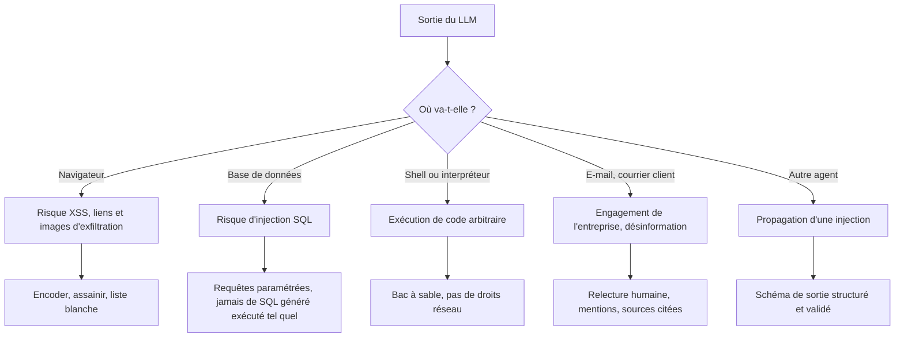

# Fuites, sorties non maîtrisées, agentivité excessive et autres risques

> [!NOTE]
> Dans cette leçon, vous allez approfondir les risques qui transforment une injection en incident réel : fuite de données (LLM02, LLM07, LLM08), sortie non maîtrisée (LLM05, LLM09), agentivité excessive (LLM06), puis les risques de socle : empoisonnement (LLM04), dépendances (LLM03) et consommation non bornée (LLM10).

## 1. Les fuites de données

Un LLM peut divulguer de l'information par trois chemins différents :

| Chemin | Catégorie OWASP | Exemple | Cause racine habituelle |
|---|---|---|---|
| Ce que le modèle a **mémorisé** | LLM02 | Le modèle fine-tuné sur des tickets restitue un numéro de téléphone | Données personnelles non nettoyées avant fine-tuning |
| Ce qui est dans le **prompt système** | LLM07 | Règles commerciales internes, identifiants, URL d'API privées | Secrets placés dans le prompt |
| Ce que le **RAG** récupère | LLM08 | Un salarié obtient un compte rendu de comité de direction | Index unique sans filtrage par droits d'accès |

> [!IMPORTANT]
> Le prompt système doit être considéré comme **public**. Ne jamais y mettre de secret, de mot de passe, de clé d'API, ni de règle dont la confidentialité est la seule protection.

Pour le RAG, la règle d'or : **l'assistant ne doit jamais pouvoir lire un document que l'utilisateur ne pourrait pas ouvrir lui-même**. Le filtrage se fait au moment de la recherche, avec l'identité de l'utilisateur, et non par une consigne « ne montre pas les documents confidentiels ».

## 2. Les sorties non maîtrisées

Le texte produit par le modèle doit être traité comme **une entrée utilisateur non fiable**, au même titre qu'un formulaire web.



La **désinformation** (LLM09) est une sortie non maîtrisée d'un genre particulier : le contenu est techniquement inoffensif, mais faux. Sur un assistant client, une réponse inventée sur une garantie, un tarif ou un délai peut engager l'entreprise. Les parades : réponses ancrées sur des sources citées, refus explicite quand la source manque, et périmètre de questions restreint.

```quiz
question: "L'assistant génère du Markdown affiché dans un widget web. Quelle mesure traite le mieux le risque LLM05 ?"
options:
  - "Demander au modèle de ne jamais produire de HTML"
  - "Assainir le rendu (pas de HTML brut, pas de chargement automatique d'images externes, liens limités à une liste de domaines)"
  - "Augmenter la température pour varier les réponses"
  - "Limiter la longueur des réponses à 200 mots"
answer: 1
explanation: "L'assainissement est fait par l'application, de façon déterministe. La consigne au modèle est contournable par injection ; la température et la longueur n'ont aucun rapport avec le risque."
```

## 3. L'agentivité excessive

L'OWASP décompose LLM06 en trois excès :

| Excès | Question à poser | Exemple de dérive | Parade |
|---|---|---|---|
| **Fonctionnalités** | L'agent a-t-il des outils dont il n'a pas besoin ? | Un outil « gestion de fichiers » qui sait aussi supprimer | Outils minimaux, un outil = une action |
| **Permissions** | Les outils ont-ils plus de droits que nécessaire ? | Compte de service administrateur de la base | Compte dédié en lecture seule, scope réduit |
| **Autonomie** | L'agent agit-il sans validation sur des actions à impact ? | Remboursement émis automatiquement | Confirmation humaine au-delà d'un seuil |

> [!TIP]
> Une bonne question de revue : « Si un stagiaire malveillant pilotait cet agent, quel serait le pire résultat possible ? ». Un agent soumis à une injection se comporte exactement comme ce stagiaire.

## 4. Les risques de socle

- **Empoisonnement (LLM04)** : un attaquant introduit des données biaisées ou piégées dans le corpus de fine-tuning, d'évaluation ou dans les documents qui alimentent le RAG. Parade : provenance des données, revue des sources, jeux d'évaluation de non-régression.
- **Chaîne d'approvisionnement (LLM03)** : modèles téléchargés depuis un hub public, bibliothèques, extensions, serveurs MCP tiers. Parade : inventaire (une forme de *SBOM* pour l'IA), versions épinglées, sources vérifiées, revue avant ajout d'un outil.
- **Consommation non bornée (LLM10)** : coûts qui explosent, déni de service, extraction du modèle par requêtes massives. Parade : authentification, quotas par utilisateur, limites de taille d'entrée et de sortie, alertes budgétaires.

```quiz
question: "Une équipe ajoute à son agent un serveur MCP open source trouvé sur un forum, qui donne accès au CRM. Quelles catégories sont concernées en priorité ? (plusieurs réponses)"
options:
  - "LLM03 Supply Chain"
  - "LLM06 Excessive Agency"
  - "LLM09 Misinformation"
  - "LLM10 Unbounded Consumption"
answer: [0, 1]
explanation: "Le composant n'est pas vérifié (LLM03) et il élargit les capacités de l'agent sur un système sensible, peut-être au-delà du besoin (LLM06). La désinformation et la consommation ne sont pas les risques premiers ici."
```

## Exercice : revue d'un agent de remboursement

Un agent support client dispose des outils suivants :

```yaml title="outils-agent.yaml"
tools:
  - name: crm_query
    description: "Exécute une requête SQL sur la base CRM"
    credentials: "compte crm_admin"
  - name: issue_refund
    description: "Émet un remboursement sur la carte du client"
    max_amount: null
    confirmation: false
  - name: send_email
    description: "Envoie un e-mail à n'importe quelle adresse"
```

Listez les problèmes et proposez une version corrigée.

<details>
<summary>Voir la solution</summary>

Problèmes relevés :

1. `crm_query` exécute du SQL libre (**LLM05**) avec un compte administrateur (**LLM06**, permissions).
2. `issue_refund` n'a ni plafond ni confirmation (**LLM06**, autonomie).
3. `send_email` peut écrire à n'importe qui : canal d'exfiltration (**LLM02** via **LLM01**).

Version corrigée :

```yaml title="outils-agent.yaml"
tools:
  - name: get_customer_orders
    description: "Liste les commandes du client authentifié (identifiant injecté par le serveur, pas par le modèle)"
    credentials: "compte crm_readonly_orders"
  - name: propose_refund
    description: "Prépare une demande de remboursement"
    max_amount: 50          # par exemple ; au-delà, escalade vers un conseiller
    confirmation: "conseiller humain au-delà du plafond, client dans tous les cas"
  - name: reply_to_customer
    description: "Répond uniquement au client de la conversation en cours"
```

Principe : remplacer les outils génériques par des **outils métier étroits**, dont les paramètres sensibles (identité du client, destinataire) sont fixés par le serveur.

</details>

## Je sais faire

- [ ] Distinguer les trois chemins de fuite (mémorisation, prompt système, RAG)
- [ ] Traiter la sortie d'un LLM comme une entrée non fiable selon sa destination
- [ ] Analyser un agent selon les trois excès : fonctionnalités, permissions, autonomie
- [ ] Citer une parade pour l'empoisonnement, la chaîne d'approvisionnement et la consommation non bornée
