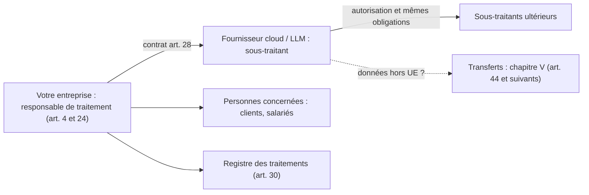

# Le RGPD appliqué aux assistants IA

> [!NOTE]
> Dans cette leçon, vous allez appliquer les notions clés du RGPD à un assistant IA : rôles (responsable de traitement, sous-traitant), base légale, minimisation et conservation, analyse d'impact (AIPD), contrats et transferts hors UE. L'objectif est de savoir **quelles questions poser** et **à quel article se référer**, pas de remplacer votre DPO.

> [!WARNING]
> Contenu informatif, pas un avis juridique. Le texte de référence est le [règlement (UE) 2016/679 sur EUR-Lex](https://eur-lex.europa.eu/eli/reg/2016/679/oj) ; les recommandations de la CNIL sur l'IA précisent son application.

## Quand le RGPD s'applique-t-il ?

Dès qu'un assistant traite des **données personnelles** : nom d'un client, numéro de commande rattachable à une personne, contenu d'un ticket, e-mail d'un salarié, voire une simple question qui décrit une situation personnelle. En pratique, presque tout assistant support client ou interne est concerné.

On distingue souvent deux phases, qui sont deux traitements à analyser :

| Phase | Exemple | Points d'attention |
|---|---|---|
| **Développement** | Constitution d'un corpus RAG, fine-tuning sur des tickets historiques | Origine des données, information des personnes, nettoyage, mémorisation possible par le modèle |
| **Déploiement** | Conversations des utilisateurs, journaux, appels d'outils | Base légale, information, durée de conservation, sécurité, droits des personnes |

## Qui est responsable ?



- Vous définissez la finalité et les moyens : vous êtes **responsable de traitement**.
- Le fournisseur qui héberge le modèle pour votre compte est généralement **sous-traitant** : il faut un contrat conforme à l'**article 28** (instructions documentées, confidentialité, sécurité, sous-traitants ultérieurs, suppression en fin de contrat, aide pour les droits et l'AIPD).
- Vérifiez noir sur blanc dans les conditions du fournisseur : **les données de vos prompts servent-elles à entraîner ses modèles ?** Où sont-elles stockées, combien de temps ?

## Base légale (article 6)

Six bases existent : consentement, contrat, obligation légale, sauvegarde des intérêts vitaux, mission d'intérêt public, intérêt légitime. Pour un assistant en entreprise, on rencontre surtout :

| Cas d'usage | Base souvent envisagée | Point de vigilance |
|---|---|---|
| Assistant support pour les clients sur leurs commandes | Exécution du **contrat** ou **intérêt légitime** | Réutiliser les conversations pour améliorer le modèle est une **autre finalité** à justifier |
| Assistant interne pour les salariés | **Intérêt légitime** de l'employeur | Mise en balance avec les droits des salariés, information, pas de surveillance détournée |
| Fine-tuning sur historique de tickets | **Intérêt légitime** (la CNIL a publié des recommandations dédiées) | Test de mise en balance, minimisation, droit d'opposition |

> [!TIP]
> Les **données sensibles** de l'article 9 (santé, opinions, origine, etc.) sont interdites de traitement par principe, sauf exceptions. Si des clients peuvent en écrire spontanément dans le chat, prévoyez un filtre et une consigne de non-conservation.

```quiz
question: "Une entreprise veut réutiliser les conversations de son chatbot client pour fine-tuner un modèle. Quelle affirmation est juste ?"
options:
  - "C'est automatiquement couvert par la base légale du support client"
  - "C'est une finalité distincte qui doit avoir sa propre base légale, une information des personnes et des mesures de minimisation"
  - "Le RGPD ne s'applique pas car les données sont transformées en poids du modèle"
answer: 1
explanation: "Améliorer un modèle n'est pas la même finalité que répondre au client. Il faut une base légale (souvent l'intérêt légitime, avec mise en balance), une information et une minimisation. La CNIL rappelle qu'un modèle peut mémoriser des données personnelles : le RGPD peut donc continuer à s'appliquer."
```

## Minimisation et conservation (article 5)

- **Minimisation** (art. 5.1.c) : ne mettre dans le contexte que ce qui est nécessaire. Un assistant de suivi de colis n'a pas besoin de la date de naissance.
- **Limitation de la conservation** (art. 5.1.e) : durée définie pour les conversations, les journaux et les index. Exemple de formulation : « conversations conservées X jours pour le traitement de la demande, puis supprimées ; journaux de sécurité pseudonymisés conservés Y mois ».
- **Sécurité** (art. 32) : c'est le pont avec le module 2. Les mesures techniques (filtrage par droits, masquage, chiffrement) sont aussi des obligations RGPD.

## L'analyse d'impact (AIPD, article 35)

Une AIPD est obligatoire quand le traitement est **susceptible d'engendrer un risque élevé** pour les droits et libertés des personnes. La CNIL publie une liste de traitements pour lesquels elle est requise, et les lignes directrices européennes donnent des critères (par exemple : usage innovant de technologies, données sensibles, personnes vulnérables, évaluation ou notation, traitement à grande échelle, croisement de données). En pratique, **la réunion de deux critères** conduit généralement à une AIPD.

```quiz
question: "Parmi ces projets, lesquels justifient très probablement une AIPD ? (plusieurs réponses)"
options:
  - "Un assistant RH qui aide à présélectionner des candidatures (évaluation de personnes + technologie innovante)"
  - "Un assistant qui reformule des fiches produits sans aucune donnée personnelle"
  - "Un chatbot de mutuelle qui traite des questions de santé de milliers d'assurés (données sensibles + grande échelle)"
answer: [0, 2]
explanation: "Les deux projets réunissent au moins deux critères de risque élevé. La reformulation de fiches produits sans données personnelles n'entre pas dans le champ du RGPD."
```

Le contenu minimal d'une AIPD (art. 35.7) : description du traitement et de ses finalités, évaluation de la nécessité et de la proportionnalité, évaluation des risques pour les personnes, mesures prévues pour y faire face. L'outil **PIA** de la CNIL peut aider à la structurer.

## Transferts hors de l'Union

Si des données sont traitées hors de l'UE/EEE (y compris par un sous-traitant ou pour du support), le chapitre V s'applique : pays bénéficiant d'une **décision d'adéquation** (pour les États-Unis, le *Data Privacy Framework*, pour les entreprises certifiées), ou à défaut **clauses contractuelles types** et évaluation complémentaire. Les offres cloud proposent souvent un choix de **région de traitement** : documentez-le.

## Droits des personnes

Accès, rectification, effacement, opposition… Ils s'appliquent aussi aux conversations et aux journaux. Prévoyez comment retrouver et supprimer les données d'une personne. Et si l'assistant participe à une **décision produisant des effets juridiques ou similaires** (refus de remboursement, de crédit…), l'**article 22** sur les décisions entièrement automatisées impose des garanties, dont une intervention humaine.

## Exercice : fiche RGPD express

Remplissez la fiche pour un **assistant interne** qui répond aux questions des salariés sur leurs congés et leur paie, à partir du SIRH et des accords d'entreprise.

<details>
<summary>Voir la solution</summary>

| Rubrique | Proposition (à valider avec le DPO) |
|---|---|
| Finalité | Répondre aux questions des salariés sur leurs propres congés, paie et accords applicables |
| Responsable / sous-traitants | L'entreprise ; fournisseur cloud du LLM (contrat art. 28, région UE, pas d'entraînement sur les données) |
| Base légale | Intérêt légitime (faciliter l'accès à l'information RH), avec mise en balance documentée |
| Données | Identité, solde de congés, éléments de paie **du seul salarié connecté** ; accords d'entreprise (non personnels) |
| Minimisation | Accès délégué au SIRH, aucune donnée d'un autre salarié ; pas de RIB ni de données de santé dans le contexte |
| Conservation | Conversations : durée courte définie ; journaux de sécurité pseudonymisés : durée définie |
| AIPD | À évaluer : données de salariés + technologie innovante = deux critères, AIPD probablement recommandée |
| Information | Mention dans la charte et à l'ouverture de l'assistant ; notice d'information des salariés mise à jour |
| Droits | Procédure d'accès et d'effacement couvrant conversations et journaux |
| Sécurité | Filtrage par identité côté serveur, masquage dans les journaux, red teaming LLM02/LLM08 |

</details>

## Je sais faire

- [ ] Identifier responsable de traitement et sous-traitants d'un assistant, et ce que doit contenir le contrat (art. 28)
- [ ] Proposer une base légale par finalité, en repérant les réutilisations (fine-tuning)
- [ ] Appliquer minimisation et durées de conservation aux conversations et aux journaux
- [ ] Dire si une AIPD est probablement nécessaire, en citant les critères
- [ ] Vérifier la localisation des données et le cadre des transferts hors UE
