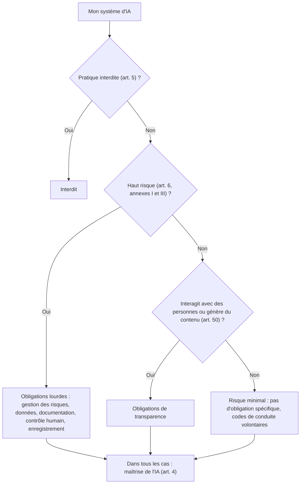
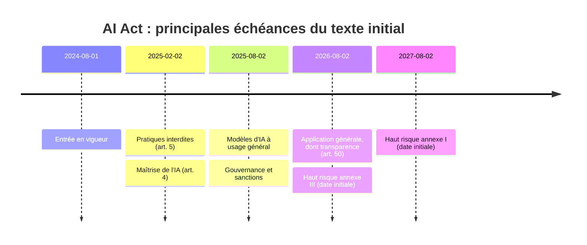

# L'AI Act européen : catégories, obligations, calendrier

> [!NOTE]
> Dans cette leçon, vous allez situer un cas d'usage dans l'approche par les risques du règlement européen sur l'IA (**règlement (UE) 2024/1689**, dit *AI Act*), identifier votre rôle (fournisseur ou déployeur), connaître les obligations de transparence qui concernent la plupart des assistants, et lire le calendrier d'application avec prudence.

> [!WARNING]
> Le texte évolue (actes délégués, lignes directrices de la Commission, normes harmonisées, et modifications législatives). Une modification dite « omnibus numérique » a ainsi été adoptée en 2026 et décale certaines échéances. **Référez-vous toujours à la version consolidée sur [EUR-Lex](https://eur-lex.europa.eu/eli/reg/2024/1689/oj)** et aux publications officielles avant toute décision.

## L'approche par les risques



| Catégorie | Exemples tirés du texte | Pour vos assistants |
|---|---|---|
| **Interdit** (art. 5) | Manipulation subliminale nuisible, exploitation des vulnérabilités, notation sociale, reconnaissance des émotions au travail et à l'école (hors raisons médicales ou de sécurité), moissonnage non ciblé d'images faciales | À exclure explicitement dans la charte d'usage |
| **Haut risque** (art. 6, annexe III) | Recrutement et gestion des salariés, accès à l'éducation, évaluation de solvabilité, tarification d'assurance vie et santé, accès à des services publics essentiels… | Un assistant RH qui **trie des candidatures** peut y entrer |
| **Transparence** (art. 50) | Systèmes qui dialoguent avec des personnes, contenus synthétiques, hypertrucages | **Un chatbot client** est typiquement concerné |
| **Minimal** | Filtre anti-spam, aide à la rédaction interne | La majorité des usages internes |

> [!IMPORTANT]
> La catégorie dépend de **l'usage**, pas de la technologie. Le même modèle est « transparence » dans un chatbot de FAQ et « haut risque » s'il sert à présélectionner des candidats.

## Fournisseur ou déployeur ?

- **Fournisseur** : développe un système d'IA (ou le fait développer) et le met sur le marché ou en service sous son nom.
- **Déployeur** : utilise un système d'IA sous son autorité dans un cadre professionnel.

Une entreprise qui assemble un assistant à partir d'un modèle d'un éditeur et le met en service sous sa propre marque peut être **fournisseur** du système, même si elle n'a pas créé le modèle. Les fournisseurs de **modèles d'IA à usage général** (les grands LLM) ont leurs propres obligations, applicables depuis le 2 août 2025.

```quiz
question: "Une entreprise intègre un LLM d'un grand éditeur dans un chatbot de support client à sa marque, ouvert au public. Quelle obligation de l'AI Act la concerne le plus directement ?"
options:
  - "Aucune, car elle n'a pas entraîné le modèle"
  - "Informer les personnes qu'elles interagissent avec un système d'IA, sauf si c'est évident (art. 50)"
  - "Les obligations des fournisseurs de modèles d'IA à usage général"
  - "L'interdiction de l'article 5"
answer: 1
explanation: "Un chatbot qui dialogue avec le public relève des obligations de transparence de l'article 50. Les obligations des modèles à usage général pèsent sur l'éditeur du modèle. Un chatbot de support n'est pas une pratique interdite."
```

## Les obligations de transparence (article 50) en pratique

Pour un assistant support client ou un assistant interne, retenez :

1. **Informer** la personne qu'elle échange avec une IA, sauf si c'est évident au vu des circonstances. Exemple : « Vous échangez avec un assistant automatisé. Vous pouvez demander à parler à un conseiller. »
2. **Marquer** les contenus synthétiques (texte, image, audio, vidéo) générés par le système, dans un format lisible par machine, lorsque le système en génère ; des exceptions existent, notamment pour l'aide à l'édition standard.
3. **Signaler** les hypertrucages (*deepfakes*) et certains textes publiés pour informer le public sur des questions d'intérêt public.

> [!TIP]
> Ces obligations rejoignent l'information RGPD (articles 13 et 14) : une même bannière ou page d'information peut couvrir les deux, à condition d'être claire.

## L'obligation de maîtrise de l'IA (article 4)

Depuis le 2 février 2025, fournisseurs et déployeurs doivent prendre des mesures pour garantir, **dans la mesure du possible**, un niveau suffisant de maîtrise de l'IA (*AI literacy*) de leur personnel qui utilise ces systèmes. C'est un argument direct pour le module 4 (formation des équipes).

## Calendrier (texte initial, à vérifier)



| Échéance | Ce qui s'applique (texte initial, art. 113) | Remarque |
|---|---|---|
| 1ᵉʳ août 2024 | Entrée en vigueur | — |
| 2 février 2025 | Pratiques interdites, maîtrise de l'IA | — |
| 2 août 2025 | Modèles à usage général, gouvernance, sanctions | — |
| 2 août 2026 | Application générale, transparence | Des aménagements transitoires ont été annoncés pour certains contenus générés : vérifier |
| 2 août 2026 / 2027 | Haut risque (annexe III / annexe I) | **Reporté** par la modification de 2026 selon les commentaires publiés : consultez le texte consolidé |

Les sanctions (art. 99) prévoient des amendes plafonnées en montant ou en pourcentage du chiffre d'affaires mondial, le plafond le plus élevé visant les pratiques interdites.

```quiz
question: "Quelle démarche est la plus prudente pour connaître la date d'application exacte des obligations haut risque à votre cas d'usage ?"
options:
  - "Se fier à un article de blog de 2024"
  - "Consulter la version consolidée du règlement sur EUR-Lex et les publications officielles de la Commission, puis valider avec le juriste"
  - "Considérer que rien ne s'applique tant qu'aucune sanction n'a été prononcée"
answer: 1
explanation: "Le calendrier a déjà été modifié après l'adoption du texte ; seule la version consolidée fait foi. L'absence de sanction ne vaut pas exemption."
```

## Exercice : classer quatre cas d'usage

Pour chacun, indiquez la catégorie AI Act probable, votre rôle et une obligation clé.

1. Chatbot de FAQ public sur le site e-commerce.
2. Assistant interne qui résume des comptes rendus de réunion.
3. Outil qui classe les CV reçus et propose une liste courte aux recruteurs.
4. Assistant qui détecte l'humeur des conseillers pendant leurs appels pour la notation managériale.

<details>
<summary>Voir la solution</summary>

| # | Catégorie probable | Rôle | Obligation clé |
|---|---|---|---|
| 1 | Transparence (art. 50) | Fournisseur du système (s'il est mis en service à votre marque) et déployeur | Informer qu'il s'agit d'une IA ; plus RGPD |
| 2 | Risque minimal | Déployeur | Maîtrise de l'IA (art. 4), charte interne ; plus RGPD |
| 3 | **Haut risque** (annexe III, emploi) | Déployeur, voire fournisseur si développé en interne | Contrôle humain, journalisation, information des personnes, obligations des déployeurs (art. 26) ; AIPD RGPD |
| 4 | **Interdit** (reconnaissance des émotions sur le lieu de travail, art. 5) | — | Ne pas déployer |

Ces classements sont indicatifs : la qualification exacte dépend des détails du cas et doit être validée juridiquement.

</details>

## Je sais faire

- [ ] Placer un cas d'usage dans les quatre catégories de l'AI Act en justifiant par l'usage
- [ ] Distinguer fournisseur et déployeur
- [ ] Rédiger une mention de transparence pour un chatbot (art. 50)
- [ ] Citer les principales échéances et savoir où vérifier leur version à jour
