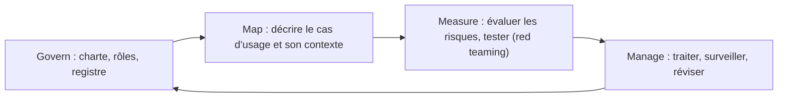
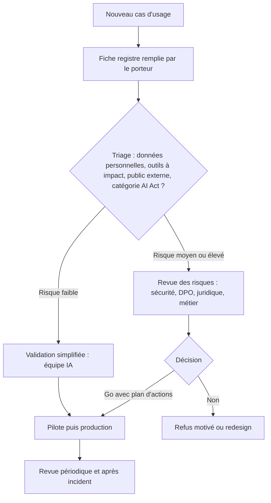

# Charte d'usage et registre des cas d'usage

> [!NOTE]
> Dans cette leçon, vous allez construire les deux outils de base de la gouvernance de l'IA générative : une **charte d'usage interne** lisible par tous, et un **registre des cas d'usage** qui permet de savoir ce qui est déployé, par qui, avec quels risques et quelles validations.

## Pourquoi une gouvernance dédiée ?

Sans cadre, on observe souvent deux dérives opposées : l'interdiction totale (qui pousse vers des outils non maîtrisés, voir leçon suivante) ou l'absence de règles (qui expose l'entreprise). La gouvernance cherche un chemin entre les deux : **des usages autorisés clairs, un circuit de validation proportionné au risque**.

Le NIST AI RMF place d'ailleurs la fonction *Govern* au centre des trois autres (*Map, Measure, Manage*) : sans rôles, politiques et suivi, les mesures techniques s'érodent.



## La charte d'usage : courte et concrète

Une charte efficace tient sur **une à deux pages** et répond aux questions que se posent vraiment les salariés.

| Rubrique | Exemple de formulation |
|---|---|
| Outils autorisés | « Les assistants IA validés sont listés sur l'intranet (ex. l'assistant interne de l'entreprise). Les autres outils grand public ne doivent pas recevoir de données internes. » |
| Données | « Jamais de données clients, de données RH, de code source confidentiel ni de secrets dans un outil non validé. » |
| Responsabilité | « Vous restez responsable de ce que vous produisez avec l'IA : relisez, vérifiez les faits et les chiffres. » |
| Transparence | « Signalez l'usage de l'IA quand un contenu est envoyé à l'extérieur sans relecture humaine substantielle. » |
| Usages interdits | « Pas d'usage pour évaluer ou noter des personnes sans validation du comité IA ; pas de reconnaissance des émotions. » |
| Signalement | « Un comportement anormal d'un assistant ? Signalez-le à [canal sécurité]. » |
| Nouveaux usages | « Un nouveau cas d'usage passe par le formulaire du registre. » |

> [!TIP]
> Testez votre charte sur trois salariés de métiers différents : s'ils ne savent pas répondre à « puis-je coller ce tableau client dans tel outil ? » après lecture, elle est trop abstraite.

```quiz
question: "Quelle formulation de charte est la plus utile pour un salarié ?"
options:
  - "Les collaborateurs doivent faire un usage responsable et éthique de l'IA."
  - "Ne collez jamais de données clients ou RH dans un outil IA absent de la liste des outils validés (lien intranet)."
  - "L'usage de l'IA est soumis à la réglementation en vigueur."
answer: 1
explanation: "Elle dit précisément quoi ne pas faire, avec quoi, et où trouver la liste. Les deux autres sont vraies mais n'aident pas à décider."
```

## Le registre des cas d'usage

Le registre est l'inventaire vivant des usages d'IA. Il ne remplace pas le registre RGPD (article 30) mais s'y articule : chaque cas d'usage qui traite des données personnelles doit y renvoyer.

```yaml title="registre/assistant-support-client.yaml"
id: UC-007
nom: "Assistant support client — suivi de commandes"
porteur_metier: "Direction relation client"
responsable_technique: "Équipe plateforme IA"
statut: "pilote"            # idée | pilote | production | retiré
utilisateurs: "Clients authentifiés du site"
plateforme: "Gemini Enterprise"   # ou watpilot, etc.
donnees:
  personnelles: true
  categories: ["identité", "commandes", "échanges"]
  sensibles_art9: false
outils_agent: ["get_my_orders", "propose_refund (plafonné, confirmation)"]
classification:
  ai_act: "transparence (art. 50)"
  criticite_interne: "élevée"
conformite:
  registre_rgpd: "TRT-042"
  aipd: "en cours"
  mention_transparence: "oui"
securite:
  derniere_revue_risques: 2026-09-30
  red_teaming: "RT-2026-09, 8 cas, 2 constats ouverts"
revue_suivante: 2027-03-31
```

| Champ | Pourquoi il compte |
|---|---|
| Porteur métier | Quelqu'un répond du cas d'usage et arbitre les risques |
| Statut | Un pilote et une production n'ont pas les mêmes exigences |
| Données et outils | Base de l'analyse des risques (modules 1 et 2) |
| Classification AI Act | Détermine les obligations (module 3) |
| Revue suivante | La gouvernance est un cycle, pas un tampon unique |

## Un circuit de validation proportionné



```quiz
question: "Lesquels de ces critères font typiquement passer un cas d'usage en revue approfondie ? (plusieurs réponses)"
options:
  - "L'assistant est exposé à des clients ou au public"
  - "L'agent peut déclencher des actions à impact (paiement, envoi externe, modification de données)"
  - "L'assistant utilise une police de caractères spécifique"
  - "Le cas d'usage pourrait relever du haut risque de l'AI Act"
answer: [0, 1, 3]
explanation: "Exposition externe, actions à impact et qualification réglementaire augmentent le risque. La police de caractères n'a aucun lien."
```

## Exercice : fiche registre pour un assistant interne

Rédigez la fiche registre (format YAML ci-dessus) d'un **assistant interne** qui répond aux questions des commerciaux à partir des contrats-cadres et des grilles tarifaires, déployé sur watpilot, sans outil d'action.

<details>
<summary>Voir la solution</summary>

```yaml title="registre/assistant-commerciaux.yaml"
id: UC-011
nom: "Assistant commerciaux — contrats et tarifs"
porteur_metier: "Direction commerciale"
responsable_technique: "Équipe plateforme IA"
statut: "pilote"
utilisateurs: "Commerciaux internes (environ une centaine, par exemple)"
plateforme: "watpilot"
donnees:
  personnelles: true          # noms des interlocuteurs dans les contrats
  categories: ["contacts professionnels", "conditions commerciales"]
  sensibles_art9: false
outils_agent: []              # lecture seule, RAG uniquement
classification:
  ai_act: "risque minimal"
  criticite_interne: "moyenne (confidentialité commerciale)"
conformite:
  registre_rgpd: "à créer ou rattacher"
  aipd: "non requise a priori, à confirmer avec le DPO"
  mention_transparence: "interne, via la charte"
securite:
  controles: ["filtrage RAG par portefeuille du commercial (LLM08)", "réponses avec sources citées (LLM09)"]
  derniere_revue_risques: null
  red_teaming: "à planifier avant production"
revue_suivante: "avant passage en production"
```

Point clé : même sans outil d'action, le risque principal est **LLM08** (un commercial accède aux conditions d'un client qui n'est pas dans son portefeuille).

</details>

## Je sais faire

- [ ] Rédiger une charte d'usage d'une page, avec des règles actionnables
- [ ] Tenir une fiche de registre de cas d'usage reliée au registre RGPD
- [ ] Définir un circuit de validation proportionné au risque
- [ ] Relier la gouvernance aux fonctions du NIST AI RMF
