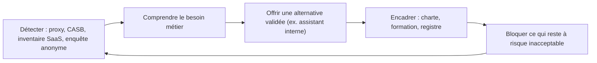

# Shadow AI, revue des risques et formation des équipes

> [!NOTE]
> Dans cette leçon, vous allez apprendre à traiter le **shadow AI** (usages d'IA non validés), à animer une **revue des risques** utile, et à bâtir un plan de **formation** des équipes qui répond aussi à l'obligation de maîtrise de l'IA (article 4 de l'AI Act).

## Le shadow AI : comprendre avant d'interdire

Le shadow AI désigne l'usage d'outils d'IA hors du cadre validé : compte personnel sur un chatbot grand public, extension de navigateur, transcription automatique de réunions, fonctions IA activées par défaut dans un logiciel SaaS.

| Risque | Exemple |
|---|---|
| Fuite de données | Un salarié colle un fichier clients dans un outil dont les conditions autorisent l'entraînement sur les données |
| Non-conformité RGPD | Traitement de données personnelles sans base légale ni contrat de sous-traitance |
| Propriété intellectuelle | Code source ou documents stratégiques envoyés à un tiers |
| Qualité | Décisions prises sur des réponses non vérifiées |

> [!IMPORTANT]
> Le shadow AI est d'abord un **signal de besoin**. Si les équipes contournent, c'est souvent que l'outil validé manque, est trop lent à obtenir ou moins pratique. Une interdiction sans alternative déplace le problème au lieu de le résoudre.



```quiz
question: "Une enquête montre que de nombreux commerciaux utilisent un chatbot grand public pour rédiger leurs propositions. Quelle première réponse est la plus efficace ?"
options:
  - "Bloquer immédiatement le site et sanctionner les contrevenants"
  - "Comprendre le besoin, proposer un assistant validé couvrant cet usage, puis encadrer et bloquer l'outil non validé si nécessaire"
  - "Ne rien faire, puisque l'usage est déjà répandu"
answer: 1
explanation: "Le blocage seul pousse vers d'autres contournements ; l'inaction laisse le risque. Offrir une alternative validée réduit durablement l'usage non maîtrisé."
```

## La revue des risques : un rituel, pas un audit

Une revue des risques réunit, pour un cas d'usage, les personnes qui détiennent chacune une partie de la réponse.

| Participant | Questions qu'il apporte |
|---|---|
| Porteur métier | Quel bénéfice ? Quel impact si l'assistant se trompe ? |
| Équipe technique | Architecture, outils, droits, filtres, journaux |
| Sécurité | Résultats du red teaming, risques OWASP, surveillance |
| DPO | Base légale, AIPD, conservation, information |
| Juridique / conformité | Catégorie AI Act, engagements contractuels, responsabilité |

Déroulé type (par exemple 60 à 90 minutes) :

1. Présentation du cas d'usage à partir de la fiche registre (10 min).
2. Parcours de la **matrice de risques** : probabilité × impact, risque par risque (30 min).
3. Décision sur chaque risque : **réduire**, **accepter** (avec un propriétaire nommé), **transférer** ou **éviter** (20 min).
4. Plan d'actions daté, propriétaire par action, date de la prochaine revue (10 min).

> [!TIP]
> Déclencheurs d'une revue hors calendrier : changement de modèle, ajout d'un outil, ouverture à un nouveau public, nouvelle source de données, incident ou quasi-incident.

```quiz
question: "Un risque résiduel est « accepté » en revue. Que faut-il au minimum documenter ? (plusieurs réponses)"
options:
  - "La personne qui accepte le risque (propriétaire)"
  - "La justification et les conditions de réexamen"
  - "Rien, puisqu'il est accepté"
  - "Les mesures de surveillance qui permettront de voir si le risque se matérialise"
answer: [0, 1, 3]
explanation: "Accepter un risque est une décision de gestion : elle doit être tracée, attribuée, justifiée et surveillée. Un risque accepté sans trace devient un risque ignoré."
```

## Former les équipes

L'article 4 de l'AI Act demande des mesures pour un niveau **suffisant** de maîtrise de l'IA, en tenant compte des connaissances, de l'expérience et du contexte d'usage. Un plan différencié par population est donc plus pertinent qu'une formation unique.

| Population | Contenu minimal | Format possible |
|---|---|---|
| Tous les salariés | Charte, outils validés, données interdites, limites des LLM (erreurs, biais), signalement | Module court en ligne + quiz |
| Utilisateurs avancés | Bonnes pratiques de prompt, vérification des sources, cas d'usage métier | Ateliers pratiques |
| Équipes produit et tech | OWASP Top 10 LLM, architecture défensive, red teaming (modules 1 et 2) | Cette formation + exercices sur leurs projets |
| Managers et comités | Gouvernance, registre, décisions d'acceptation du risque, cadre légal | Session courte avec cas concrets |
| DPO, juristes, risques | RGPD et AI Act appliqués, AIPD de systèmes d'IA | Veille réglementaire continue |

Mesurez l'effet : taux de complétion, résultats des quiz, nombre de signalements, évolution du shadow AI détecté.

## Exercice : plan à 90 jours

Votre entreprise découvre un usage important d'outils IA non validés et n'a ni charte, ni registre. Proposez un plan à 90 jours en trois phases.

<details>
<summary>Voir la solution</summary>

| Phase | Actions | Livrables |
|---|---|---|
| **J0 – J30 : voir et rassurer** | Enquête anonyme sur les usages ; inventaire des outils détectés ; publication d'une charte provisoire d'une page ; message clair « voici ce qui est autorisé dès maintenant » | Cartographie des usages, charte v0 |
| **J30 – J60 : offrir et encadrer** | Mise à disposition d'un assistant validé (contrat art. 28, région UE, pas d'entraînement sur les données) ; création du registre ; triage des cinq cas d'usage les plus fréquents ; module de formation pour tous | Assistant interne en pilote, registre v1, formation tous salariés |
| **J60 – J90 : maîtriser** | Revues des risques des cas d'usage externes ; red teaming de l'assistant ; blocage des outils à risque inacceptable ; indicateurs de suivi | Comptes rendus de revue, plan d'actions, tableau de bord |

L'ordre compte : **offrir une alternative avant de bloquer**.

</details>

## Je sais faire

- [ ] Expliquer pourquoi le shadow AI est un signal de besoin et proposer une réponse en cinq temps
- [ ] Animer une revue des risques avec les bons participants et un déroulé cadré
- [ ] Documenter une décision d'acceptation de risque
- [ ] Construire un plan de formation différencié par population, en lien avec l'article 4 de l'AI Act
