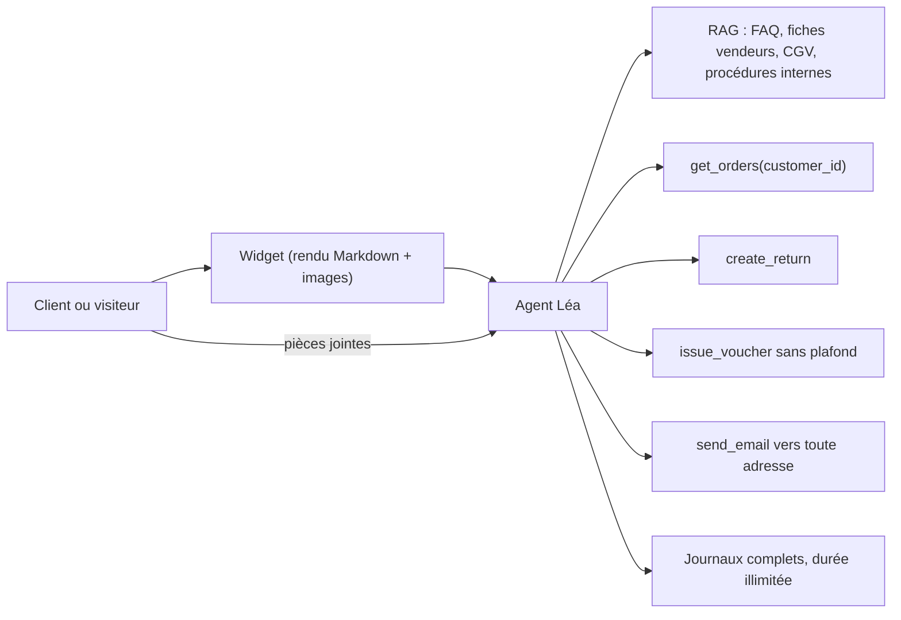
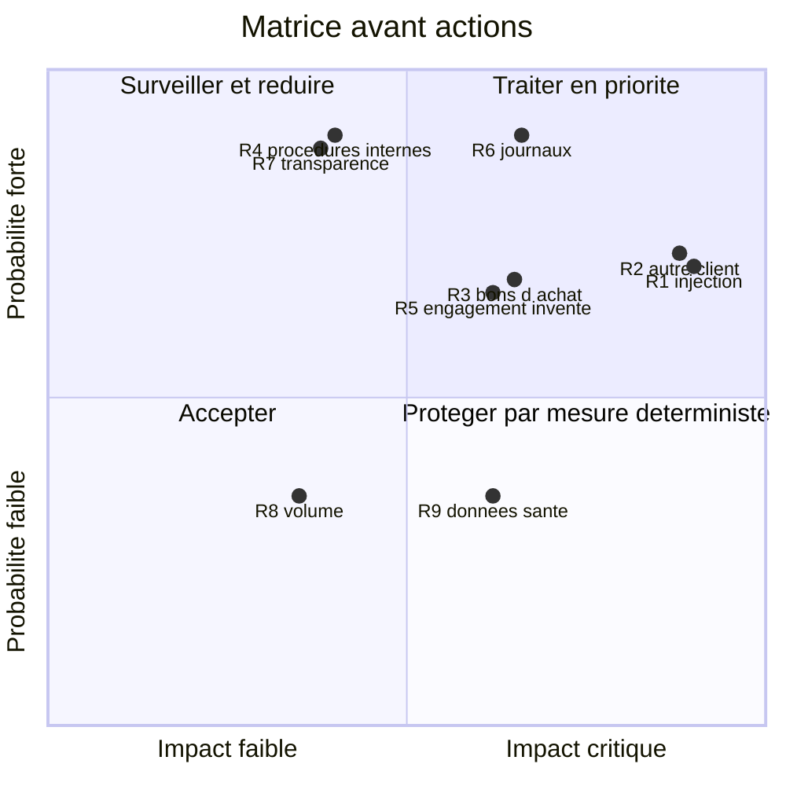

# Projet final : analyse de risques d'un assistant IA client

> [!NOTE]
> Dans ce projet, vous allez réaliser l'analyse de risques complète d'un assistant IA de support client fictif : description du système, identification des risques (OWASP), **matrice probabilité × impact**, volet conformité (RGPD, AI Act) et **plan d'actions** priorisé. Comptez environ 40 minutes, puis évaluez-vous avec la grille finale.

## Le cas : « Léa », l'assistante de la boutique

Une enseigne fictive de vente en ligne d'électroménager déploie **Léa**, un assistant sur son site et dans son application.

| Élément | Description |
|---|---|
| Utilisateurs | Clients connectés et visiteurs anonymes |
| Plateforme | Gemini Enterprise (agent) ; une variante interne pour les conseillers sur watpilot |
| Sources RAG | FAQ publique, fiches produits (dont certaines rédigées par des vendeurs partenaires), conditions générales, **et** un dossier « procédures internes SAV » ajouté « pour améliorer les réponses » |
| Outils | `get_orders(customer_id)`, `create_return(order_ref)`, `issue_voucher(amount)` sans plafond, `send_email(to, body)` |
| Pièces jointes | Les clients peuvent déposer photos et factures PDF |
| Journaux | Conversations complètes conservées sans durée définie |
| Interface | Le widget rend le Markdown, images comprises |
| Information | Aucune mention indiquant qu'il s'agit d'une IA |



## Étape 1 : identifier les risques

Listez au moins **huit** risques, chacun relié à une catégorie OWASP ou à une exigence RGPD / AI Act.

```quiz
question: "Quel élément du cas crée la combinaison la plus dangereuse pour une exfiltration par injection indirecte ?"
options:
  - "La FAQ publique"
  - "Des fiches produits rédigées par des tiers + l'accès aux commandes + send_email vers toute adresse et un rendu d'images"
  - "Le fait que les clients soient connectés"
answer: 1
explanation: "Contenu non fiable (fiches vendeurs, pièces jointes), données sensibles (commandes) et canal de sortie (e-mail libre, images) : la « lethal trifecta » est réunie."
```

## Étape 2 : coter et construire la matrice

Échelle proposée : **probabilité** de 1 (rare) à 4 (très probable), **impact** de 1 (faible) à 4 (critique). Criticité = probabilité × impact. Seuils, par exemple : 1–4 faible, 5–8 moyen, 9–16 élevé.

| | Impact 1 | Impact 2 | Impact 3 | Impact 4 |
|---|---|---|---|---|
| **Probabilité 4** | 4 | 8 | 12 | 16 |
| **Probabilité 3** | 3 | 6 | 9 | 12 |
| **Probabilité 2** | 2 | 4 | 6 | 8 |
| **Probabilité 1** | 1 | 2 | 3 | 4 |

```quiz
question: "Un risque coté probabilité 2 et impact 4 a une criticité de 8. Avec les seuils proposés, comment le traiter ?"
options:
  - "Risque faible, on l'ignore"
  - "Risque moyen, mais l'impact critique justifie souvent de le traiter en priorité, par une mesure déterministe"
  - "Risque élevé par définition"
answer: 1
explanation: "Le score seul ne suffit pas : un impact critique (fuite massive, perte financière) appelle généralement une mesure même si la probabilité est modérée. Les seuils sont un outil d'aide à la décision, pas un automatisme."
```

## Étape 3 : conformité

Répondez : base légale des traitements, AIPD nécessaire ou non, contrat de sous-traitance, durée de conservation, catégorie AI Act et obligation de transparence.

## Étape 4 : plan d'actions

Pour chaque risque élevé ou moyen : une action, un type (déterministe ou probabiliste), un propriétaire, une échéance, un indicateur de vérification.

## Votre livrable

Un document (ou un fichier YAML/tableur) contenant : la description, la matrice cotée **avant** et **après** actions, le volet conformité, le plan d'actions. Faites-le, **puis** comparez avec le corrigé.

<details>
<summary>Voir la solution</summary>

### Matrice des risques (avant actions)

| ID | Risque | Réf. | P | I | Criticité |
|---|---|---|---|---|---|
| R1 | Injection indirecte via fiche vendeur ou PDF, puis exfiltration par e-mail ou image | LLM01, LLM05, LLM02 | 3 | 4 | **12** |
| R2 | Accès aux commandes d'un autre client (`customer_id` fourni par le modèle) | LLM06, LLM02 | 3 | 4 | **12** |
| R3 | Bons d'achat émis sans plafond | LLM06 | 3 | 3 | **9** |
| R4 | Procédures internes SAV révélées au public via le RAG | LLM08 | 4 | 2 | **8** |
| R5 | Engagement inventé (garantie, délai, prix) | LLM09 | 3 | 3 | **9** |
| R6 | Journaux complets sans durée : non-conformité et surface de fuite | RGPD art. 5.1.e, 32 | 4 | 3 | **12** |
| R7 | Absence d'information « vous parlez à une IA » | AI Act art. 50, RGPD art. 13 | 4 | 2 | **8** |
| R8 | Abus de volume par visiteurs anonymes (coûts, déni de service) | LLM10 | 2 | 2 | 4 |
| R9 | Données de santé spontanées dans le chat (ex. « appareil pour mon handicap ») | RGPD art. 9 | 2 | 3 | 6 |



### Conformité

- **Rôles** : l'enseigne est responsable de traitement ; le fournisseur cloud est sous-traitant (contrat art. 28, région de traitement documentée, pas d'entraînement sur les données).
- **Base légale** : exécution du contrat pour le suivi de commandes ; intérêt légitime pour l'assistance aux visiteurs ; toute réutilisation pour améliorer le modèle = finalité distincte.
- **AIPD** : à mener par prudence (technologie innovante, grande échelle, clients) ; à confirmer avec le DPO.
- **AI Act** : obligations de transparence (art. 50) ; non haut risque pour cet usage ; maîtrise de l'IA (art. 4) pour les conseillers.

### Plan d'actions

| Action | Risques | Type | Propriétaire | Échéance | Vérification |
|---|---|---|---|---|---|
| Remplacer `get_orders(customer_id)` par `get_my_orders()` lié à la session | R2 | Déterministe | Tech lead | Avant prod | Test RT-03 à 0 % |
| Remplacer `send_email` par une réponse dans le fil client uniquement | R1 | Déterministe | Tech lead | Avant prod | Revue de code + RT-02 |
| Rendu sans images externes ni HTML, liens en liste blanche | R1 | Déterministe | Front | Avant prod | Test RT-06 |
| Plafond sur `issue_voucher` + confirmation conseiller au-delà | R3 | Déterministe | Produit | Avant prod | Journaux de la passerelle |
| Retirer les procédures internes du corpus public ; index séparé pour l'assistant conseillers | R4 | Déterministe | Data | Avant prod | Test RT-07 |
| Filtre d'injection et de données sensibles (ex. Model Armor) en entrée et sortie | R1, R9 | Probabiliste | Sécurité | Avant prod | Taux de détection sur jeu de test |
| Réponses ancrées avec sources, refus si pas de source ; CGV comme référence | R5 | Probabiliste | Produit | Avant prod | Échantillon relu chaque mois |
| Durée de conservation définie, masquage, accès restreint aux journaux | R6, R9 | Déterministe | DPO + Ops | 30 jours | Purge automatique vérifiée |
| Mention « assistant automatisé » + lien vers un conseiller et vers la notice | R7 | Déterministe | Produit | Avant prod | Capture d'écran en revue |
| Quotas par session, captcha pour anonymes, alerte budgétaire | R8 | Déterministe | Ops | 30 jours | Test de charge |
| Red teaming complet puis revue des risques | Tous | — | Sécurité | Avant prod puis tous les 6 mois | Rapport |

### Matrice cible (après actions, à confirmer par les tests)

R2 et R3 passent à une probabilité de 1 (contrôles déterministes) ; R1 passe à 2 × 3 = 6 grâce au retrait du canal d'e-mail et du rendu d'images ; R4, R6, R7 deviennent faibles. Le risque résiduel principal reste **R5** (désinformation) : il est accepté par le porteur métier, avec une surveillance mensuelle.

</details>

## Grille d'auto-évaluation

Comptez 1 point par critère rempli. **12 points ou plus : objectif atteint. 8 à 11 : reprenez les leçons liées aux critères manqués. Moins de 8 : refaites le projet après les modules 1 et 2.**

| # | Critère | Leçon de référence |
|---|---|---|
| 1 | J'ai identifié au moins 8 risques distincts | 1.1 |
| 2 | Chaque risque est relié à une catégorie OWASP ou à un article précis | 1.1, 3.1, 3.2 |
| 3 | J'ai repéré la chaîne d'injection indirecte (contenu tiers → données → sortie) | 1.2 |
| 4 | J'ai signalé le `customer_id` fourni par le modèle | 2.1 |
| 5 | J'ai traité le rendu Markdown et les images comme un risque de sortie | 1.3, 2.2 |
| 6 | J'ai repéré les procédures internes dans le corpus public | 1.3 |
| 7 | Ma matrice utilise une échelle définie et des seuils explicites | Projet |
| 8 | J'ai privilégié des mesures déterministes pour les risques à impact critique | 2.1 |
| 9 | Chaque action a un propriétaire, une échéance et un moyen de vérification | 4.2 |
| 10 | J'ai défini une durée de conservation et un masquage des journaux | 2.2, 3.1 |
| 11 | J'ai traité base légale, AIPD et contrat de sous-traitance | 3.1 |
| 12 | J'ai identifié l'obligation de transparence de l'AI Act | 3.2 |
| 13 | J'ai prévu un red teaming et une revue périodique | 2.3, 4.2 |
| 14 | J'ai documenté au moins un risque résiduel accepté, avec son propriétaire | 4.2 |

## Je sais faire

- [ ] Décrire un assistant IA sous forme de schéma de flux exploitable pour l'analyse de risques
- [ ] Coter des risques en probabilité × impact et construire une matrice
- [ ] Produire le volet conformité RGPD et AI Act d'un cas d'usage
- [ ] Rédiger un plan d'actions priorisé, attribué et vérifiable
- [ ] Présenter une matrice avant / après et justifier le risque résiduel
