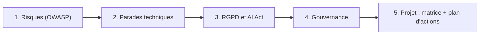

# IA responsable et sécurité des LLM

Un assistant IA branché sur vos documents, vos outils et vos clients n'est pas « un chatbot de plus » : c'est une nouvelle surface d'attaque **et** un nouveau traitement de données personnelles. Cette formation vous donne une méthode pour passer de « on a un POC qui marche » à « on sait expliquer ses risques, ses parades et sa conformité ».

> [!NOTE]
> La formation reste volontairement **indépendante de la plateforme**. Pour la mise en œuvre concrète sur Google Cloud (Model Armor, VPC-SC, IAM, journalisation de Gemini Enterprise), enchaînez avec [Sécurité de Gemini Enterprise](../../04-agents-google-cloud/03-securite-gemini-enterprise/index.md).

## Pour qui ?

| Profil | Ce que vous y trouverez |
|---|---|
| **Équipes produit** | Lire une analyse de risques, arbitrer les parades, rédiger les mentions de transparence |
| **Équipes tech** (dev, ops, sécurité) | Patterns d'architecture défensive, filtrage, validation des sorties, red teaming |
| **Conformité** (DPO, juristes, risques) | Articulation RGPD / AI Act, AIPD, registre des cas d'usage, gouvernance |

## Objectifs mesurables

À la fin de la formation, vous serez capable de :

1. **Classer** une dizaine de scénarios d'incident dans les catégories de l'OWASP Top 10 pour les LLM.
2. **Proposer au moins une parade technique** par risque majeur d'un assistant (injection, fuite, agentivité excessive…).
3. **Écrire un mini-plan de red teaming** de 10 cas de test et en interpréter les résultats.
4. **Déterminer** la base légale, la nécessité d'une AIPD et la catégorie AI Act d'un cas d'usage, en citant l'article concerné.
5. **Rédiger** une fiche de registre de cas d'usage et une charte d'usage d'une page.
6. **Produire** une matrice de risques et un plan d'actions priorisé pour un assistant client.

## Prérequis

- Savoir ce qu'est un LLM, un prompt, un RAG et un agent avec outils (niveau d'un premier projet ou d'un POC).
- Aucune compétence juridique n'est requise : les textes sont présentés de manière factuelle, avec renvoi aux sources officielles.

## Programme

| Module | Leçons | Durée indicative |
|---|---|---|
| 1. Les risques | Panorama OWASP Top 10 LLM · Injection de prompt directe et indirecte · Fuites, sorties non maîtrisées et agentivité excessive | 1h30 |
| 2. Se protéger techniquement | Architecture défensive · Filtrer, valider, journaliser · Red teaming | 1h45 |
| 3. Données personnelles et cadre légal | RGPD appliqué aux LLM · AI Act : catégories, obligations, calendrier | 1h15 |
| 4. Gouvernance | Charte d'usage et registre des cas d'usage · Shadow AI, revue des risques et formation | 50 min |
| 5. Projet final | Analyse de risques d'un assistant IA client | 40 min |

## Ce que vous saurez faire

- Expliquer à un comité de direction pourquoi « on a mis un bon prompt système » **n'est pas** une mesure de sécurité suffisante.
- Revoir l'architecture d'un assistant (support client ou assistant interne) et pointer les privilèges en trop.
- Préparer le dossier conformité d'un cas d'usage : registre, base légale, AIPD si nécessaire, transparence.
- Animer une revue des risques et suivre un plan d'actions dans le temps.

> [!WARNING]
> Cette formation n'est pas un avis juridique. Les textes (RGPD, AI Act) et leurs calendriers évoluent : vérifiez toujours la version consolidée sur EUR-Lex et les publications de la CNIL avant une décision.
