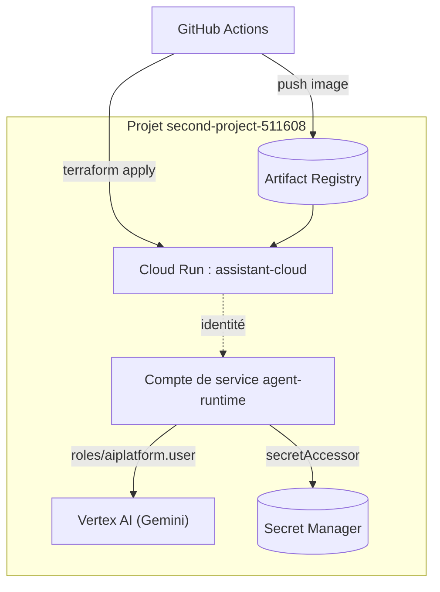

## Vue d'ensemble



## Variables

```hcl title="infra/variables.tf"
variable "project_id" { type = string }
variable "region" {
  type    = string
  default = "europe-west1"
}
variable "image" {
  type        = string
  description = "Image complète, par exemple europe-west1-docker.pkg.dev/p/agents/assistant:sha"
}
```

## Ressources

```hcl title="infra/main.tf"
resource "google_artifact_registry_repository" "agents" {
  location      = var.region
  repository_id = "agents"
  format        = "DOCKER"
}

resource "google_service_account" "runtime" {
  account_id   = "agent-runtime"
  display_name = "Runtime de l'agent ADK"
}

resource "google_project_iam_member" "vertex" {
  project = var.project_id
  role    = "roles/aiplatform.user"
  member  = "serviceAccount:${google_service_account.runtime.email}"
}

resource "google_cloud_run_v2_service" "agent" {
  name                = "assistant-cloud"
  location            = var.region
  deletion_protection = false
  ingress             = "INGRESS_TRAFFIC_ALL"

  template {
    service_account = google_service_account.runtime.email
    scaling {
      min_instance_count = 0
      max_instance_count = 5
    }
    containers {
      image = var.image
      resources {
        limits = { cpu = "1", memory = "1Gi" }
      }
      env {
        name  = "GOOGLE_GENAI_USE_VERTEXAI"
        value = "TRUE"
      }
      env {
        name  = "GOOGLE_CLOUD_PROJECT"
        value = var.project_id
      }
      env {
        name  = "GOOGLE_CLOUD_LOCATION"
        value = var.region
      }
    }
  }
}

output "url" {
  value = google_cloud_run_v2_service.agent.uri
}
```

## Le conteneur

```dockerfile title="Dockerfile"
FROM python:3.12-slim
WORKDIR /srv
COPY requirements.txt .
RUN pip install --no-cache-dir -r requirements.txt
COPY app ./app
ENV PORT=8080
CMD ["sh", "-c", "adk api_server --host 0.0.0.0 --port $PORT ."]
```

Premier déploiement manuel :

```bash
cd infra
terraform init
terraform apply -var project_id=second-project-511608 \
  -var image=europe-west1-docker.pkg.dev/second-project-511608/agents/assistant:v1
```
