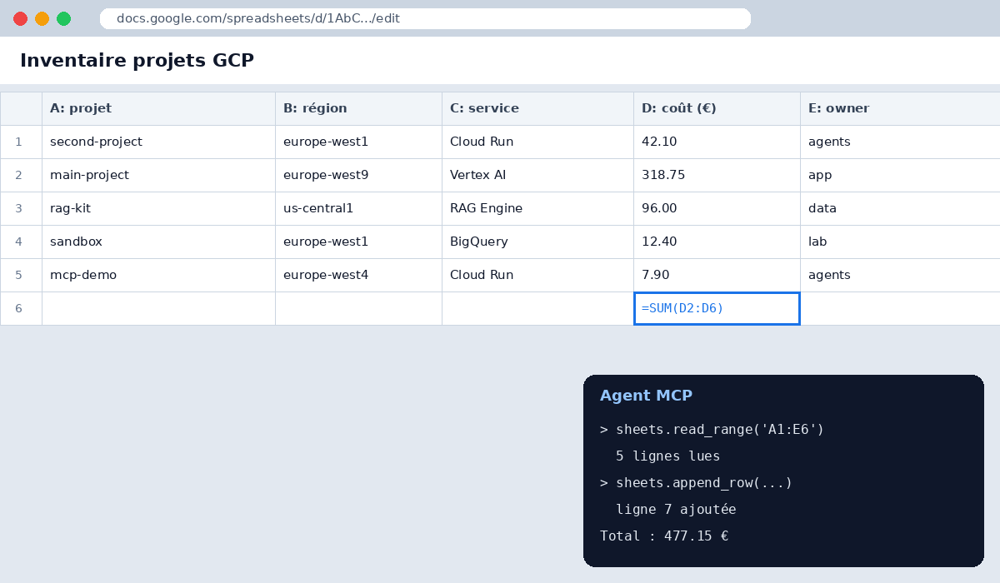
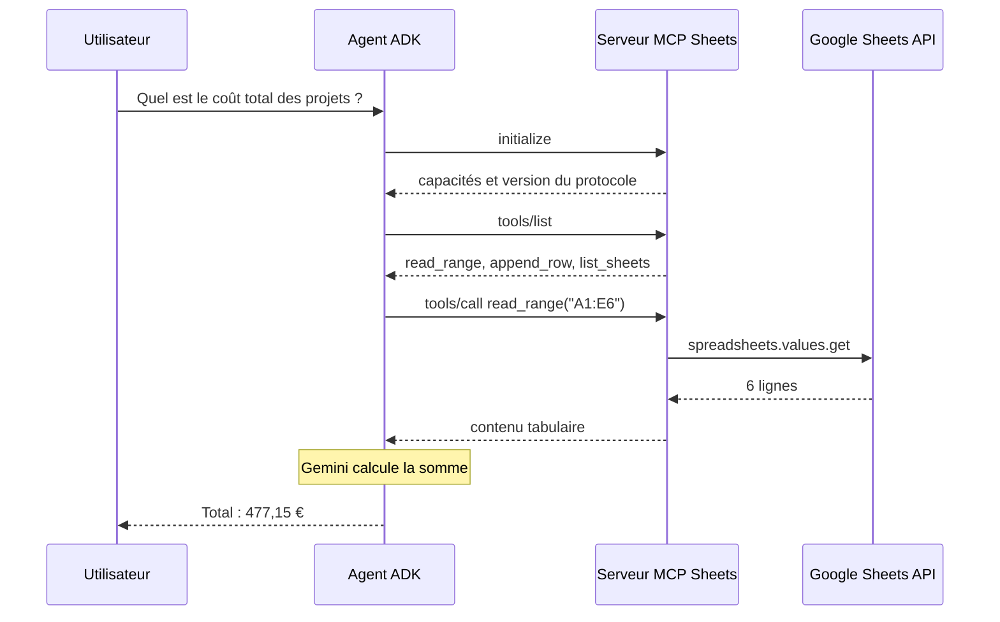

Le [Model Context Protocol](https://modelcontextprotocol.io/) (MCP) standardise la façon dont un agent découvre et appelle des outils externes. Plutôt que de coder une intégration Google Sheets dans chaque agent, on écrit **un** serveur MCP réutilisable par ADK, Gemini CLI ou n'importe quel client compatible.

## Le résultat



## Les échanges



## Le serveur

```python title="server.py"
from mcp.server.fastmcp import FastMCP
from googleapiclient.discovery import build
import google.auth

mcp = FastMCP("google-sheets")
creds, _ = google.auth.default(scopes=["https://www.googleapis.com/auth/spreadsheets"])
sheets = build("sheets", "v4", credentials=creds).spreadsheets()


@mcp.tool()
def read_range(spreadsheet_id: str, a1_range: str) -> list[list[str]]:
    """Lit une plage au format A1 (ex. 'Feuille1!A1:E10')."""
    res = sheets.values().get(spreadsheetId=spreadsheet_id, range=a1_range).execute()
    return res.get("values", [])


@mcp.tool()
def append_row(spreadsheet_id: str, a1_range: str, values: list[str]) -> int:
    """Ajoute une ligne à la fin de la plage. Renvoie le nombre de cellules écrites."""
    res = sheets.values().append(
        spreadsheetId=spreadsheet_id, range=a1_range,
        valueInputOption="USER_ENTERED", body={"values": [values]},
    ).execute()
    return res["updates"]["updatedCells"]


if __name__ == "__main__":
    mcp.run(transport="streamable-http")
```

## Les outils exposés

| Outil | Méthode Sheets API | Portée OAuth | Lecture seule | Usage typique |
| --- | --- | --- | :---: | --- |
| `list_sheets` | `spreadsheets.get` | `spreadsheets.readonly` | ✅ | Découvrir les onglets |
| `read_range` | `values.get` | `spreadsheets.readonly` | ✅ | Lire un tableau |
| `batch_read` | `values.batchGet` | `spreadsheets.readonly` | ✅ | Lire plusieurs plages |
| `append_row` | `values.append` | `spreadsheets` | ❌ | Journaliser un résultat |
| `update_range` | `values.update` | `spreadsheets` | ❌ | Corriger des cellules |
| `clear_range` | `values.clear` | `spreadsheets` | ❌ | Vider une plage |
| `add_sheet` | `spreadsheets.batchUpdate` | `spreadsheets` | ❌ | Créer un onglet |
| `format_header` | `spreadsheets.batchUpdate` | `spreadsheets` | ❌ | Mettre en forme |

## Brancher le serveur dans ADK

```python
from google.adk.agents import Agent
from google.adk.tools.mcp_tool import MCPToolset, StreamableHTTPConnectionParams

root_agent = Agent(
    name="analyste_sheets",
    model="gemini-2.5-flash",
    instruction="Tu analyses des feuilles Google Sheets. Lis avant d'écrire.",
    tools=[MCPToolset(connection_params=StreamableHTTPConnectionParams(url="https://mcp-sheets-xyz.a.run.app/mcp"))],
)
```

## Ce que j'en retiens

- Séparer outils **lecture** et **écriture** permet de n'accorder que la portée `readonly` aux agents d'analyse.
- Le transport *streamable HTTP* se déploie sans difficulté sur Cloud Run, derrière une authentification IAM.
- Des docstrings précises améliorent nettement le choix d'outil par le modèle.

Pour d'autres exemples, voir le dépôt [awesome-llm-apps](https://github.com/Shubhamsaboo/awesome-llm-apps) et la liste des [serveurs MCP de référence](https://github.com/modelcontextprotocol/servers).
