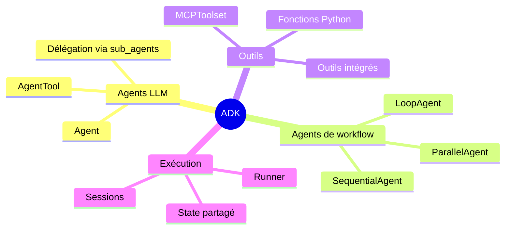
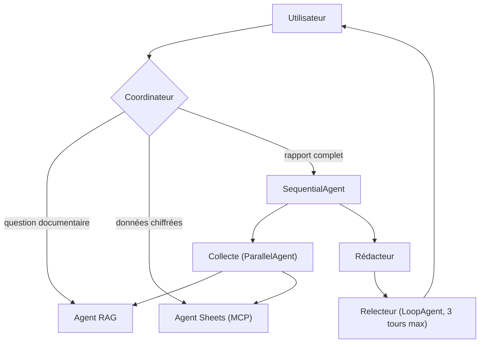

Un agent unique avec vingt outils finit par mal choisir. ADK permet de **composer** plusieurs agents spécialisés sous un coordinateur.

## Les briques d'ADK



## L'architecture testée



## Le code

```python
from google.adk.agents import Agent, ParallelAgent, SequentialAgent

rag_agent = Agent(name="rag", model="gemini-2.5-flash",
                  description="Répond à partir de la documentation interne.",
                  output_key="doc")
sheets_agent = Agent(name="sheets", model="gemini-2.5-flash",
                     description="Lit les données de coûts dans Google Sheets.",
                     output_key="chiffres")

collecte = ParallelAgent(name="collecte", sub_agents=[rag_agent, sheets_agent])
redacteur = Agent(name="redacteur", model="gemini-2.5-pro",
                  instruction="Rédige un rapport à partir de {doc} et {chiffres}.")
rapport = SequentialAgent(name="rapport", sub_agents=[collecte, redacteur])

root_agent = Agent(
    name="coordinateur",
    model="gemini-2.5-flash",
    instruction="Délègue à l'agent le plus adapté. Pour un rapport, utilise 'rapport'.",
    sub_agents=[rapport],
)
```

> [!NOTE]
> Un agent ne peut avoir qu'un seul parent dans l'arbre ADK. Pour réutiliser `rag_agent` à deux endroits, créez deux instances ou exposez-le via `AgentTool`.

## Observations

- Les `output_key` qui écrivent dans le *state* de session sont le moyen le plus simple de faire circuler les résultats.
- Les descriptions des sous-agents pèsent plus que les instructions du coordinateur dans la décision de délégation.
- Le `ParallelAgent` divise la latence de collecte par deux sur ce cas.
