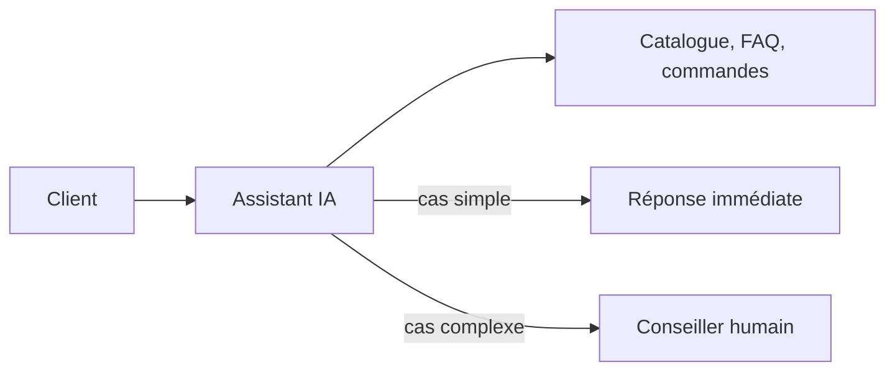

## Le besoin

Vos clients posent souvent les mêmes questions : disponibilité, prix, suivi de commande, horaires. Ils écrivent sur WhatsApp, par e-mail ou sur votre site, à toute heure. Un assistant IA peut traiter ces demandes immédiatement et transmettre les cas complexes à votre équipe, avec tout l'historique.

## Comment ça marche

## Par où commencer

1. Comprendre ce qu'un modèle sait faire, et ce qu'il ne sait pas faire : *Les fondamentaux de l'IA générative*.
2. Écrire les consignes de l'assistant (ton, limites, escalade) : *Prompt engineering*.
3. Lui donner des outils (catalogue, statut de commande) : *Construire un agent IA de A à Z*.
4. Mesurer la qualité avant d'ouvrir à tous les clients : *Évaluer et fiabiliser une application LLM*.

> [!TIP]
> Une solution prête à l'emploi comme **Watpilot** couvre ce cas sur WhatsApp sans développement. Les formations vous aident à bien la paramétrer, ou à construire la vôtre.
