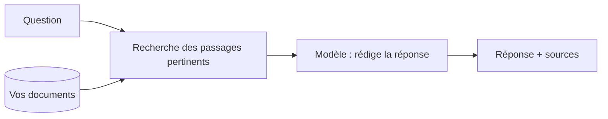

## Le besoin

L'information existe, mais elle est éparpillée dans des centaines de documents. Plutôt que de chercher par mots-clés, on veut demander : « quelle est la procédure de retour pour un client pro ? » et obtenir la réponse, avec le lien vers le document.

## La technique : le RAG

## Par où commencer

- *Les fondamentaux de l'IA générative* (comprendre les embeddings et la recherche sémantique).
- *RAG sur vos documents Google Drive* : quatre kits prêts à déployer, testés en vrai.
- *Évaluer et fiabiliser une application LLM* : vérifier que les réponses citent les bonnes sources.
