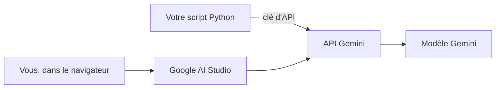
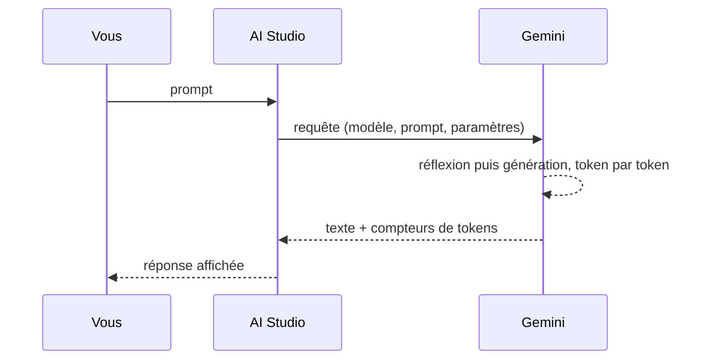

# Créer une clé et un premier prompt

> [!NOTE]
> Dans cette leçon, vous allez ouvrir Google AI Studio, envoyer votre premier prompt à un modèle Gemini et créer une clé d'API, le « badge » qui permettra plus tard à votre code d'appeler le même modèle.

## AI Studio, l'API Gemini, Gemini : qui fait quoi ?

Trois noms reviennent sans cesse ; ils désignent trois choses différentes.

| Nom | Ce que c'est | Pour qui |
| --- | --- | --- |
| **Gemini** | une famille de **modèles de langage** (LLM) de Google : des programmes qui prédisent la suite d'un texte | tout le monde |
| **API Gemini** | le service web qui donne accès à ces modèles depuis du code (une **API** est une porte d'entrée pour programmes) | développeurs |
| **Google AI Studio** | une page web qui parle à l'API Gemini à votre place, avec des boutons et des curseurs | pour prototyper, sans code |



Autrement dit : AI Studio et votre futur script frappent **à la même porte**. Ce que vous réglez dans AI Studio se traduit directement en paramètres de l'API, ce qui rend le passage au code très simple (module 3).

## Étape 1 : ouvrir AI Studio et envoyer un prompt

1. Allez sur [aistudio.google.com](https://aistudio.google.com) et connectez-vous avec un compte Google.
2. Ouvrez un nouveau chat (le « playground », l'espace d'essai).
3. Dans la zone de saisie, tapez votre **prompt**, c'est-à-dire la consigne envoyée au modèle :

```text title="prompt"
Écris un slogan de 10 mots maximum pour une gourde isotherme.
```

4. Lancez (bouton **Run** ou `Ctrl + Entrée`). La réponse s'affiche en quelques secondes.

> [!TIP]
> L'interface d'AI Studio évolue souvent : un bouton peut changer de nom ou de place. Les notions, elles, restent les mêmes : prompt, modèle, instructions système, paramètres, export du code.

## Étape 2 : créer une clé d'API

Dans AI Studio, la clé s'obtient depuis le menu **Get API key** puis **Create API key**. AI Studio rattache la clé à un projet Google Cloud (il peut en créer un pour vous). Copiez-la une fois, puis rangez-la dans un fichier `.env` qui ne quittera jamais votre poste :

```bash title=".env"
GEMINI_API_KEY=collez-votre-cle-ici
```

> [!WARNING]
> Une clé d'API vaut un mot de passe : quiconque la possède consomme **votre** quota, voire votre budget. Ne la mettez jamais dans le code, dans un dépôt git, dans une capture d'écran ou dans un message. Si elle fuit, supprimez-la dans AI Studio et créez-en une autre.

```quiz
question: "Vous venez de tester un prompt dans AI Studio. Que faut-il pour obtenir le même résultat depuis un script Python ?"
options:
  - "Rien : AI Studio et le script utilisent le même modèle sans authentification"
  - "Une clé d'API, que le script envoie à l'API Gemini"
  - "Installer le modèle Gemini sur votre ordinateur"
answer: 1
explanation: "Le modèle tourne chez Google. Votre script s'identifie avec une clé d'API ; AI Studio, lui, utilise votre connexion Google. Rien n'est installé localement à part la bibliothèque cliente."
```

```quiz
question: "Où ranger votre clé d'API ?"
options:
  - "Dans le code, en haut du fichier, pour la retrouver facilement"
  - "Dans un fichier .env local, exclu de git"
  - "Dans le README du projet, pour vos collègues"
answer: 1
explanation: "Un fichier .env local (listé dans .gitignore) garde la clé hors du code partagé. Le code la lit au démarrage."
```

## Ce qui se passe quand vous cliquez sur Run



Un **token** est un morceau de mot (en français, un mot fait souvent 1 à 2 tokens). C'est l'unité de mesure des modèles : la longueur maximale d'un texte, les quotas et le prix se comptent en tokens. Les modèles récents « réfléchissent » avant de répondre : ces **tokens de pensée** sont comptés aussi.

## Résultat obtenu

Le même prompt envoyé à l'API Gemini (`gemini-3.5-flash`) le 2026-10-15 :

```text title="sortie"
text='**Garde la fraîcheur, préserve la chaleur. Partout avec vous.**'
finish=STOP
prompt=18 out=17 thoughts=907 total=942
```

Lecture : 18 tokens de prompt, 17 tokens de réponse… et 907 tokens de **pensée**. Pour une tâche aussi courte, la réflexion coûte bien plus que la réponse elle-même : on y reviendra avec les quotas (module 3). Votre slogan sera différent : la génération comporte une part de hasard (module 2).

## Exercice

Envoyez dans AI Studio trois variantes du prompt : « un slogan », « un slogan de 5 mots pour des sportifs », « trois slogans de 5 mots pour des sportifs, numérotés ». Notez ce qui change. Quelle règle en tirez-vous ?

<details>
<summary>Voir la solution</summary>

Plus le prompt est **précis** (public visé, longueur, nombre de propositions, format), plus la réponse est utilisable telle quelle. Avec « un slogan », le modèle choisit seul le ton et la longueur ; avec la troisième version, vous obtenez trois propositions courtes et numérotées, faciles à comparer.

Règle : un bon prompt dit **qui** est visé, **quoi** produire, **combien** et **sous quelle forme**. C'est exactement ce que nous mettrons dans le prompt système de l'assistant de fiches produit.

</details>

## Je sais faire

- [ ] Expliquer la différence entre Gemini, l'API Gemini et Google AI Studio
- [ ] Envoyer un prompt dans AI Studio
- [ ] Créer une clé d'API et la ranger dans un fichier `.env`
- [ ] Dire ce qu'est un token et pourquoi on les compte
