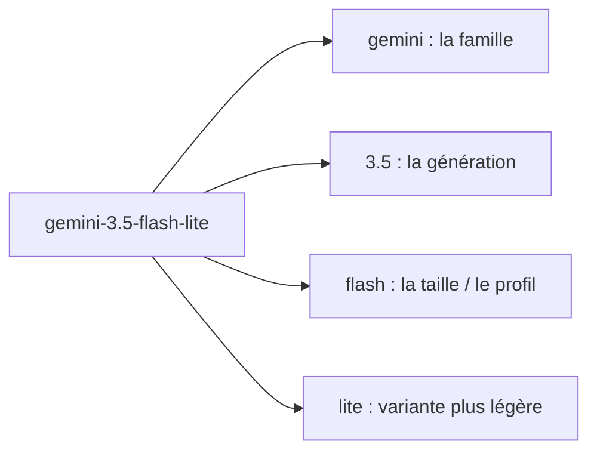
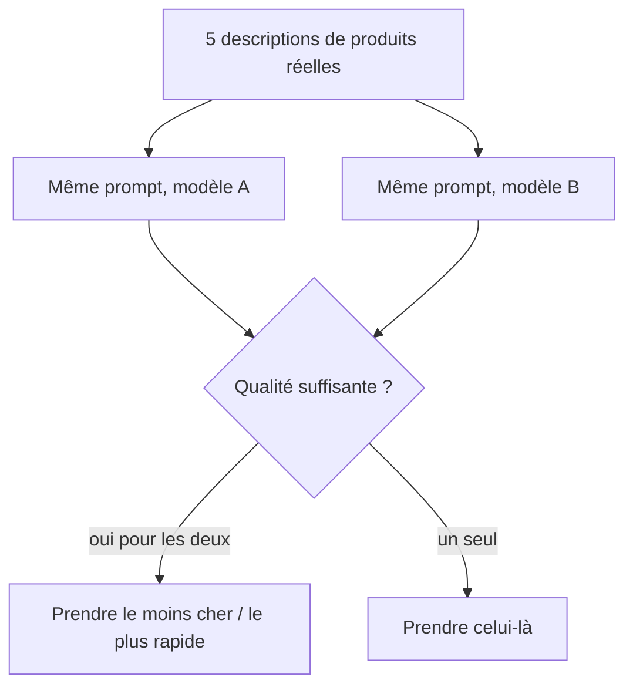

# Choisir un modèle

> [!NOTE]
> Dans cette leçon, vous allez comprendre comment sont nommés les modèles Gemini, lire leurs limites (fenêtre de contexte, taille de réponse) et choisir celui qui convient à l'assistant de fiches produit.

## Le sélecteur de modèle

En haut à droite d'AI Studio, une liste déroulante propose des dizaines de modèles. Leur nom suit presque toujours le même schéma :



| Profil | Pour quoi | Compromis |
| --- | --- | --- |
| **flash** | usage général : rédaction, résumé, extraction | bon équilibre qualité / vitesse / prix |
| **flash-lite** | gros volumes de tâches simples (classer, reformuler) | plus rapide et moins cher, un peu moins fin |
| **pro** (quand il est proposé) | raisonnement difficile, code complexe | plus lent et plus cher |
| suffixes `-preview`, `-tts`, `-image`, `-live` | versions d'essai ou spécialisées (voix, images, temps réel) | à éviter pour un premier projet texte |

> [!TIP]
> Un modèle `-preview` peut changer ou disparaître sans long préavis. Pour un prototype qui deviendra une application, préférez un modèle **stable** (sans suffixe) et gardez son nom dans une variable, pour pouvoir en changer sans toucher au code.

## Deux limites à connaître

- **Fenêtre de contexte** (*input token limit*) : la quantité maximale de texte que le modèle peut lire en une fois (prompt + historique + documents).
- **Taille maximale de réponse** (*output token limit*) : le plafond de tokens que le modèle peut produire, pensée comprise.

Pour une fiche produit, l'entrée fait quelques centaines de tokens : n'importe quel modèle `flash` suffit largement. Ces limites deviennent importantes quand on lui donne des documents entiers.

```quiz
question: "Vous devez reformuler 50 000 titres de produits très courts, chaque nuit, au moindre coût. Quel profil essayer en premier ?"
options:
  - "Un modèle pro"
  - "Un modèle flash-lite"
  - "Un modèle -tts"
answer: 1
explanation: "Tâche simple et gros volume : c'est le terrain de flash-lite. On vérifie sur un échantillon que la qualité suffit ; sinon on remonte à flash. Les modèles -tts produisent de la voix, pas du texte."
```

```quiz
question: "Que mesure la fenêtre de contexte d'un modèle ?"
options:
  - "Le nombre de requêtes qu'on peut envoyer par minute"
  - "La quantité de texte, en tokens, que le modèle peut lire dans une seule requête"
  - "Le nombre de langues que le modèle comprend"
answer: 1
explanation: "La fenêtre de contexte est une limite de taille par requête, comptée en tokens. Le nombre de requêtes par minute est un quota (rate limit), une autre notion vue au module 3."
```

## Comparer deux modèles sur votre cas

Le meilleur juge, c'est votre tâche. AI Studio permet de relancer le même prompt avec un autre modèle (et propose selon les versions un mode de comparaison côte à côte). Méthode simple :



Pour ce cours, nous retenons **`gemini-3.5-flash`** : stable, bon en rédaction française, et rapide.

## Résultat obtenu

Liste des modèles « flash » visibles avec notre clé, puis les limites du modèle choisi, obtenues par l'API le 2026-10-15 (extrait) :

```text title="sortie"
models/gemini-2.5-flash
models/gemini-2.5-flash-lite
models/gemini-3-flash-preview
models/gemini-3.1-flash-lite
models/gemini-3.5-flash
models/gemini-3.5-flash-lite
models/gemini-3.8-flash
models/gemini-3.8-flash-tts
models/gemini-flash-latest
...
models/gemini-3.5-flash in=1048576 out=65536
```

`gemini-3.5-flash` lit jusqu'à 1 048 576 tokens en entrée et produit au plus 65 536 tokens : de quoi traiter un catalogue entier, bien au-delà de nos besoins. La liste dépend de votre compte et de la date ; vérifiez-la dans AI Studio ou sur la page [Modèles Gemini](https://ai.google.dev/gemini-api/docs/models).

## Exercice

Vous construisez trois fonctionnalités : (a) classer des avis clients en « positif / négatif / neutre », 10 000 par jour ; (b) rédiger des fiches produit soignées ; (c) lire à voix haute un message d'accueil. Quel profil de modèle testez-vous en premier pour chacune ?

<details>
<summary>Voir la solution</summary>

- (a) **flash-lite** : tâche simple, très gros volume. On vérifie la précision sur une centaine d'avis déjà classés à la main.
- (b) **flash** : la qualité rédactionnelle compte, le volume est modéré.
- (c) un modèle **-tts** (*text-to-speech*, synthèse vocale), spécialisé dans la production de voix.

Dans les trois cas, le nom du modèle reste un **paramètre** de l'application, pas une constante gravée dans le code.

</details>

## Je sais faire

- [ ] Lire un nom de modèle Gemini (famille, génération, profil, variante)
- [ ] Expliquer fenêtre de contexte et taille maximale de réponse
- [ ] Choisir entre flash et flash-lite selon le volume et la difficulté
- [ ] Comparer deux modèles sur quelques exemples réels
