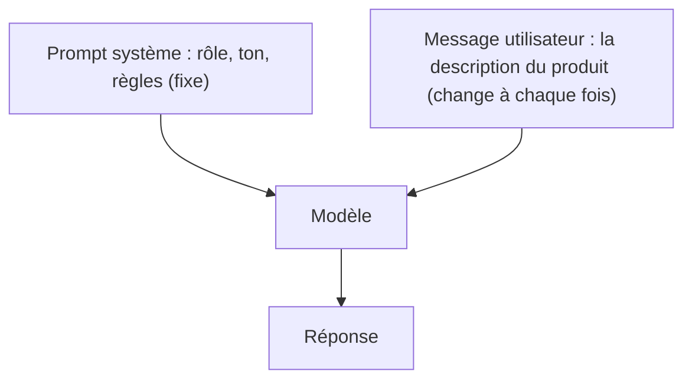
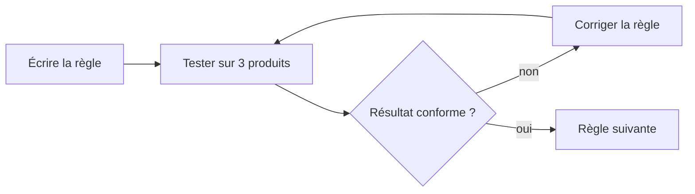

# Le prompt système

> [!NOTE]
> Dans cette leçon, vous allez écrire le **prompt système** de l'assistant de fiches produit : le texte qui fixe une fois pour toutes son rôle, son ton et ses interdits.

## Deux sortes de consignes

Jusqu'ici, tout tenait dans un seul message. Mais si l'on doit rappeler « ton chaleureux, 70 caractères maximum, n'invente rien » à chaque produit, on finit par l'oublier. Le **prompt système** (*system instructions* dans AI Studio) règle ce problème : il est envoyé avec **chaque** requête, avant le message de l'utilisateur.



| | Prompt système | Message utilisateur |
| --- | --- | --- |
| Qui l'écrit | vous, l'auteur de l'application | l'utilisateur ou vos données |
| Fréquence | identique pour toutes les requêtes | change à chaque requête |
| Contenu typique | rôle, public, ton, format, interdits | la tâche du moment |
| Dans AI Studio | champ « System instructions » | zone de saisie du chat |

## Les 5 ingrédients d'un bon prompt système

1. **Le rôle** : « Tu es rédacteur e-commerce pour une boutique en ligne française. »
2. **La tâche** : « À partir d'une description brute, tu rédiges une fiche produit. »
3. **Le format** : la liste des champs et leurs contraintes (longueur, nombre d'éléments).
4. **Le ton** : chaleureux, précis, vouvoiement…
5. **Les interdits** : le plus important pour une fiche produit, « N'invente AUCUNE caractéristique absente de la description ».

Voici celui du lab, tel qu'on le colle dans AI Studio :

```python title="files/fiche_produit.py"
SYSTEM_INSTRUCTION = """Tu es rédacteur e-commerce pour une boutique en ligne française.
À partir d'une description brute, tu rédiges une fiche produit :
- un titre de 70 caractères maximum, sans majuscules partout ;
- une accroche d'une phrase ;
- une description de 2 à 3 phrases, ton chaleureux et précis ;
- 3 à 5 points forts courts ;
- 3 à 6 mots-clés en minuscules pour le référencement.
N'invente AUCUNE caractéristique absente de la description (dimensions, matière, garantie...).
Si une information manque, n'en parle pas."""
```

> [!WARNING]
> Un modèle de langage complète du texte de façon **plausible**, pas forcément **vraie**. Sans interdit explicite, il peut « enrichir » une fiche avec une garantie de 2 ans ou une matière qui n'existe pas : on appelle cela une **hallucination**. Sur une fiche produit, c'est un vrai risque juridique. L'interdit dans le prompt réduit ce risque ; une relecture humaine reste nécessaire.

```quiz
question: "Où placer la règle « 70 caractères maximum pour le titre » ?"
options:
  - "Dans le prompt système, car elle s'applique à tous les produits"
  - "Dans chaque message utilisateur, à côté de la description"
  - "Nulle part : le modèle le devine"
answer: 0
explanation: "Une règle valable pour toutes les requêtes appartient au prompt système. Le message utilisateur ne contient que ce qui change : la description du produit."
```

```quiz
question: "Quels ingrédients manquent au prompt système « Écris des fiches produit sympas » ?"
options:
  - "Le format attendu"
  - "Les interdits (ne rien inventer)"
  - "Le rôle et le public visé"
  - "Rien, il est complet"
answer: [0, 1, 2]
explanation: "« Sympas » donne vaguement un ton, rien d'autre : ni rôle, ni format (champs, longueurs), ni interdits. Le modèle comblera ces trous à sa façon, différemment à chaque fois."
```

## Tester dans AI Studio

Collez le prompt système, puis envoyez une description courte. Changez une règle (par exemple « une accroche en forme de question ») et relancez : vous voyez immédiatement l'effet. C'est tout l'intérêt du prototypage : **itérer en secondes**, avant d'écrire une ligne de code.



## Résultat obtenu

Le 2026-10-15, la description « Décris en 2 phrases : coussin de sol en lin, 60 cm, déhoussable. » envoyée à `gemini-3.5-flash`, sans puis avec un prompt système court (« Tu es rédacteur e-commerce. Ton chaleureux, phrases courtes, tutoiement interdit, aucune caractéristique inventée. ») :

```text title="sans prompt système"
Ce coussin de sol en lin de 60 cm allie élégance naturelle et confort absolu pour aménager
un espace détente chaleureux. Pratique au quotidien, il est entièrement déhoussable pour un
entretien facile et rapide.
```

```text title="avec prompt système"
Ce coussin de sol en lin de 60 cm apporte une note douce et chaleureuse à votre intérieur.
Pratique au quotidien, il est entièrement déhoussable pour un entretien très facile.
```

La version avec prompt système est plus sobre (« confort absolu » disparaît, promesse invérifiable) et vouvoie le lecteur. Sur un exemple aussi simple l'écart est modeste ; il se creuse quand les descriptions sont plus pauvres et que le modèle est tenté de combler les vides.

## Exercice

Ajoutez au prompt système une règle pour que les fiches des produits destinés aux enfants mentionnent toujours l'âge minimum **si et seulement si** la description le donne. Rédigez la règle.

<details>
<summary>Voir la solution</summary>

```text title="règle à ajouter"
Si la description indique un âge minimum (par exemple « dès 3 ans »), cite-le dans les
points forts. Si elle ne l'indique pas, n'indique aucun âge.
```

La seconde phrase est essentielle : sans elle, le modèle risque d'inventer un âge « raisonnable ». Formulez toujours le cas où l'information **manque**.

</details>

## Je sais faire

- [ ] Distinguer prompt système et message utilisateur
- [ ] Écrire un prompt système avec rôle, tâche, format, ton et interdits
- [ ] Expliquer ce qu'est une hallucination et comment la limiter
- [ ] Itérer sur une règle dans AI Studio
