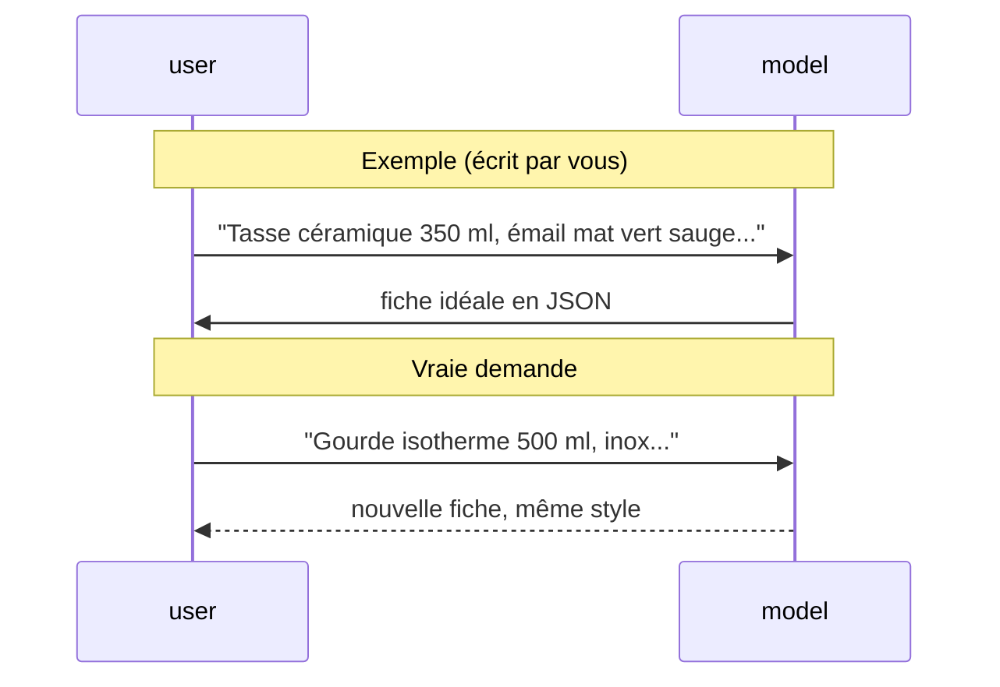

# Donner des exemples (few-shot)

> [!NOTE]
> Dans cette leçon, vous allez montrer au modèle **une fiche produit idéale**, pour qu'il imite son style et sa structure. C'est la technique du *few-shot prompting*.

## Montrer plutôt que décrire

Décrire un style (« chaleureux mais précis ») est difficile ; le montrer est facile. Un **exemple** est une paire « entrée → sortie attendue » que l'on place avant la vraie demande.

| Technique | Nombre d'exemples | Quand l'utiliser |
| --- | --- | --- |
| *zero-shot* | 0 | tâche simple, format libre |
| *one-shot* | 1 | fixer un format et un ton |
| *few-shot* | 2 à 5 | cas variés, style très particulier |



Le modèle voit une conversation où « il » a déjà répondu parfaitement une fois : il continue sur la même lancée.

## Dans AI Studio

Dans le chat, écrivez une description d'exemple, puis **modifiez** la réponse du modèle (AI Studio permet d'éditer un tour de conversation) pour qu'elle soit exactement la fiche que vous voulez. Les tours suivants s'appuieront dessus.

## Dans le code du lab

Les exemples deviennent des tours `user` / `model` placés avant la demande :

```python title="files/fiche_produit.py"
EXEMPLES = [
    (
        "Tasse céramique 350 ml, émail mat vert sauge, passe au lave-vaisselle",
        {
            "titre": "Tasse en céramique 350 ml, émail mat vert sauge",
            "accroche": "Votre boisson chaude préférée mérite une jolie tasse.",
            ...
        },
    ),
]

def build_contents(description: str) -> list[types.Content]:
    """Les exemples deviennent des tours user/model, puis vient la vraie demande."""
    contents = []
    for entree, sortie in EXEMPLES:
        contents.append(types.Content(role="user", parts=[types.Part(text=entree)]))
        contents.append(types.Content(role="model", parts=[
            types.Part(text=json.dumps(sortie, ensure_ascii=False))]))
    contents.append(types.Content(role="user", parts=[types.Part(text=description)]))
    return contents
```

Code complet : [fiche_produit.py](../files/fiche_produit.py).

> [!TIP]
> Un exemple doit respecter **toutes** vos règles : si votre exemple contient un titre de 90 caractères, le modèle en déduira que 90 est acceptable, quoi que dise le prompt système. Les exemples pèsent souvent plus lourd que les consignes.

> [!WARNING]
> Ne prenez pas un exemple trop proche des vraies demandes (trois tasses d'affilée) : le modèle risque de recopier des tournures (« mérite une jolie tasse ») sur des produits qui n'ont rien à voir. Variez les catégories.

```quiz
question: "Votre exemple de fiche contient « Garantie 2 ans » alors que la description d'exemple n'en parle pas. Quel risque ?"
options:
  - "Aucun, le prompt système interdit d'inventer"
  - "Le modèle peut apprendre qu'ajouter une garantie est normal, et en inventer sur les vrais produits"
  - "L'API refuse la requête"
answer: 1
explanation: "L'exemple contredit l'interdit du prompt système. Face à cette contradiction, le modèle imite souvent l'exemple. Un exemple doit être irréprochable."
```

```quiz
question: "Dans la liste contents envoyée à l'API, dans quel ordre apparaissent les éléments ?"
options:
  - "Vraie demande, puis exemples"
  - "Exemple user, exemple model, puis vraie demande user"
  - "Exemples model uniquement"
answer: 1
explanation: "On reconstitue une conversation : la question d'exemple, la réponse idéale, puis la vraie question. Le modèle répond au dernier tour user."
```

## Résultat obtenu

Le 2026-10-15, avec un seul exemple (la tasse), `gemini-3.5-flash` a produit pour la gourde une fiche de **même structure** et de même ton, et n'a repris que les caractéristiques fournies (extrait) :

```json title="sortie"
{
  "titre": "Gourde isotherme en inox 500 ml avec bouchon anti-fuite",
  "accroche": "Emportez vos boissons chaudes ou froides partout avec vous en toute sérénité.",
  "points_forts": [
    "Contenance de 500 ml",
    "Conception en inox",
    "Garde le froid 24 h et le chaud 12 h",
    "Bouchon anti-fuite"
  ]
}
```

Comme dans l'exemple, les points forts reprennent un à un les éléments de la description, sans garantie ni dimension inventées.

## Exercice

Ajoutez à `EXEMPLES` un deuxième exemple, d'une catégorie différente (textile, par exemple), qui montre le cas d'une description **pauvre** (« Tee-shirt coton bio, blanc »). À quoi ressemble la fiche idéale ?

<details>
<summary>Voir la solution</summary>

```python title="files/fiche_produit.py (ajout)"
EXEMPLES.append((
    "Tee-shirt coton bio, blanc",
    {
        "titre": "Tee-shirt blanc en coton bio",
        "accroche": "Un basique tout simple, en coton bio.",
        "description": "Ce tee-shirt blanc est confectionné en coton bio. "
                       "Un indispensable facile à associer.",
        "points_forts": ["Coton bio", "Coloris blanc", "Basique polyvalent"],
        "mots_cles": ["tee-shirt", "coton bio", "blanc"],
    },
))
```

La fiche reste **courte** : pas de taille, de grammage ni de coupe, puisque la description n'en parle pas. Cet exemple apprend au modèle qu'une fiche brève vaut mieux qu'une fiche inventée.

</details>

## Je sais faire

- [ ] Expliquer zero-shot, one-shot et few-shot
- [ ] Construire des exemples sous forme de tours user / model
- [ ] Vérifier qu'un exemple respecte toutes les règles du prompt système
- [ ] Choisir des exemples variés, dont un cas difficile
