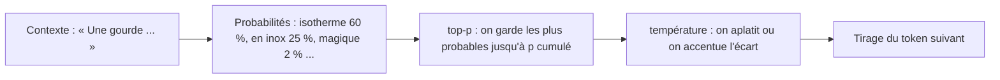

# Température et top-p

> [!NOTE]
> Dans cette leçon, vous allez comprendre les curseurs du panneau **Run settings** d'AI Studio (température, top-p, longueur maximale), voir ce qu'ils changent vraiment et savoir quand **ne pas** y toucher.

## Comment un modèle choisit le mot suivant

À chaque étape, le modèle calcule une probabilité pour chaque token possible, puis en **tire un au sort** selon ces probabilités. C'est ce tirage, appelé **échantillonnage** (*sampling*), que règlent les curseurs.



| Paramètre | Ce qu'il fait | Valeur basse | Valeur haute |
| --- | --- | --- | --- |
| **température** | aplatit (haute) ou accentue (basse) les écarts de probabilité | réponses prudentes et répétables | réponses variées, parfois farfelues |
| **top-p** | ne garde que les tokens les plus probables dont la somme atteint p | vocabulaire restreint | vocabulaire large |
| **longueur maximale** (*max output tokens*) | coupe la réponse au-delà de N tokens | réponses tronquées si trop bas | aucun effet si la réponse est courte |

Exemple : avec top-p = 0,9, si « isotherme » (60 %) et « en inox » (25 %) totalisent déjà 85 %, on ajoute le suivant pour dépasser 90 %, et tous les autres sont écartés.

## Ce que dit la documentation (important)

> [!WARNING]
> Selon la [documentation de l'API Gemini](https://ai.google.dev/gemini-api/docs/text-generation) consultée le 2026-10-15, les modèles **Gemini 3.6 et suivants ignorent** les valeurs personnalisées de température, top-p et top-k (et renverront une erreur 400 dans une version future). Pour les modèles Gemini 3 antérieurs, comme `gemini-3.5-flash`, la documentation recommande de **garder les valeurs par défaut** pour ne pas dégrader le raisonnement. Ces curseurs restent utiles avec les générations précédentes (`gemini-2.5-flash`).

Pourquoi ce changement ? Les modèles récents **réfléchissent** avant de répondre (les tokens de pensée vus en leçon 1) : leur qualité dépend d'un échantillonnage réglé par Google. Le levier de créativité devient alors **le prompt** : « propose trois variantes très différentes » marche mieux qu'un curseur.

C'est pourquoi le lab n'envoie la température et le top-p **que si vous les définissez** :

```python title="files/fiche_produit.py"
def reglages_echantillonnage() -> dict:
    """Température et top-p, seulement si TEMPERATURE / TOP_P sont définies.
    Gemini 3.6+ les ignore ; pour Gemini 3 et 3.5, la doc conseille les valeurs par défaut."""
    noms = {"temperature": "TEMPERATURE", "top_p": "TOP_P"}
    return {cle: float(os.environ[var]) for cle, var in noms.items() if os.environ.get(var)}
```

```quiz
question: "Vous voulez des accroches plus originales avec gemini-3.5-flash. Quelle approche suit la documentation ?"
options:
  - "Monter la température à 2"
  - "Garder les réglages par défaut et demander explicitement dans le prompt des variantes originales et différentes"
  - "Baisser top-p à 0,1"
answer: 1
explanation: "Pour les modèles Gemini 3, la documentation conseille de garder température et top-p par défaut. La variété s'obtient par la consigne. Baisser top-p ferait l'inverse : un vocabulaire plus restreint."
```

```quiz
question: "Avec un modèle plus ancien qui respecte la température, quelle valeur choisir pour extraire des dates d'un contrat ?"
options:
  - "Basse (proche de 0)"
  - "Haute (proche de 2)"
  - "Peu importe"
answer: 0
explanation: "Une extraction a une seule bonne réponse : on veut le tirage le plus prudent. Une température haute sert la créativité (slogans, idées), pas la fidélité."
```

## Température 0 ne veut pas dire « toujours la même réponse »

On lit souvent qu'une température de 0 rend le modèle **déterministe** (même entrée, même sortie). Notre essai montre que ce n'est pas garanti avec un modèle qui réfléchit.

## Résultat obtenu

Le 2026-10-15, le prompt « Propose un nom de marque original (un seul mot) pour une gamme de bougies parfumées » envoyé 3 fois à `gemini-3.5-flash` avec chaque température :

```text title="sortie"
température 0.0  ->  Luminora | Velume | Lumora
température 1.5  ->  Olfaya   | Lumora | Veluma
```

Avec 0, on obtient tout de même trois noms différents ; avec 1,5, pas d'explosion de créativité non plus. Conclusion pratique : sur ces modèles, ne comptez ni sur la température pour figer une réponse, ni sur elle pour la rendre originale. Pour la répétabilité, on **stocke** la réponse validée ; pour l'originalité, on **demande** plusieurs variantes.

## Exercice

Dans AI Studio, avec `gemini-3.5-flash` et les réglages par défaut, obtenez **cinq** noms de marque très différents les uns des autres en un seul appel. Écrivez le prompt.

<details>
<summary>Voir la solution</summary>

```text title="prompt"
Propose 5 noms de marque pour une gamme de bougies parfumées.
Contraintes : un seul mot chacun, 5 à 8 lettres, prononçables en français,
et chaque nom doit évoquer une idée différente (lumière, nature, voyage, douceur, mystère).
Réponds par une liste numérotée, sans commentaire.
```

Imposer une **idée différente par nom** force la diversité bien plus sûrement qu'une température élevée : le modèle ne peut pas proposer cinq variations de « Lumora ».

</details>

## Je sais faire

- [ ] Expliquer l'échantillonnage, la température et le top-p avec mes mots
- [ ] Savoir que Gemini 3.6+ ignore ces paramètres et que Gemini 3 / 3.5 doit garder les défauts
- [ ] Obtenir de la variété par le prompt plutôt que par les curseurs
- [ ] Ne pas compter sur « température 0 » pour obtenir toujours la même réponse
