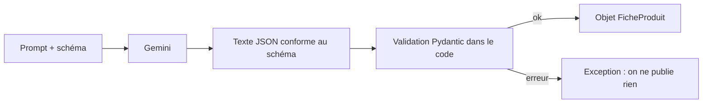

# Des sorties JSON exploitables

> [!NOTE]
> Dans cette leçon, vous allez obliger le modèle à répondre dans un **format JSON précis**, pour que les fiches produit s'importent directement dans un site ou un tableur, sans copier-coller.

## Pourquoi du JSON ?

Un texte libre se lit bien mais se traite mal : où commence le titre, où finissent les points forts ? **JSON** (*JavaScript Object Notation*) est un format texte structuré, lisible par tous les langages :

```json title="une fiche en JSON"
{"titre": "Gourde isotherme en inox 500 ml", "points_forts": ["500 ml", "Inox"]}
```

Demander « réponds en JSON » dans le prompt ne suffit pas toujours : le modèle peut ajouter une phrase avant, oublier un champ ou en inventer un. La **sortie structurée** (*structured output*) règle cela : on fournit un **schéma** (la liste des champs et de leurs types) et l'API contraint la génération à le respecter.



| Méthode | Garantie de format | Effort |
| --- | --- | --- |
| « Réponds en JSON » dans le prompt | faible | nul |
| Type de réponse `application/json` | JSON valide, champs libres | un réglage |
| `application/json` **+ schéma** | JSON valide **et** champs imposés | décrire le schéma |

## Dans AI Studio

Activez **Structured output** dans le panneau des réglages, puis éditez le schéma (AI Studio propose un éditeur visuel et un éditeur de code). Déclarez les cinq champs : `titre`, `accroche`, `description` (textes) et `points_forts`, `mots_cles` (listes de textes).

## Dans le code du lab

En Python, on décrit le schéma avec **Pydantic**, une bibliothèque qui définit des structures de données typées. Le même objet sert deux fois : pour dire à Gemini quoi produire, puis pour vérifier ce qu'il a produit.

```python title="files/fiche_produit.py"
class FicheProduit(BaseModel):
    titre: str = Field(description="70 caractères maximum")
    accroche: str
    description: str
    points_forts: list[str]
    mots_cles: list[str]

def build_config() -> types.GenerateContentConfig:
    return types.GenerateContentConfig(
        system_instruction=SYSTEM_INSTRUCTION,
        max_output_tokens=4096,
        **reglages_echantillonnage(),
        response_mime_type="application/json",
        response_schema=FicheProduit,
    )
```

Puis, après l'appel : `FicheProduit.model_validate_json(response.text)`. Si un champ manque, Pydantic lève une exception : mieux vaut une erreur visible qu'une fiche à moitié vide publiée en silence. Code complet : [fiche_produit.py](../files/fiche_produit.py).

> [!TIP]
> Le schéma garantit la **forme**, pas le **fond** : il assure qu'il y a bien un champ `titre`, pas que ce titre fait moins de 70 caractères ni qu'il est vrai. Gardez les règles de contenu dans le prompt système et, si elles sont critiques, vérifiez-les dans le code (`len(fiche.titre) <= 70`).

> [!WARNING]
> Gardez les schémas **simples** : quelques champs, peu d'imbrication. Un schéma très profond ou très long peut ralentir fortement la génération, voire la faire échouer. Nous l'avons constaté le 2026-10-15 sur Vertex AI avec un autre modèle (voir la formation suivante).

```quiz
question: "Le schéma impose points_forts: list[str]. Que garantit-il ?"
options:
  - "Qu'il y aura entre 3 et 5 points forts"
  - "Que le champ points_forts existera et contiendra une liste de textes"
  - "Que les points forts sont exacts"
answer: 1
explanation: "Le schéma garantit la structure (présence et type du champ). Le nombre d'éléments et l'exactitude relèvent du prompt et des vérifications dans le code."
```

```quiz
question: "Pourquoi valider la réponse avec Pydantic alors que l'API applique déjà le schéma ?"
options:
  - "Pour obtenir un objet Python typé et détecter tout écart (réponse tronquée, champ manquant) avant de publier"
  - "Parce que l'API ignore toujours le schéma"
  - "Ce n'est pas utile"
answer: 0
explanation: "Une réponse peut être coupée (limite de tokens) ou vide (filtre de sécurité). La validation transforme ces cas en erreur claire et donne un objet facile à manipuler."
```

## Résultat obtenu

Une des trois fiches produites par le lab le 2026-10-15 (`gemini-3.5-flash`, schéma `FicheProduit`), directement exploitable :

```json title="sortie"
{
  "titre": "Plaid en laine recyclée 130 x 170 cm à motif chevrons",
  "accroche": "Ajoutez une note chaleureuse et élégante à votre intérieur avec ce plaid doux.",
  "description": "Confectionné en laine recyclée, ce plaid de 130 x 170 cm allie confort et démarche écoresponsable. Son motif à chevrons aux tons gris et moutarde apporte une touche moderne à votre décoration. Très facile à vivre, il est directement lavable en machine à 30 degrés.",
  "points_forts": ["En laine recyclée", "Dimensions 130 x 170 cm", "Motif chevrons gris et moutarde", "Lavable à 30 degrés"],
  "mots_cles": ["plaid", "laine recyclée", "chevrons", "moutarde", "gris"]
}
```

Le titre fait 53 caractères : la règle des 70 est respectée, mais c'est le prompt qui l'a obtenue, pas le schéma.

## Exercice

Ajoutez au schéma un champ `categorie` qui ne peut prendre que trois valeurs : `maison`, `sport`, `bureau`. Comment l'écrire avec Pydantic ?

<details>
<summary>Voir la solution</summary>

```python title="files/fiche_produit.py (modification)"
from typing import Literal

class FicheProduit(BaseModel):
    titre: str = Field(description="70 caractères maximum")
    accroche: str
    description: str
    points_forts: list[str]
    mots_cles: list[str]
    categorie: Literal["maison", "sport", "bureau"]
```

`Literal` devient une **énumération** (`enum`) dans le schéma envoyé à Gemini : le modèle ne peut choisir qu'une des trois valeurs. Pensez à ajouter `categorie` à l'exemple de `EXEMPLES` (la tasse : `maison`), sinon l'exemple ne respecte plus le schéma.

</details>

## Je sais faire

- [ ] Expliquer pourquoi un format JSON imposé vaut mieux qu'un texte libre
- [ ] Activer la sortie structurée dans AI Studio et décrire un schéma
- [ ] Écrire le même schéma avec Pydantic et valider la réponse
- [ ] Distinguer ce que garantit le schéma (forme) de ce qu'il ne garantit pas (fond)
