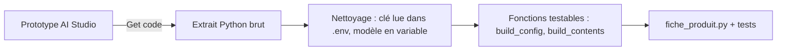

# Exporter le code

> [!NOTE]
> Dans cette leçon, vous allez passer du prototype AI Studio à un vrai script Python : récupérer le code avec **Get code**, installer la bibliothèque, ranger la clé et lancer le script sur votre machine.

## Du bouton au fichier

Le bouton **Get code** d'AI Studio affiche le code qui rejoue **exactement** votre prototype (modèle, prompt système, exemples, réglages, schéma), en plusieurs langages : Python, JavaScript, REST (`curl`)…



L'extrait généré est un bon point de départ, mais pas un programme fini : tout est dans une seule fonction, le texte de la description est en dur, et il n'y a ni test ni gestion d'erreurs. Le lab [fiche_produit.py](../files/fiche_produit.py) est cet extrait **réorganisé** :

| Dans AI Studio | Dans le code exporté | Dans le lab |
| --- | --- | --- |
| choix du modèle | `model="..."` en dur | `MODEL = os.environ.get("MODEL", "gemini-3.5-flash")` |
| System instructions | `system_instruction=[...]` | constante `SYSTEM_INSTRUCTION` |
| tours d'exemple | liste `contents` | `EXEMPLES` + `build_contents()` |
| Run settings | `GenerateContentConfig(...)` | `build_config()` |
| Structured output | schéma `genai.types.Schema(...)` | classe Pydantic `FicheProduit` |

## Installer et configurer

```bash title="terminal"
python3 -m venv .venv && source .venv/bin/activate   # un environnement isolé
pip install -r requirements.txt                       # google-genai, pydantic, python-dotenv, pytest
cp .env.example .env                                  # puis collez votre clé dans .env
```

Le fichier `.env` ne contient qu'une ligne utile (les fichiers dont le nom commence par un point peuvent manquer dans certains téléchargements : créez-le alors à la main) :

```bash title=".env"
GEMINI_API_KEY=votre-cle-ai-studio-ici
```

Un **environnement virtuel** (`venv`) est un dossier qui contient les bibliothèques d'un seul projet, pour ne pas mélanger les versions entre projets. Le paquet **`google-genai`** est le SDK officiel (*Software Development Kit*, la bibliothèque cliente) de l'API Gemini.

## Le cœur du script

```python title="files/fiche_produit.py"
def rediger_fiche(client, description: str, essais: int = 4) -> FicheProduit:
    """Appelle Gemini et renvoie une fiche validée. Réessaie sur 429 / 5xx."""
    description = description.strip()
    if not description:
        raise ValueError("Description vide")
    for essai in range(essais):
        try:
            response = client.models.generate_content(
                model=MODEL, contents=build_contents(description), config=build_config())
            return FicheProduit.model_validate_json(response.text)
        except errors.APIError as e:
            if e.code not in (429, 500, 503) or essai == essais - 1:
                raise
            time.sleep(2 ** essai * 5)  # 5 s, 10 s, 20 s
```

Et dans `main()` : `load_dotenv()` charge le fichier `.env`, puis `genai.Client()` trouve tout seul la variable `GEMINI_API_KEY`. Aucune clé n'apparaît dans le code.

> [!WARNING]
> L'extrait généré par AI Studio peut contenir `api_key=os.environ.get("GEMINI_API_KEY")` : c'est correct. En revanche, ne remplacez **jamais** cette ligne par la clé elle-même « pour tester vite ». C'est ainsi que la plupart des clés fuient.

> [!TIP]
> Recevoir le `client` en paramètre de `rediger_fiche` (au lieu de le créer dedans) permet de lui passer un **faux client** dans les tests : on teste toute la logique sans clé, sans réseau et sans coût. C'est ce que fait [test_fiche_produit.py](../files/test_fiche_produit.py).

```quiz
question: "Que fait genai.Client() sans argument ?"
options:
  - "Il demande la clé dans le terminal"
  - "Il lit la clé dans les variables d'environnement (GEMINI_API_KEY ou GOOGLE_API_KEY)"
  - "Il utilise une clé publique de démonstration"
answer: 1
explanation: "Le SDK cherche la clé dans l'environnement. load_dotenv() y a copié le contenu du fichier .env juste avant."
```

```quiz
question: "Pourquoi le nom du modèle vient-il d'une variable d'environnement MODEL ?"
options:
  - "Pour changer de modèle (essai de flash-lite, nouveau modèle) sans modifier le code"
  - "Parce que l'API l'exige"
  - "Pour cacher le nom du modèle"
answer: 0
explanation: "Les modèles évoluent vite. Un paramètre externe permet de comparer ou de migrer en changeant une ligne du .env, avec un défaut raisonnable dans le code."
```

## Résultat obtenu

Exécution réelle du lab le 2026-10-15 sur une description (extrait) :

```bash title="terminal"
python fiche_produit.py "Gourde isotherme 500 ml, inox, garde le froid 24 h et le chaud 12 h, bouchon anti-fuite"
```

```json title="sortie"
[
  {
    "titre": "Gourde isotherme en inox 500 ml avec bouchon anti-fuite",
    "accroche": "Emportez vos boissons chaudes ou froides partout avec vous en toute sérénité.",
    "description": "Fabriquée en inox, cette gourde isotherme de 500 ml conserve vos boissons au chaud pendant 12 heures et au froid pendant 24 heures. Son bouchon anti-fuite vous assure un transport sans risque au quotidien.",
    ...
  }
]
```

## Exercice

Ajoutez une option `--modele` à la ligne de commande, qui remplace `MODEL` pour cette exécution seulement. Quelles lignes modifier ?

<details>
<summary>Voir la solution</summary>

```python title="files/fiche_produit.py (modification de main)"
parser.add_argument("--modele", help="nom du modèle, remplace MODEL")
args = parser.parse_args(argv)
if args.modele:
    global MODEL
    MODEL = args.modele
```

La déclaration `global MODEL` doit être la première instruction de `main()` qui mentionne `MODEL` (placez-la en tête de fonction). Plus propre encore : passer `model` en paramètre de `rediger_fiche`. Pour un script de cette taille, la variable d'environnement (`MODEL=gemini-3.5-flash-lite python fiche_produit.py ...`) suffit souvent.

</details>

## Je sais faire

- [ ] Récupérer le code d'un prototype avec Get code
- [ ] Créer un environnement virtuel et installer `google-genai`
- [ ] Faire lire la clé depuis `.env` sans l'écrire dans le code
- [ ] Réorganiser l'extrait en fonctions testables
