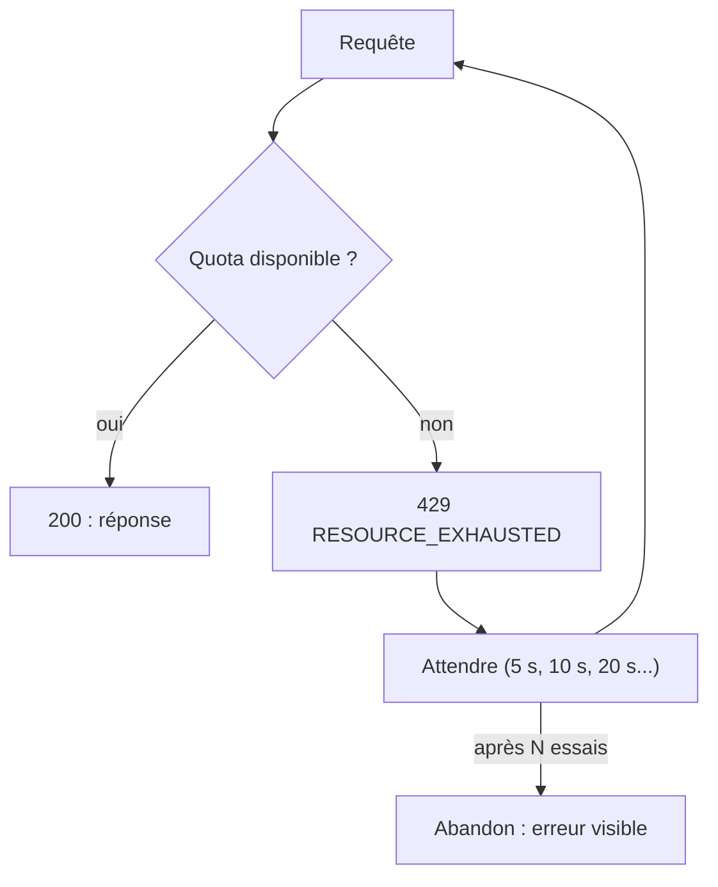

# Limites, quotas et bonnes pratiques

> [!NOTE]
> Dans cette leçon, vous allez découvrir les limites qui s'appliquent à votre clé (quotas, coûts, confidentialité), reconnaître les erreurs les plus courantes et savoir y réagir.

## Les quotas : combien, à quelle vitesse

Chaque clé est soumise à des **limites de débit** (*rate limits*), qui dépendent du modèle et de votre niveau (gratuit ou payant) :

| Sigle | Signification | Exemple de dépassement |
| --- | --- | --- |
| **RPM** | requêtes par minute | lancer 200 fiches en parallèle |
| **TPM** | tokens par minute (entrée) | envoyer de gros documents d'affilée |
| **RPD** | requêtes par jour | traiter tout le catalogue d'un coup sur le niveau gratuit |

Les valeurs exactes changent régulièrement : consultez la page [Rate limits](https://ai.google.dev/gemini-api/docs/rate-limits) et l'onglet d'utilisation d'AI Studio plutôt qu'un chiffre recopié dans un cours.



## Les erreurs à connaître

| Code | Signification | Que faire |
| --- | --- | --- |
| **400** `INVALID_ARGUMENT` | requête mal formée, ou clé invalide | corriger ; **ne pas** réessayer |
| **403** `PERMISSION_DENIED` | clé sans droit sur ce service | vérifier la clé et son projet |
| **404** `NOT_FOUND` | nom de modèle inconnu | vérifier `MODEL` |
| **429** `RESOURCE_EXHAUSTED` | quota dépassé | attendre puis réessayer |
| **500** / **503** | incident ou surcharge côté serveur | attendre puis réessayer |

Le lab applique exactement cette règle : il réessaie sur 429, 500 et 503 avec une **attente exponentielle** (qui double à chaque essai), et abandonne immédiatement sur les autres codes. Ces deux cas sont vérifiés sans clé par `test_reessaie_sur_429` et `test_ne_reessaie_pas_sur_400` dans [test_fiche_produit.py](../files/test_fiche_produit.py).

> [!WARNING]
> Réessayer une erreur 400 en boucle ne sert à rien : la requête est fausse, elle le restera. Pire, une boucle sans limite sur un 429 aggrave la saturation. Toujours : liste fermée de codes, nombre d'essais maximal, attente croissante.

## Coût et confidentialité

- **Coût** : au niveau payant, on paie les tokens d'entrée et de sortie, et les tokens de **pensée** sont facturés comme de la sortie. Les prix par million de tokens sont sur la page [Tarifs](https://ai.google.dev/gemini-api/docs/pricing). Pour estimer un lot, multipliez la consommation d'une fiche (lisible dans `response.usage_metadata`) par le nombre de produits.
- **Confidentialité** : les conditions d'utilisation diffèrent entre niveau gratuit et niveau payant, notamment sur l'usage des contenus envoyés pour améliorer les produits de Google. Lisez-les avant d'envoyer des données internes ; n'envoyez jamais de données personnelles de clients dans un prototype.

> [!TIP]
> Pour un gros catalogue, traitez les produits **en série** avec une petite pause, ou par lots de quelques-uns, plutôt que tous en même temps : vous restez sous les RPM et les erreurs 429 deviennent rares.

```quiz
question: "Votre script reçoit 400 INVALID_ARGUMENT « API key not valid ». Que doit-il faire ?"
options:
  - "Réessayer 10 fois avec une attente croissante"
  - "S'arrêter avec un message clair : la clé est à corriger"
  - "Passer silencieusement au produit suivant"
answer: 1
explanation: "Une clé invalide ne deviendra pas valide en attendant. Le programme doit s'arrêter et dire pourquoi."
```

```quiz
question: "Quelles erreurs justifient un nouvel essai après une attente ?"
options:
  - "429"
  - "503"
  - "404"
  - "400"
answer: [0, 1]
explanation: "429 (quota) et 503 (surcharge) sont temporaires. 404 (modèle inconnu) et 400 (requête invalide) demandent une correction."
```

## Résultat obtenu

Deux erreurs provoquées volontairement le 2026-10-15, pour reconnaître leur message (extraits) :

```text title="clé invalide"
400 INVALID_ARGUMENT. {'error': {'code': 400, 'message': 'API key not valid. Please pass a valid API key.',
'status': 'INVALID_ARGUMENT', 'details': [{... 'reason': 'API_KEY_INVALID' ...}]}}
```

```text title="modèle inconnu"
404 NOT_FOUND. {'error': {'code': 404, 'message': 'models/gemini-modele-inexistant is not found for API
version v1beta, or is not supported for generateContent. Call ModelService.ListModels to see the list of
available models and their supported methods.', 'status': 'NOT_FOUND'}}
```

Et la consommation d'un appel simple (un slogan, leçon 1) : `prompt=18 out=17 thoughts=907`. Sur ce modèle, la pensée domine largement le coût des petites tâches.

## Exercice

Vous devez générer 2 000 fiches cette nuit sur une clé dont le quota est, par exemple, de 60 requêtes par minute. Combien de temps faut-il au minimum, et comment organiser le script ?

<details>
<summary>Voir la solution</summary>

2 000 requêtes à 60 par minute : au moins **34 minutes** environ (2 000 / 60 ≈ 33,3). Organisation :

- traiter les produits **un par un** (ou par petits lots), avec une pause d'environ 1 seconde entre deux appels ;
- garder les réessais sur 429 / 5xx, au cas où d'autres programmes partagent la clé ;
- **écrire chaque fiche dès qu'elle est prête** (une ligne par fiche dans un fichier), pour pouvoir reprendre là où l'on s'est arrêté en cas d'abandon.

Le chiffre de 60 n'est qu'un exemple : lisez votre vrai quota dans AI Studio.

</details>

## Je sais faire

- [ ] Expliquer RPM, TPM et RPD
- [ ] Reconnaître les codes 400, 404, 429 et 503 et savoir lesquels réessayer
- [ ] Estimer le coût d'un lot à partir de `usage_metadata`
- [ ] Vérifier les conditions d'utilisation avant d'envoyer des données réelles
