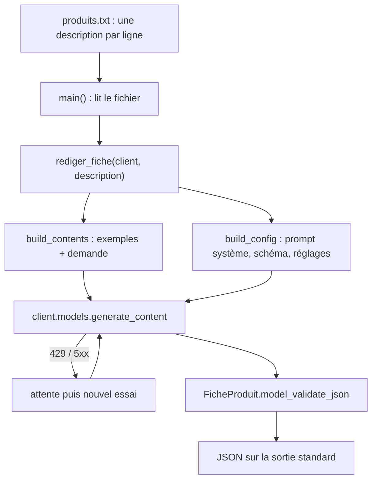

# L'assistant de fiches produit, de bout en bout

> [!NOTE]
> Dans cette leçon, vous allez assembler toutes les briques, lancer les tests sans clé, puis générer les fiches d'un petit catalogue avec le vrai modèle. À la fin, vous aurez un outil réutilisable et une méthode pour le faire évoluer.

## L'architecture complète



| Fichier | Rôle |
| --- | --- |
| [fiche_produit.py](../files/fiche_produit.py) | le script : prompt, exemples, schéma, appel, réessais, ligne de commande |
| [test_fiche_produit.py](../files/test_fiche_produit.py) | 8 tests avec un faux client, sans clé ni réseau |
| [produits.txt](../files/produits.txt) | 3 descriptions fictives pour l'essai |
| [requirements.txt](../files/requirements.txt) | les dépendances |
| `files/.env.example` | modèle de fichier `.env` (valeurs factices) |

## Étape 1 : les tests, sans clé

Un **test automatisé** est une petite fonction qui vérifie un comportement et échoue bruyamment s'il change. Ici, un **faux client** (*mock*) imite `client.models.generate_content` : il renvoie une réponse préparée à l'avance, ou lève une erreur 429 pour simuler un quota dépassé.

```python title="files/test_fiche_produit.py"
def test_reessaie_sur_429(monkeypatch):
    monkeypatch.setattr(fp.time, "sleep", lambda s: None)   # pas de vraie attente
    quota = errors.ClientError(429, {"error": {"message": "quota", "status": "RESOURCE_EXHAUSTED"}})
    client = fake_client(quota, json.dumps(FICHE))
    assert fp.rediger_fiche(client, "Gourde").titre
    assert len(client.models.appels) == 2                   # un échec, puis un succès
```

```bash title="terminal"
pytest -q
```

## Étape 2 : le vrai modèle

```bash title="terminal"
cp .env.example .env        # puis collez votre clé dans .env
python fiche_produit.py --fichier produits.txt > fiches.json
```

> [!TIP]
> Commencez toujours par 3 à 5 produits, relisez les fiches, ajustez le prompt ou les exemples, **puis** lancez le catalogue entier. Corriger un prompt coûte quelques secondes ; corriger 2 000 fiches publiées coûte une semaine.

> [!WARNING]
> Une fiche générée reste un **brouillon**. Avant publication, une personne vérifie au minimum les chiffres (dimensions, durées, contenances), qui engagent la boutique vis-à-vis de ses clients.

```quiz
question: "Pourquoi les tests utilisent-ils un faux client plutôt que la vraie API ?"
options:
  - "Pour tester la logique (exemples, validation, réessais) sans clé, sans réseau, sans coût et de façon répétable"
  - "Parce que la vraie API ne fonctionne pas avec pytest"
  - "Pour vérifier la qualité rédactionnelle des fiches"
answer: 0
explanation: "Le faux client rend les tests rapides et déterministes. La qualité des fiches, elle, se juge en lançant le vrai modèle sur des exemples et en les relisant."
```

```quiz
question: "Une fiche affiche « garantie 5 ans » alors que la description n'en parle pas. Par quoi commencer ?"
options:
  - "Vérifier que l'interdit est bien dans le prompt système et que les exemples ne contiennent pas d'information inventée"
  - "Changer de modèle immédiatement"
  - "Supprimer le schéma JSON"
answer: 0
explanation: "Une invention vient souvent d'un prompt flou ou d'un exemple qui contredit la règle. On corrige la consigne, on rejoue les 3 à 5 produits de test, puis seulement on envisage un autre modèle."
```

## Résultat obtenu

Exécution réelle le 2026-10-15. D'abord les tests :

```text title="pytest -v (extrait)"
test_fiche_produit.py::test_config_reprend_le_prototype PASSED           [ 12%]
test_fiche_produit.py::test_temperature_et_top_p_optionnels PASSED       [ 25%]
test_fiche_produit.py::test_exemples_puis_demande PASSED                 [ 37%]
test_fiche_produit.py::test_rediger_fiche_valide_le_json PASSED          [ 50%]
test_fiche_produit.py::test_json_incomplet_refuse PASSED                 [ 62%]
test_fiche_produit.py::test_description_vide_refusee PASSED              [ 75%]
test_fiche_produit.py::test_reessaie_sur_429 PASSED                      [ 87%]
test_fiche_produit.py::test_ne_reessaie_pas_sur_400 PASSED               [100%]
============================== 8 passed in 0.30s ===============================
```

Puis le catalogue de 3 produits avec `gemini-3.5-flash` (troisième fiche, environ 18 secondes pour les trois) :

```json title="fiches.json (extrait)"
{
  "titre": "Lampe de bureau LED à bras articulé et port USB-C",
  "accroche": "Illuminez efficacement votre espace de travail au quotidien.",
  "description": "Cette lampe de bureau LED est dotée d'un bras articulé pour orienter la lumière à votre convenance. Elle propose 3 températures de couleur afin de personnaliser votre éclairage selon vos besoins. Son port USB-C intégré apporte une praticité appréciable au quotidien.",
  "points_forts": ["Bras articulé pratique", "3 températures de couleur", "Port USB-C intégré"],
  "mots_cles": ["lampe de bureau", "led", "bras articule", "usb-c"]
}
```

Les trois fiches respectent le schéma et n'ajoutent aucune caractéristique absente des descriptions. Un défaut à corriger : le mot-clé « bras articule » a perdu son accent. C'est typiquement le genre de détail qu'on règle par une règle (« garde les accents dans les mots-clés ») puis un nouvel essai.

## Exercice final

Faites évoluer l'assistant : (1) ajoutez la règle sur les accents, (2) vérifiez dans le code que chaque titre fait au plus 70 caractères et, sinon, levez une erreur, (3) ajoutez le test correspondant.

<details>
<summary>Voir la solution</summary>

```python title="files/fiche_produit.py (modifications)"
SYSTEM_INSTRUCTION += "\nGarde les accents dans les mots-clés."

def rediger_fiche(client, description: str, essais: int = 4) -> FicheProduit:
    ...
            fiche = FicheProduit.model_validate_json(response.text)
            if len(fiche.titre) > 70:
                raise ValueError(f"Titre trop long ({len(fiche.titre)} caractères)")
            return fiche
```

```python title="files/test_fiche_produit.py (ajout)"
def test_titre_trop_long_refuse():
    longue = dict(FICHE, titre="x" * 71)
    with pytest.raises(ValueError):
        fp.rediger_fiche(fake_client(json.dumps(longue)), "Gourde")
```

La règle du prompt **réduit** le problème ; la vérification dans le code le **garantit**. Le test empêche qu'un futur changement retire cette garantie sans que personne ne s'en aperçoive.

</details>

## Pour aller plus loin

Prochaine étape : [Premiers pas avec l'API Gemini en Python](../../02-premiers-pas-api-gemini-python/index.md), pour maîtriser le streaming, les conversations, le comptage des tokens et le passage à Vertex AI sur Google Cloud.

## Je sais faire

- [ ] Lancer les tests du lab sans clé
- [ ] Générer les fiches d'un fichier de descriptions avec le vrai modèle
- [ ] Repérer un défaut dans une sortie et le corriger par le prompt ou par le code
- [ ] Ajouter une vérification et son test
