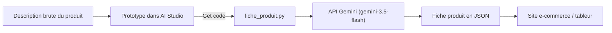

Vous avez une idée d'application IA, mais pas encore de code ? **Google AI Studio** est un atelier web gratuit où l'on teste un modèle Gemini en quelques minutes : on écrit une consigne, on règle quelques curseurs, on regarde le résultat, on recommence. Quand le prototype vous convient, un bouton donne le code Python correspondant.

Fil rouge : un **assistant de rédaction de fiches produit** pour une boutique en ligne. On lui donne une description brute (« Gourde isotherme 500 ml, inox… »), il renvoie un titre, une accroche, une description, des points forts et des mots-clés, au format JSON, prêts à être importés dans un site e-commerce.

## Pour qui ?

- Toute personne curieuse de l'IA générative : chef de produit, rédacteur, développeur débutant.
- Aucun prérequis en IA. Pour les modules 3 et 4, savoir lancer une commande dans un terminal suffit : le code est fourni et expliqué ligne par ligne.

## Ce que vous allez construire

| Brique | Rôle | Où on la règle |
| --- | --- | --- |
| Prompt système | le rôle et les règles de l'assistant | AI Studio, champ « System instructions » |
| Exemples | montrer une fiche idéale | AI Studio, tours de conversation |
| Paramètres | dosage de créativité (température, top-p) | AI Studio, panneau « Run settings » |
| Schéma JSON | forcer un format exploitable | AI Studio, « Structured output » |
| Script Python | rejouer le prototype sur 1 000 produits | `files/fiche_produit.py` |

## Prérequis

- Un compte Google (personnel ou professionnel) pour ouvrir AI Studio.
- Pour le code : Python 3.10 ou plus récent.

## Programme

| Module | Leçons | Durée indicative |
| --- | --- | --- |
| 1. Découvrir AI Studio | Créer une clé et un premier prompt ; choisir un modèle | 40 min |
| 2. Construire le prototype | Prompt système ; exemples ; température et top-p ; sorties JSON | 1h20 |
| 3. Du prototype au code | Exporter le code ; limites, quotas et bonnes pratiques | 40 min |
| 4. Projet final | L'assistant de fiches produit complet, testé | 20 min |

Chaque leçon contient un schéma, des quiz corrigés, un exercice avec sa solution, une checklist « Je sais faire » et le résultat réel obtenu lors de nos tests.

## En local ou sur Google Cloud ?

| | En local (cette formation) | Sur Google Cloud |
| --- | --- | --- |
| Accès au modèle | clé d'API créée dans AI Studio | Vertex AI, identité Google Cloud |
| Coût de départ | niveau gratuit, avec quotas | facturation du projet GCP |
| Pour aller plus loin | ce cours | [Premiers pas avec l'API Gemini en Python](../02-premiers-pas-api-gemini-python/index.md), qui montre le passage à Vertex AI en changeant deux variables |

## Le lab

Le code complet est dans [files/](./files/fiche_produit.py) : le script [fiche_produit.py](./files/fiche_produit.py), ses tests [test_fiche_produit.py](./files/test_fiche_produit.py) (sans clé), un fichier d'exemple [produits.txt](./files/produits.txt) et un modèle de configuration `files/.env.example` (valeurs factices, à copier en `.env`).
