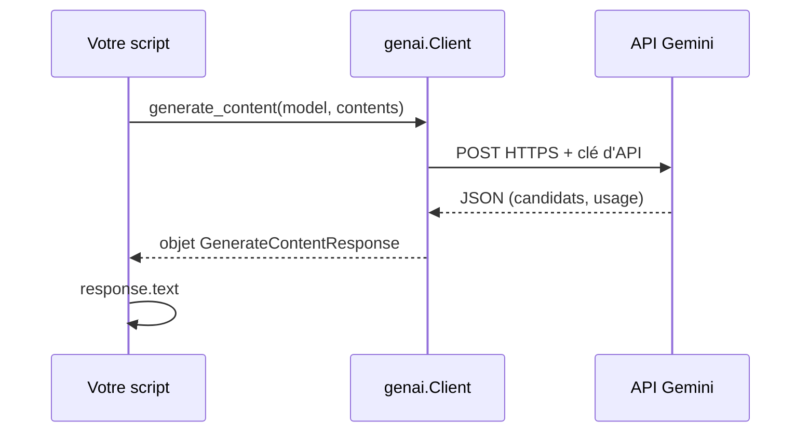

# Installer le SDK et faire un premier appel

> [!NOTE]
> Dans cette leçon, vous allez installer `google-genai`, créer un **client**, envoyer votre premier `generate_content` et lire tout ce que contient la réponse : le texte, la raison de fin et les compteurs de tokens.

## Le vocabulaire

| Terme | Définition | Dans le code |
| --- | --- | --- |
| **SDK** | bibliothèque officielle qui emballe les appels HTTP à l'API | `pip install google-genai`, `from google import genai` |
| **client** | l'objet qui connaît vos identifiants et envoie les requêtes | `client = genai.Client()` |
| **modèle** | le LLM appelé, désigné par son nom | `model="gemini-3.5-flash"` |
| **contents** | ce que vous envoyez : un texte, ou une liste de messages | `contents="Bonjour"` |
| **réponse** | l'objet renvoyé : texte, candidats, métadonnées d'usage | `response.text`, `response.usage_metadata` |

> [!WARNING]
> Il existe un ancien paquet nommé `google-generativeai` (import `google.generativeai`). Il est **obsolète**. Le SDK actuel s'appelle `google-genai` et s'importe avec `from google import genai`. Beaucoup de tutoriels en ligne utilisent encore l'ancien : vérifiez l'import avant de copier du code.

## Installer

```bash title="terminal"
python3 -m venv .venv && source .venv/bin/activate
pip install google-genai python-dotenv pydantic pytest
```

Puis créez un fichier `.env` à côté de votre script (jamais versionné dans git) :

```bash title=".env"
GEMINI_API_KEY=votre-cle-ai-studio-ici
```

## Le premier appel

```python title="premier_appel.py"
from dotenv import load_dotenv
from google import genai

load_dotenv()                 # copie le contenu de .env dans les variables d'environnement
client = genai.Client()       # trouve GEMINI_API_KEY tout seul

response = client.models.generate_content(
    model="gemini-3.5-flash",
    contents="Écris un slogan de 10 mots maximum pour une gourde isotherme.",
)
print(response.text)
print(response.candidates[0].finish_reason)
print(response.usage_metadata)
```



`response.text` est un raccourci : la réponse complète contient une liste de **candidats** (des réponses possibles, en pratique une seule), chacun avec ses **parts** (morceaux de contenu) et une **raison de fin** (`finish_reason`) :

| `finish_reason` | Signification |
| --- | --- |
| `STOP` | le modèle a fini naturellement |
| `MAX_TOKENS` | la réponse a été coupée par la limite de tokens |
| `SAFETY` | bloquée par un filtre de sécurité |

> [!TIP]
> Vérifiez toujours `finish_reason` quand la réponse paraît étrange. Un texte vide ou tronqué avec `MAX_TOKENS` n'est pas un bug du modèle, c'est une limite trop basse (leçon « Configuration »).

```quiz
question: "Quel import correspond au SDK actuel ?"
options:
  - "import google.generativeai as genai"
  - "from google import genai"
  - "import gemini"
answer: 1
explanation: "Le paquet google-genai s'importe avec from google import genai. google.generativeai est l'ancien SDK, à ne plus utiliser pour un nouveau projet."
```

```quiz
question: "response.text vaut None et finish_reason vaut MAX_TOKENS. Que s'est-il passé ?"
options:
  - "La clé d'API est invalide"
  - "Le plafond de tokens de sortie a été atteint avant que le modèle produise du texte (par exemple pendant sa réflexion)"
  - "Le modèle n'existe pas"
answer: 1
explanation: "Une clé invalide ou un modèle inconnu lèveraient une exception (400, 404). MAX_TOKENS signifie que la génération s'est arrêtée sur la limite ; avec les modèles qui réfléchissent, la pensée consomme ce budget en premier."
```

## Résultat obtenu

Le même appel exécuté le 2026-10-15 (`gemini-3.5-flash`, mode clé d'API), sortie mise en forme sur trois lignes :

```text title="sortie"
text='**Garde la fraîcheur, préserve la chaleur. Partout avec vous.**'
finish=STOP
prompt=18 out=17 thoughts=907 total=942
```

Remarquez `thoughts=907` : le modèle a « réfléchi » 907 tokens pour produire un slogan de 17 tokens. Ces tokens de pensée sont facturés ; nous apprendrons à les mesurer et à les réduire au module 2.

## Exercice

Modifiez `premier_appel.py` pour qu'il prenne le prompt en argument de ligne de commande (`python premier_appel.py "Ma question"`) et affiche seulement le texte puis, entre crochets, le nombre total de tokens.

<details>
<summary>Voir la solution</summary>

```python title="premier_appel.py"
import sys

from dotenv import load_dotenv
from google import genai

load_dotenv()
client = genai.Client()
prompt = " ".join(sys.argv[1:]) or "Dis bonjour."
response = client.models.generate_content(model="gemini-3.5-flash", contents=prompt)
print(response.text)
print(f"[{response.usage_metadata.total_token_count} tokens]")
```

`sys.argv` contient les arguments de la commande ; `" ".join(sys.argv[1:])` les recolle, ce qui évite d'exiger des guillemets. `total_token_count` additionne entrée, sortie et pensée.

</details>

## Je sais faire

- [ ] Installer `google-genai` dans un environnement virtuel
- [ ] Créer un client qui lit la clé depuis `.env`
- [ ] Appeler `generate_content` et lire `text`, `finish_reason` et `usage_metadata`
- [ ] Reconnaître l'ancien SDK `google.generativeai` dans un tutoriel
