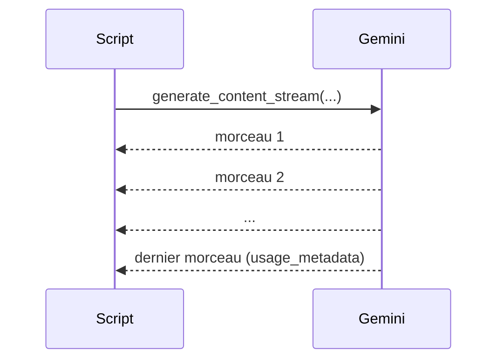
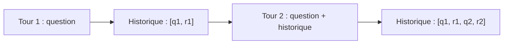

# Streaming et conversation multi-tours

> [!NOTE]
> Dans cette leçon, vous allez afficher une réponse **au fil de l'eau** (streaming) et tenir une **conversation** où le modèle se souvient des messages précédents. Ce sont les commandes `resume --stream` et `chat` de l'assistant de réunion.

## Le streaming : voir la réponse arriver

Sans streaming, on attend la réponse complète avant d'afficher quoi que ce soit. Avec le **streaming**, l'API envoie la réponse en **morceaux** (*chunks*) dès qu'ils sont prêts : l'utilisateur lit les premières phrases pendant que la suite se génère.



| | `generate_content` | `generate_content_stream` |
| --- | --- | --- |
| Renvoie | une réponse complète | un itérateur de morceaux |
| Premier mot visible | à la fin | après le premier morceau |
| Idéal pour | traitements, JSON, lots | interfaces de chat, longues réponses |

```python title="files/reunion.py"
def resume_stream(client, transcription: str) -> str:
    """Affiche le résumé morceau par morceau ; renvoie le texte complet."""
    def lancer():
        # La requête part à la première itération : on réessaie donc toute la boucle.
        texte = ""
        for chunk in client.models.generate_content_stream(
                model=MODEL, contents=f"Transcription :\n{transcription}\n\nRésume en 5 lignes.",
                config=config()):
            print(chunk.text or "", end="", flush=True)
            texte += chunk.text or ""
        return texte

    texte = avec_reessais(lancer)
    print()
    return texte
```

Deux détails importants : `chunk.text` peut valoir `None` (d'où le `or ""`), et `flush=True` force l'affichage immédiat au lieu d'attendre la fin de ligne.

## La conversation : `client.chats`

Un modèle ne garde **aucune mémoire** entre deux appels : chaque requête est indépendante. Pour une conversation, il faut renvoyer **tout l'historique** à chaque tour. L'objet `chat` du SDK le fait pour vous.



```python title="files/reunion.py"
def chat(client, transcription: str, entrees=sys.stdin) -> None:
    session = client.chats.create(model=MODEL, config=config(), history=[
        types.Content(role="user", parts=[types.Part(text=f"Transcription :\n{transcription}")]),
        types.Content(role="model", parts=[types.Part(text="Transcription reçue. Posez vos questions.")]),
    ])
    print("Posez vos questions (ligne vide pour quitter).")
    for question in entrees:
        if not question.strip():
            break
        r = avec_reessais(lambda: session.send_message(question.strip()))
        print(f"> {question.strip()}\n{r.text.strip()}\n")
```

On **amorce** l'historique avec la transcription : toutes les questions suivantes s'y rapportent. Le paramètre `entrees` vaut le clavier par défaut, et un texte préparé dans les tests. Code complet : [reunion.py](../files/reunion.py).

> [!WARNING]
> Comme tout l'historique est renvoyé à chaque tour, une conversation **coûte de plus en plus cher** : au 10e tour, vous payez à nouveau les 9 premiers en tokens d'entrée. Pour une longue session, résumez ou tronquez l'historique.

```quiz
question: "Pourquoi le modèle « se souvient »-il du prénom donné au tour précédent dans un chat ?"
options:
  - "Le modèle stocke la conversation sur les serveurs de Google entre deux appels"
  - "L'objet chat renvoie tout l'historique à chaque nouveau message"
  - "Le prénom est enregistré dans la clé d'API"
answer: 1
explanation: "Le modèle est sans état : la mémoire, c'est l'historique que le SDK renvoie à chaque tour. C'est aussi pour cela que le coût d'entrée grandit avec la conversation."
```

```quiz
question: "Quand préférer generate_content_stream ?"
options:
  - "Pour afficher une longue réponse à un utilisateur qui attend devant l'écran"
  - "Pour produire un JSON qu'on va valider avant tout usage"
  - "Pour réduire le nombre de tokens facturés"
answer: 0
explanation: "Le streaming améliore le temps d'affichage du premier mot, pas le coût. Pour un JSON, on a besoin du texte complet avant de le valider : pas d'intérêt à streamer."
```

## Résultat obtenu

Le 2026-10-15, en mode clé d'API (`gemini-3.5-flash`), un streaming de trois conseils est arrivé en **6 morceaux** (extrait, chaque ligne est un `chunk.text`) :

```text title="morceaux reçus"
'Voici 3 conseils courts pour bien préparer une réunion :\n\n1. **Définissez'
' un objectif clair et un ordre du jour** : Sachez exactement ce que vous devez accomplir et partagez les sujets'
" à aborder aux participants à l'avance.\n2. **Invitez uniquement les personnes indispensables** : Limitez le nombre"
...
''
```

Et une conversation de deux tours :

```text title="chat"
1> Bonjour Inès ! Enchanté. C'est un plaisir de t'aider. ...
2> Tu t'appelles **Inès** !
history=4
```

L'historique contient 4 messages : deux questions, deux réponses. Les morceaux coupent les mots n'importe où (« **Définissez » / « un objectif ») : n'analysez jamais un morceau isolé, seulement le texte recollé.

## Exercice

Ajoutez à `chat` une commande spéciale : si l'utilisateur tape `/historique`, le programme affiche le nombre de messages de l'historique au lieu d'interroger le modèle.

<details>
<summary>Voir la solution</summary>

```python title="files/reunion.py (dans la boucle de chat)"
    for question in entrees:
        if not question.strip():
            break
        if question.strip() == "/historique":
            print(f"{len(session.get_history())} messages dans l'historique\n")
            continue
        r = avec_reessais(lambda: session.send_message(question.strip()))
        print(f"> {question.strip()}\n{r.text.strip()}\n")
```

`session.get_history()` renvoie la liste des `Content` échangés, amorce comprise. Le `continue` passe à la ligne suivante sans appel au modèle (donc sans coût).

</details>

## Je sais faire

- [ ] Afficher une réponse en streaming avec `generate_content_stream`
- [ ] Gérer les morceaux vides (`chunk.text` à `None`)
- [ ] Tenir une conversation avec `client.chats.create` et `send_message`
- [ ] Expliquer pourquoi le coût d'une conversation augmente à chaque tour
