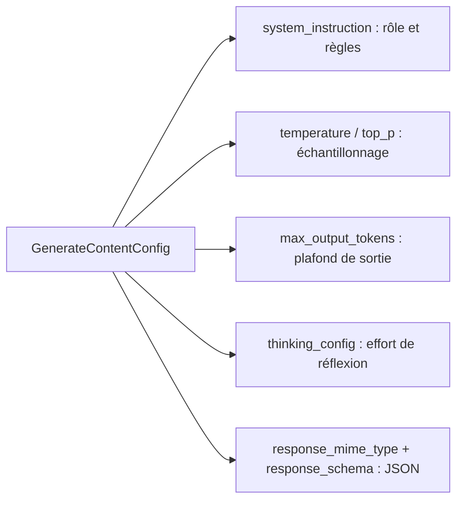

# Configurer l'appel : instructions, température, tokens

> [!NOTE]
> Dans cette leçon, vous allez régler un appel avec `GenerateContentConfig` : le rôle du modèle (`system_instruction`), la température, la longueur maximale (`max_output_tokens`) et le niveau de réflexion (`thinking_level`).

## Un objet pour tous les réglages

Tous les réglages passent par un seul paramètre, `config`, de type `types.GenerateContentConfig` :



| Réglage | Rôle | Valeur dans l'assistant de réunion |
| --- | --- | --- |
| `system_instruction` | rôle, ton, interdits, envoyé à chaque requête | « Tu n'inventes ni décision, ni responsable, ni date » |
| `temperature` | part de hasard du tirage | non envoyée par défaut (voir l'avertissement) |
| `max_output_tokens` | plafond de tokens produits, **pensée comprise** | 4096 |
| `thinking_config` | effort de réflexion (`low`, `medium`, `high`…) | défaut du modèle |
| `response_schema` | format JSON imposé | `CompteRendu` (leçon projet) |

```python title="files/reunion.py"
SYSTEM_INSTRUCTION = """Tu es l'assistant de réunion d'une équipe.
On te donne la transcription d'une réunion. Tu réponds en français, de façon factuelle.
Tu n'inventes ni décision, ni responsable, ni date : si l'information n'est pas dans
la transcription, écris « non précisé »."""

def config(**extra) -> types.GenerateContentConfig:
    if os.environ.get("TEMPERATURE"):
        extra["temperature"] = float(os.environ["TEMPERATURE"])
    return types.GenerateContentConfig(
        system_instruction=SYSTEM_INSTRUCTION,
        max_output_tokens=4096,   # plafond de la réponse (pensée comprise)
        **extra,
    )
```

`**extra` permet à chaque commande d'ajouter ses propres réglages (le schéma JSON pour `resume`) sans dupliquer le reste.

> [!WARNING]
> La [documentation](https://ai.google.dev/gemini-api/docs/text-generation) (consultée le 2026-10-15) indique que Gemini 3.6 et suivants **ignorent** `temperature`, `top_p` et `top_k`, et que pour les modèles Gemini 3 antérieurs (dont `gemini-3.5-flash`) il vaut mieux garder les valeurs par défaut. C'est pourquoi la température n'est envoyée que si vous définissez `TEMPERATURE`, utile par exemple avec `gemini-2.5-flash` (`TEMPERATURE=0.2` pour un compte rendu sobre).

## `max_output_tokens` et la réflexion

Les modèles récents **réfléchissent** avant d'écrire, et ces tokens de pensée comptent dans `max_output_tokens`. Un plafond trop bas peut donc être épuisé **avant le premier mot**.

```python title="essai.py"
r = client.models.generate_content(
    model="gemini-3.5-flash", contents="Explique la photosynthèse.",
    config=types.GenerateContentConfig(max_output_tokens=20))
print(r.candidates[0].finish_reason, r.text)
```

Pour réduire la réflexion (et le coût) sur une tâche simple, on règle `thinking_level` :

```python title="essai.py"
config = types.GenerateContentConfig(
    thinking_config=types.ThinkingConfig(thinking_level="low"))
```

> [!TIP]
> Ne baissez `max_output_tokens` que pour **protéger** votre budget contre une réponse anormalement longue, avec une bonne marge. Pour obtenir une réponse courte, demandez-la dans le prompt (« en 5 lignes ») : le modèle s'arrêtera proprement au lieu d'être coupé.

```quiz
question: "Avec max_output_tokens=20, la réponse est vide et finish_reason vaut MAX_TOKENS. Pourquoi ?"
options:
  - "Le modèle a refusé de répondre"
  - "Les tokens de pensée ont consommé le plafond avant que le texte commence"
  - "La clé d'API n'a pas assez de quota"
answer: 1
explanation: "Sur un modèle qui réfléchit, la pensée vient en premier et compte dans max_output_tokens. Avec 20 tokens, il ne reste rien pour la réponse. Un quota épuisé donnerait une erreur 429."
```

```quiz
question: "Où mettre la règle « n'invente aucune date » ?"
options:
  - "Dans system_instruction"
  - "Dans max_output_tokens"
  - "Dans la variable MODEL"
answer: 0
explanation: "Les règles de comportement valables pour toutes les requêtes vont dans l'instruction système."
```

## Résultat obtenu

Trois essais réels du 2026-10-15 avec `gemini-3.5-flash` :

```text title="sortie"
max_output_tokens=20                    -> finish=MAX_TOKENS text=None
max_output_tokens=300, thinking=low     -> finish=MAX_TOKENS, 11 tokens de texte, 285 de pensée
                                           'La **photosynthèse** est le processus biologique qui'
résumé d'une phrase, thinking par défaut -> pensée=535 tokens, réponse=22 tokens
résumé d'une phrase, thinking=low        -> pensée=364 tokens, réponse=20 tokens
```

Même en `low`, la réflexion reste dominante sur une petite tâche, et elle varie d'un appel à l'autre. Le niveau de réflexion est un **levier de coût** réel, à mesurer sur vos propres requêtes (leçon suivante).

## Exercice

Ajoutez à l'assistant une variable d'environnement `THINKING` (par exemple `low`) qui, si elle est définie, règle le niveau de réflexion dans `config()`.

<details>
<summary>Voir la solution</summary>

```python title="files/reunion.py (dans config)"
    if os.environ.get("THINKING"):
        extra["thinking_config"] = types.ThinkingConfig(
            thinking_level=os.environ["THINKING"])
```

Même logique que `TEMPERATURE` : rien n'est envoyé par défaut, le modèle garde son comportement standard. Attention, `thinking_level` concerne les modèles Gemini 3 ; les modèles 2.5 utilisent `thinking_budget` (un nombre de tokens).

</details>

## Je sais faire

- [ ] Construire un `GenerateContentConfig` avec instruction système et plafond de tokens
- [ ] Savoir quand ne **pas** envoyer `temperature`
- [ ] Expliquer pourquoi la pensée peut vider `max_output_tokens`
- [ ] Régler `thinking_level` pour réduire la réflexion
