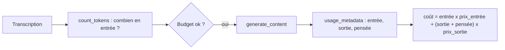

# Compter les tokens et estimer le coût

> [!NOTE]
> Dans cette leçon, vous allez compter les tokens **avant** un appel avec `count_tokens`, lire la consommation réelle **après** avec `usage_metadata`, et transformer ces chiffres en estimation de coût. C'est la commande `tokens` de l'assistant de réunion.

## Avant et après l'appel



| Outil | Quand | Ce qu'il donne | Coût de l'appel |
| --- | --- | --- | --- |
| `client.models.count_tokens` | avant | tokens d'**entrée** seulement | pas de génération |
| `response.usage_metadata` | après | `prompt_token_count`, `candidates_token_count`, `thoughts_token_count`, `total_token_count` | inclus dans l'appel |

On ne peut pas connaître la sortie à l'avance : `count_tokens` sert à vérifier qu'un document tient dans la fenêtre de contexte et à estimer la part « entrée » du prix.

## Le code

```python title="files/reunion.py"
# Prix en dollars par million de tokens. Valeurs d'EXEMPLE : recopiez celles de la page
# https://ai.google.dev/gemini-api/docs/pricing pour votre modèle.
PRIX_ENTREE_1M = float(os.environ.get("PRIX_ENTREE_1M", "0.30"))
PRIX_SORTIE_1M = float(os.environ.get("PRIX_SORTIE_1M", "2.50"))

def cout(usage) -> float:
    """Coût estimé d'un appel à partir de usage_metadata (la pensée est facturée en sortie)."""
    entree = usage.prompt_token_count or 0
    sortie = (usage.candidates_token_count or 0) + (usage.thoughts_token_count or 0)
    return (entree * PRIX_ENTREE_1M + sortie * PRIX_SORTIE_1M) / 1_000_000

def tokens(client, transcription: str) -> int:
    r = avec_reessais(lambda: client.models.count_tokens(model=MODEL, contents=transcription))
    return r.total_tokens
```

La formule, pour un appel :

$$\text{coût} = \frac{N_{entrée} \times P_{entrée} + (N_{sortie} + N_{pensée}) \times P_{sortie}}{1\,000\,000}$$

> [!WARNING]
> Les prix par défaut du code (0,30 $ et 2,50 $ par million) sont des **valeurs d'exemple** pour illustrer le calcul, pas le tarif d'un modèle donné. Les tarifs varient selon le modèle, le niveau (gratuit ou payant), la longueur du contexte et la plateforme (API Gemini ou Vertex AI). Renseignez `PRIX_ENTREE_1M` et `PRIX_SORTIE_1M` à partir de la [page tarifs](https://ai.google.dev/gemini-api/docs/pricing).

> [!TIP]
> Les `or 0` ne sont pas décoratifs : selon le modèle et l'appel, `thoughts_token_count` peut valoir `None` (pas de réflexion). Le test `test_cout_tolere_les_champs_vides` le vérifie.

```quiz
question: "Un appel affiche prompt=1000, candidates=200, thoughts=300. Avec 1 $ / million en entrée et 10 $ / million en sortie, combien coûte-t-il ?"
options:
  - "0,003 $"
  - "0,006 $"
  - "0,0012 $"
answer: 1
explanation: "1000 x 1 + (200 + 300) x 10 = 6000, divisé par un million : 0,006 $. Oublier la pensée donnerait 0,003 $, soit deux fois moins que la réalité."
```

```quiz
question: "Que renvoie count_tokens ?"
options:
  - "Le nombre de tokens de la réponse future"
  - "Le nombre de tokens du contenu envoyé, sans générer de réponse"
  - "Le quota restant sur la clé"
answer: 1
explanation: "count_tokens mesure l'entrée. La sortie n'existe pas encore ; on la lit après coup dans usage_metadata."
```

## Résultat obtenu

Sur la transcription fictive [reunion_exemple.txt](../files/reunion_exemple.txt), le 2026-10-15 (prix d'exemple) :

```text title="python reunion.py tokens reunion_exemple.txt"
[mode : clé d'API | modèle : gemini-3.5-flash]
302 tokens en entrée, soit environ 0.000091 $ avant la réponse
```

```text title="python reunion.py resume reunion_exemple.txt (dernière ligne)"
[coût estimé : 0.003344 $]
```

Pour la même transcription, Vertex AI compte **301** tokens au lieu de 302 : les deux plateformes peuvent différer d'une unité, ce qui ne change rien à l'ordre de grandeur. Surtout, le compte rendu complet coûte environ **37 fois** la part entrée (0,003344 / 0,000091) : c'est la sortie et la pensée qui pèsent.

## Exercice

Votre équipe tient 40 réunions par semaine, chacune d'environ 6 000 tokens de transcription. Un compte rendu consomme, par exemple, 1 500 tokens de sortie et de pensée. Avec les prix d'exemple du code, estimez le coût hebdomadaire.

<details>
<summary>Voir la solution</summary>

Par réunion : entrée 6 000 x 0,30 = 1 800 ; sortie 1 500 x 2,50 = 3 750 ; total 5 550, divisé par un million = **0,00555 $**.

Par semaine : 40 x 0,00555 ≈ **0,22 $**.

Méthode à retenir : mesurer `usage_metadata` sur quelques vrais appels, faire la moyenne, multiplier par le volume, puis remplacer les prix d'exemple par les tarifs réels de votre modèle.

</details>

## Je sais faire

- [ ] Compter les tokens d'entrée avec `count_tokens`
- [ ] Lire `usage_metadata` et ses quatre compteurs
- [ ] Calculer un coût en comptant la pensée comme de la sortie
- [ ] Ne jamais présenter un prix d'exemple comme un tarif réel
