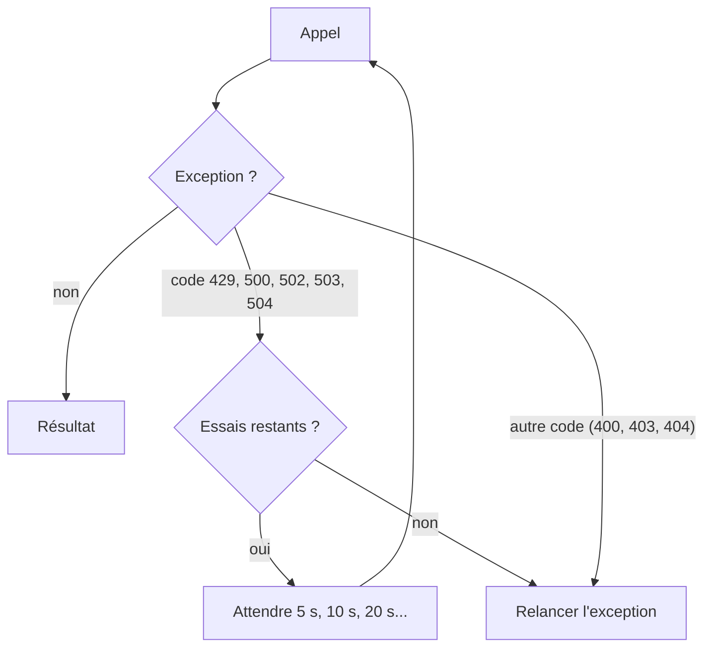

# Gérer les erreurs et réessayer

> [!NOTE]
> Dans cette leçon, vous allez distinguer les erreurs **définitives** (à corriger) des erreurs **temporaires** (à réessayer), écrire une fonction de réessai avec attente exponentielle, et fixer un délai maximal pour qu'une requête bloquée ne fige jamais votre programme.

## Les exceptions du SDK

Quand l'API répond par une erreur, `google-genai` lève une exception de `google.genai.errors` :

| Exception | Codes HTTP | Exemples |
| --- | --- | --- |
| `errors.ClientError` | 4xx : **votre** requête pose problème | 400 clé invalide, 404 modèle inconnu, 429 quota |
| `errors.ServerError` | 5xx : **le service** a un souci | 500 erreur interne, 503 surcharge, 504 délai dépassé |
| `errors.APIError` | classe mère des deux | attribut `e.code` (le code HTTP) |



Seul 429 parmi les 4xx est temporaire : le quota se reconstitue avec le temps. Tous les autres 4xx demandent une **correction** (clé, nom de modèle, format de requête).

## La fonction de réessai

```python title="files/reunion.py"
def avec_reessais(appel, essais=4, attente=5):
    """Réessaie sur 429 (quota) et 5xx (serveur), avec attente exponentielle."""
    for essai in range(essais):
        try:
            return appel()
        except errors.APIError as e:
            if e.code not in (429, 500, 502, 503, 504) or essai == essais - 1:
                raise
            pause = attente * 2 ** essai
            print(f"[erreur {e.code}, nouvel essai dans {pause} s]", file=sys.stderr)
            time.sleep(pause)
```

On lui passe une fonction sans argument (`lambda: client.models.count_tokens(...)`) : la même logique protège tous les appels du CLI. L'**attente exponentielle** (5, 10, 20 s) laisse au service le temps de récupérer, au lieu de le marteler.

> [!TIP]
> Le SDK propose aussi des réessais intégrés : `genai.Client(http_options=types.HttpOptions(retry_options=types.HttpRetryOptions(attempts=4)))`. Notre fonction maison a l'avantage d'être lisible, testable sans réseau, et d'afficher ce qu'elle fait. Choisissez l'un **ou** l'autre, pas les deux (sinon 4 x 4 = 16 essais).

## Le délai maximal

Sans délai, une requête qui ne répond jamais bloque le programme indéfiniment. Le client du lab fixe une limite :

```python title="files/reunion.py"
def make_client() -> genai.Client:
    """Le même code sert les deux modes : le SDK lit les variables d'environnement.
    Le délai (en millisecondes) évite qu'une requête bloquée fige le programme."""
    return genai.Client(http_options=types.HttpOptions(timeout=90_000))
```

> [!WARNING]
> Ce n'est pas théorique. Pendant nos tests du 2026-10-15, une requête **avec schéma JSON** vers `gemini-3.5-flash` sur Vertex AI est restée plus de 10 minutes sans réponse avant que nous ajoutions ce délai. Avec un délai, le serveur a répondu `504 DEADLINE_EXCEEDED`, une erreur propre que l'on peut réessayer ou signaler. Détails dans la leçon Vertex AI.

```quiz
question: "Quelles erreurs avec_reessais réessaie-t-elle ?"
options:
  - "404 NOT_FOUND"
  - "429 RESOURCE_EXHAUSTED"
  - "503 UNAVAILABLE"
  - "400 INVALID_ARGUMENT"
answer: [1, 2]
explanation: "429 et 503 sont temporaires. 404 (modèle inconnu) et 400 (clé ou requête invalide) se reproduiraient à l'identique : il faut corriger, pas attendre."
```

```quiz
question: "Pourquoi l'attente double-t-elle à chaque essai ?"
options:
  - "Pour laisser au service ou au quota le temps de se rétablir sans le surcharger"
  - "Parce que l'API l'impose"
  - "Pour réduire le nombre de tokens"
answer: 0
explanation: "Réessayer immédiatement après un 429 ou un 503 a toutes les chances d'échouer encore et ajoute de la charge. Doubler l'attente espace les tentatives."
```

## Résultat obtenu

Les tests sans réseau simulent les trois situations (extrait de `pytest -v`, 2026-10-15) :

```text title="pytest -v (extrait)"
test_reunion.py::test_reessais_sur_503_puis_succes PASSED
test_reunion.py::test_pas_de_reessai_sur_cle_invalide PASSED
test_reunion.py::test_abandon_apres_n_essais PASSED
```

Et deux vraies erreurs provoquées volontairement en mode clé d'API, pour reconnaître les messages :

```text title="sortie"
400 INVALID_ARGUMENT. {'error': {'code': 400, 'message': 'API key not valid. Please pass a valid API key.', ...}}
404 NOT_FOUND. {'error': {'code': 404, 'message': 'models/gemini-modele-inexistant is not found for API version v1beta, ...'}}
```

## Exercice

Écrivez le test qui vérifie que `avec_reessais` attend bien 5 puis 10 secondes avant de réussir au troisième essai, sans vraiment attendre.

<details>
<summary>Voir la solution</summary>

```python title="files/test_reunion.py (ajout)"
def test_attentes_exponentielles(monkeypatch):
    pauses = []
    monkeypatch.setattr(reunion.time, "sleep", pauses.append)  # enregistre au lieu d'attendre
    panne = errors.ServerError(503, {"error": {"message": "x", "status": "UNAVAILABLE"}})
    client = FakeClient(panne, panne, NS(total_tokens=1))
    assert reunion.tokens(client, "x") == 1
    assert pauses == [5, 10]
```

`monkeypatch.setattr` remplace `time.sleep` par `pauses.append` le temps du test : chaque « attente » ajoute sa durée à la liste. On vérifie ainsi le calcul sans perdre 15 secondes.

</details>

## Je sais faire

- [ ] Distinguer `ClientError` et `ServerError` et lire `e.code`
- [ ] Réessayer seulement les erreurs temporaires, avec attente exponentielle et nombre d'essais maximal
- [ ] Fixer un délai maximal avec `HttpOptions(timeout=...)`
- [ ] Tester une logique de réessai sans réseau ni attente réelle
