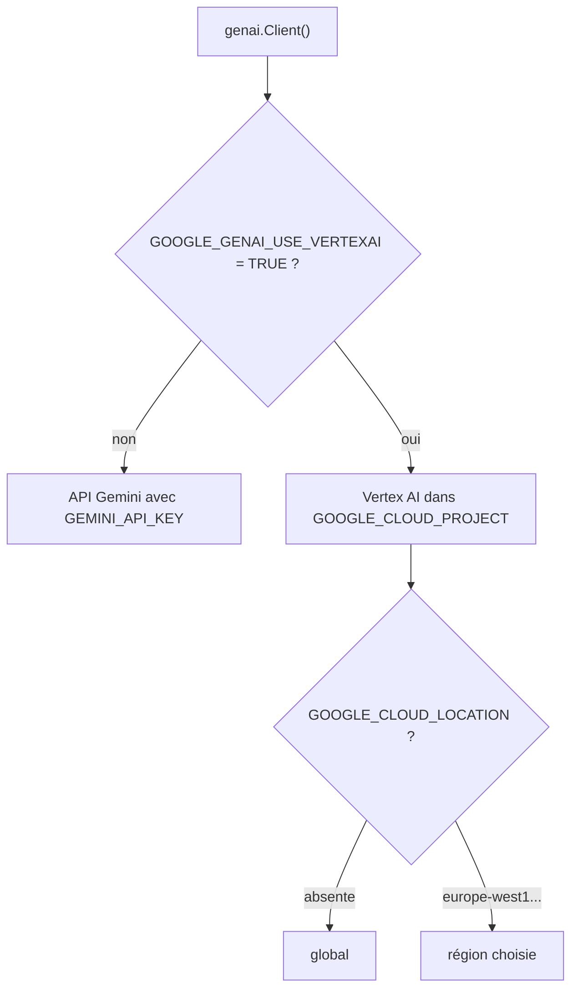

# Passer à Vertex AI en changeant 2 variables

> [!NOTE]
> Dans cette leçon, vous allez faire tourner **le même code** sur Vertex AI, la plateforme IA de Google Cloud, en changeant uniquement des variables d'environnement. Vous saurez aussi choisir une région et vérifier qu'un modèle y est disponible.

## Pourquoi Vertex AI ?

| Critère | API Gemini (clé d'API) | Vertex AI |
| --- | --- | --- |
| Identité | une clé secrète | votre identité Google Cloud (utilisateur ou compte de service), sans clé à faire circuler |
| Facturation | compte AI Studio | projet Google Cloud, avec budgets et alertes |
| Contrôle d'accès | qui a la clé peut tout faire | rôles IAM (*Identity and Access Management*) par personne ou service |
| Région | gérée par Google | `global`, ou une région précise comme `europe-west1` |
| Usage typique | prototype, projet perso | application d'entreprise |

Le SDK `google-genai` parle aux deux. Il choisit selon les variables d'environnement, lues par `genai.Client()` :



## Les étapes

1. Un projet Google Cloud avec facturation et l'API Vertex AI activée (`gcloud services enable aiplatform.googleapis.com --project MON-PROJET`).
2. S'identifier une fois sur son poste avec les **ADC** (*Application Default Credentials*, les identifiants par défaut que les bibliothèques Google trouvent toutes seules) :

```bash title="terminal"
gcloud auth application-default login
```

3. Changer **deux variables** dans `.env` :

```bash title=".env (mode Vertex AI)"
GOOGLE_GENAI_USE_VERTEXAI=TRUE
GOOGLE_CLOUD_PROJECT=mon-projet-gcp
```

C'est tout : `make_client()` ne change pas, il appelle toujours `genai.Client(...)`. Le CLI affiche le mode détecté :

```python title="files/reunion.py"
def mode() -> str:
    vertex = os.environ.get("GOOGLE_GENAI_USE_VERTEXAI", "").lower() in ("true", "1")
    return "Vertex AI" if vertex else "clé d'API"
```

> [!WARNING]
> Si une clé d'API traîne encore dans l'environnement, le SDK donne la priorité au projet et à la région venant des variables d'environnement, et ignore la clé (il l'écrit dans ses journaux). Pour éviter toute ambiguïté, commentez `GEMINI_API_KEY` quand vous passez en mode Vertex AI.

## Région et disponibilité des modèles

Sans `GOOGLE_CLOUD_LOCATION`, le SDK utilise le point d'accès **`global`** : Google route la requête là où le modèle est disponible. Pour garder les traitements dans une région (par exemple pour des raisons de conformité), ajoutez `GOOGLE_CLOUD_LOCATION=europe-west1`, mais tous les modèles n'y sont pas proposés.

> [!IMPORTANT]
> Ce que nous avons constaté le 2026-10-15 sur notre projet de test :
> - `gemini-3.5-flash` : disponible en `global` (texte, streaming, chat, comptage), **introuvable** en `europe-west1` (404), et les requêtes **avec schéma JSON** en `global` ont fini en `504 DEADLINE_EXCEEDED` (3 essais sur 3) ;
> - `gemini-2.5-flash` : tout fonctionne, en `global` comme en `europe-west1` ;
> - `gemini-3.8-flash` : schéma JSON en `global` fonctionnel.
>
> Nous avons donc testé le mode Vertex AI avec `MODEL=gemini-2.5-flash`. Refaites cette vérification avec votre projet : la disponibilité évolue.

Pour vérifier en une commande qu'un modèle répond dans une région :

```bash title="terminal"
GOOGLE_CLOUD_LOCATION=europe-west1 MODEL=gemini-2.5-flash python reunion.py tokens reunion_exemple.txt
```

```quiz
question: "Quelles variables suffisent pour passer l'assistant de la clé d'API à Vertex AI (région global) ?"
options:
  - "GOOGLE_GENAI_USE_VERTEXAI=TRUE et GOOGLE_CLOUD_PROJECT"
  - "GEMINI_API_KEY et MODEL"
  - "GOOGLE_CLOUD_LOCATION seulement"
answer: 0
explanation: "La première active Vertex AI, la seconde désigne le projet facturé. La région est facultative (global par défaut) et l'authentification vient des ADC."
```

```quiz
question: "Avec GOOGLE_CLOUD_LOCATION=europe-west1, vous obtenez 404 « Publisher model ... not found ». Que faire ?"
options:
  - "Réessayer avec une attente exponentielle"
  - "Choisir un modèle disponible dans cette région, ou utiliser global"
  - "Recréer les identifiants ADC"
answer: 1
explanation: "Un 404 sur un modèle signifie qu'il n'est pas proposé à cet endroit. Réessayer n'y changera rien ; les ADC ne sont pas en cause (sinon ce serait 401 ou 403)."
```

## Résultat obtenu

Le CLI en mode Vertex AI le 2026-10-15, projet de test, `MODEL=gemini-2.5-flash` :

```text title="python reunion.py tokens reunion_exemple.txt"
[mode : Vertex AI | modèle : gemini-2.5-flash]
301 tokens en entrée, soit environ 0.000090 $ avant la réponse
```

```text title="python reunion.py chat reunion_exemple.txt"
> Quelle date de lancement a été retenue ?
La date de lancement retenue est le 4 novembre.

> Pourquoi ?
Le lancement a été décalé car il restait des tests de bout en bout sur le module de paiement et deux jours
de recette nécessaires, ce qui empêchait de tenir la date initiale du 28 octobre.
```

Aucune ressource n'a été créée dans le projet : on appelle seulement un modèle. Il n'y a **rien à supprimer** après le test ; la consommation apparaît simplement dans la facturation du projet.

## Exercice

Écrivez les deux lignes de commande (sans modifier `.env`) qui lancent `resume` d'abord en mode clé d'API, puis en mode Vertex AI dans `europe-west1` avec `gemini-2.5-flash`.

<details>
<summary>Voir la solution</summary>

```bash title="terminal"
GOOGLE_GENAI_USE_VERTEXAI=FALSE python reunion.py resume reunion_exemple.txt

env -u GEMINI_API_KEY GOOGLE_GENAI_USE_VERTEXAI=TRUE GOOGLE_CLOUD_PROJECT=mon-projet-gcp \
    GOOGLE_CLOUD_LOCATION=europe-west1 MODEL=gemini-2.5-flash \
    python reunion.py resume reunion_exemple.txt
```

Une variable placée devant une commande ne vaut que pour cette commande. `env -u GEMINI_API_KEY` retire la clé pour lever toute ambiguïté. Attention : `load_dotenv()` ne remplace pas une variable déjà définie, donc ces valeurs l'emportent sur le `.env`.

</details>

## Je sais faire

- [ ] Expliquer ce qu'apporte Vertex AI par rapport à une clé d'API
- [ ] M'identifier avec `gcloud auth application-default login`
- [ ] Passer en mode Vertex AI avec `GOOGLE_GENAI_USE_VERTEXAI` et `GOOGLE_CLOUD_PROJECT`
- [ ] Choisir une région et vérifier qu'un modèle y est disponible
