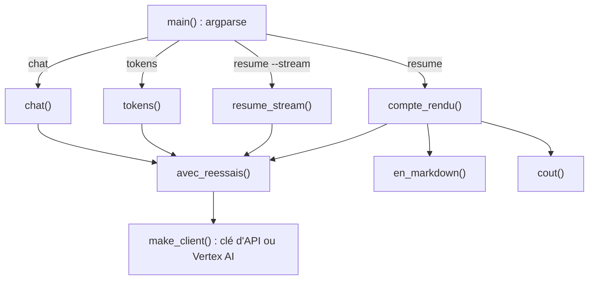

# Construire le CLI assistant de réunion

> [!NOTE]
> Dans cette leçon, vous allez assembler toutes les briques du cours dans [reunion.py](../files/reunion.py) : un compte rendu structuré en JSON (résumé, décisions, actions), sa mise en forme en Markdown et une ligne de commande à trois commandes.

## L'architecture



| Fonction | Rôle | Leçon |
| --- | --- | --- |
| `make_client`, `mode` | client unique pour les deux modes, avec délai | Vertex AI |
| `config` | instruction système, plafond, température facultative | Configuration |
| `avec_reessais` | réessais sur 429 / 5xx | Erreurs |
| `cout`, `tokens` | estimation du coût | Tokens et coût |
| `resume_stream`, `chat` | streaming et multi-tours | Streaming et conversation |
| `compte_rendu`, `en_markdown` | **nouveau** : JSON structuré puis tableau | cette leçon |

## Le compte rendu structuré

Le schéma décrit ce qu'on attend d'un compte rendu : un résumé, des décisions, et des actions qui ont chacune une tâche, un responsable et une échéance.

```python title="files/reunion.py"
class Action(BaseModel):
    tache: str
    responsable: str
    echeance: str


class CompteRendu(BaseModel):
    resume: str
    decisions: list[str]
    actions: list[Action]


def compte_rendu(client, transcription: str) -> tuple[CompteRendu, float]:
    response = avec_reessais(lambda: client.models.generate_content(
        model=MODEL,
        contents=f"Transcription :\n{transcription}\n\nFais le compte rendu.",
        config=config(response_mime_type="application/json", response_schema=CompteRendu),
    ))
    return CompteRendu.model_validate_json(response.text), cout(response.usage_metadata)
```

L'échéance est un simple texte (`"vendredi"`, `"non précisé"`) et non une date : dans une réunion, on dit « vendredi », pas « 2026-10-16 ». Convertir en date exacte demanderait de connaître le jour de la réunion, et risquerait d'inventer.

> [!TIP]
> L'instruction système impose « non précisé » quand l'information manque. Sans cette consigne, le modèle a tendance à attribuer chaque action à quelqu'un, même quand personne ne s'est engagé. Une action sans responsable **visible** est une information utile : elle signale un trou dans la réunion.

## La mise en forme

```python title="files/reunion.py"
def en_markdown(cr: CompteRendu) -> str:
    lignes = ["## Résumé", cr.resume, "", "## Décisions"]
    lignes += [f"- {d}" for d in cr.decisions] or ["- aucune"]
    lignes += ["", "## Actions", "| Tâche | Responsable | Échéance |", "| --- | --- | --- |"]
    lignes += [f"| {a.tache} | {a.responsable} | {a.echeance} |" for a in cr.actions]
    return "\n".join(lignes)
```

Le résultat se colle tel quel dans un wiki, un ticket ou un message d'équipe. Séparer **extraction** (le modèle produit du JSON) et **présentation** (Python produit le Markdown) permet de changer le format d'affichage sans toucher au prompt, et de tester la présentation sans appeler le modèle.

> [!WARNING]
> Une transcription de réunion contient souvent des informations internes ou personnelles. Avant d'envoyer de vraies transcriptions, vérifiez les règles de votre organisation et les conditions d'utilisation de la plateforme (niveau gratuit, niveau payant ou Vertex AI). Le fichier [reunion_exemple.txt](../files/reunion_exemple.txt) est entièrement fictif.

```quiz
question: "Pourquoi demander du JSON au modèle puis produire le Markdown en Python, au lieu de demander directement du Markdown ?"
options:
  - "Pour valider la structure, tester la mise en forme sans modèle et changer de format d'affichage sans toucher au prompt"
  - "Parce que Gemini ne sait pas écrire de Markdown"
  - "Pour réduire la latence"
answer: 0
explanation: "Le JSON validé par Pydantic garantit que chaque action a bien ses trois champs ; le Markdown devient un simple affichage, testé par test_markdown_contient_le_tableau_des_actions."
```

```quiz
question: "Dans la transcription, personne ne s'engage sur une date pour une action. Que doit contenir le champ echeance ?"
options:
  - "Une date plausible, par exemple dans une semaine"
  - "« non précisé »"
  - "Le champ doit être supprimé"
answer: 1
explanation: "L'instruction système l'impose : on n'invente pas d'échéance. Le schéma exige le champ, donc on y met « non précisé »."
```

## Résultat obtenu

`python reunion.py resume reunion_exemple.txt`, mode clé d'API, `gemini-3.5-flash`, 2026-10-15 (résumé abrégé) :

```markdown title="sortie"
## Décisions
- Décalage du lancement de la v2 de l'application au 4 novembre

## Actions
| Tâche | Responsable | Échéance |
| --- | --- | --- |
| Analyser le problème d'export PDF sur les gros fichiers | Karim | cette semaine |
| Envoyer les captures d'écran de la v2 à Thomas | Karim | vendredi |
| Préparer le message pour informer les clients du nouveau calendrier | Léa | lundi |
```

Le budget publicitaire, reporté sans responsable, n'apparaît pas comme action : c'est correct. Discutable en revanche : l'échéance « lundi » de Léa est en fait la date de **validation** du message. Un compte rendu généré se **relit** avant diffusion.

## Exercice

Ajoutez au compte rendu une liste `questions_ouvertes` (sujets évoqués mais non tranchés) et affichez-la dans une section « Questions ouvertes » du Markdown.

<details>
<summary>Voir la solution</summary>

```python title="files/reunion.py (modifications)"
class CompteRendu(BaseModel):
    resume: str
    decisions: list[str]
    actions: list[Action]
    questions_ouvertes: list[str]


def en_markdown(cr: CompteRendu) -> str:
    ...
    lignes += ["", "## Questions ouvertes"]
    lignes += [f"- {q}" for q in cr.questions_ouvertes] or ["- aucune"]
    return "\n".join(lignes)
```

Mettez à jour le dictionnaire `CR` des tests (ajout de `"questions_ouvertes": [...]`), sinon `model_validate` échouera : c'est le test qui vous rappelle que le contrat a changé. Sur la transcription d'exemple, on s'attend à voir apparaître le budget publicitaire.

</details>

## Je sais faire

- [ ] Décrire un compte rendu avec des modèles Pydantic imbriqués (`Action` dans `CompteRendu`)
- [ ] Obtenir un JSON validé puis le présenter en Markdown
- [ ] Imposer « non précisé » plutôt qu'une information inventée
- [ ] Organiser un petit CLI en fonctions réutilisables
