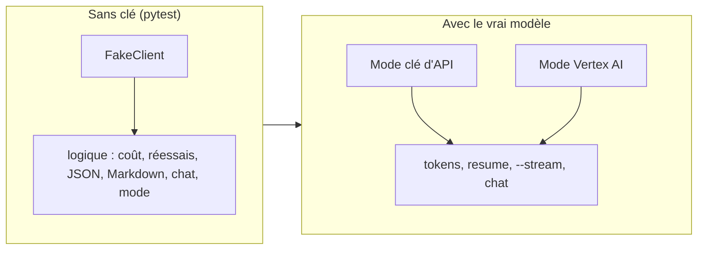

# Tester dans les deux modes

> [!NOTE]
> Dans cette leçon, vous allez vérifier l'assistant à deux niveaux : 14 tests **sans clé** (rapides, gratuits, répétables), puis un test **de bout en bout** avec le vrai modèle, en mode clé d'API puis en mode Vertex AI.

## Deux niveaux de tests



| | Tests pytest | Test de bout en bout |
| --- | --- | --- |
| Clé ou projet nécessaire | non | oui |
| Durée | moins d'une seconde | de quelques secondes à une minute |
| Coût | nul | quelques fractions de centime |
| Ce qu'il prouve | le code fait ce qu'on croit | l'ensemble marche avec le vrai service et donne des résultats sensés |

## Le faux client

`FakeClient` imite les quatre points d'entrée utilisés (`models.generate_content`, `models.generate_content_stream`, `models.count_tokens`, `chats.create`). Il renvoie des réponses préparées, ou lève une erreur pour simuler un incident :

```python title="files/test_reunion.py"
class FakeClient:
    def __init__(self, *reponses):
        self.reponses = list(reponses)
        self.appels = []
        self.models = self
        self.chats = self

    def _suivante(self, **kw):
        self.appels.append(kw)
        r = self.reponses.pop(0)
        if isinstance(r, Exception):
            raise r
        return r
```

Chaque test prépare un scénario et vérifie le résultat **et** les appels effectués (par exemple, que la config contient bien le schéma JSON). Code complet : [test_reunion.py](../files/test_reunion.py).

```bash title="terminal"
pip install -r requirements.txt
pytest -q
```

## Le test de bout en bout

```bash title="terminal : mode clé d'API"
python reunion.py tokens reunion_exemple.txt
python reunion.py resume reunion_exemple.txt
python reunion.py resume reunion_exemple.txt --stream
printf "Qui prépare le message aux clients ?\nEt quand est-il validé ?\n\n" | python reunion.py chat reunion_exemple.txt
```

```bash title="terminal : mode Vertex AI"
gcloud auth application-default login          # une seule fois
export GOOGLE_GENAI_USE_VERTEXAI=TRUE GOOGLE_CLOUD_PROJECT=mon-projet-gcp
export MODEL=gemini-2.5-flash                  # voir la leçon Vertex AI
# puis les mêmes quatre commandes
```

> [!TIP]
> `printf ... | python reunion.py chat` envoie les questions par un **tube** (*pipe*) au lieu du clavier : la conversation devient scriptable, donc rejouable à l'identique (côté questions).

> [!WARNING]
> Ne mettez pas les tests de bout en bout dans `pytest` par défaut : ils échoueraient chez quiconque n'a pas de clé, consommeraient du quota à chaque lancement et donneraient des résultats variables. Gardez-les comme une étape manuelle (ou une tâche planifiée séparée).

```quiz
question: "Que prouve test_compte_rendu_structure, qui utilise FakeClient ?"
options:
  - "Que Gemini produit de bons comptes rendus"
  - "Que compte_rendu envoie le schéma JSON et l'instruction système, puis transforme correctement la réponse en objet et en coût"
  - "Que la clé d'API est valide"
answer: 1
explanation: "Le faux client ne juge pas la qualité du modèle : il vérifie notre code (paramètres envoyés, validation, calcul). La qualité se juge au test de bout en bout, en relisant."
```

```quiz
question: "Le mode Vertex AI nécessite-t-il de supprimer quelque chose après le test ?"
options:
  - "Oui, le modèle déployé"
  - "Non : on appelle un modèle géré par Google, aucune ressource n'est créée dans le projet"
  - "Oui, le bucket de stockage créé par le SDK"
answer: 1
explanation: "Les appels à generate_content ne créent ni endpoint, ni bucket, ni service. Seule la consommation est facturée au projet."
```

## Résultat obtenu

Tests sans clé, 2026-10-15 :

```text title="pytest -v (fin)"
test_reunion.py::test_mode[TRUE-Vertex AI] PASSED                     [ 85%]
test_reunion.py::test_mode[false-cl\xe9 d'API] PASSED                    [ 92%]
test_reunion.py::test_mode[-cl\xe9 d'API] PASSED                         [100%]
============================== 14 passed in 0.29s ==============================
```

Bout en bout en **mode clé d'API** (`gemini-3.5-flash`) :

```text title="sortie"
[mode : clé d'API | modèle : gemini-3.5-flash]
302 tokens en entrée, soit environ 0.000091 $ avant la réponse
[coût estimé : 0.003344 $]
1. Le lancement de la v2 de l'application est officiellement décalé au 4 novembre.
2. Karim analyse cette semaine le problème d'export PDF sur les gros fichiers.
...
> Et quand est-il validé ?
Le message sera validé lundi (par Inès et Léa).
```

Bout en bout en **mode Vertex AI** (projet de test, `gemini-2.5-flash`, région `global` puis `europe-west1`) :

```text title="sortie"
[mode : Vertex AI | modèle : gemini-2.5-flash]
301 tokens en entrée, soit environ 0.000090 $ avant la réponse
[coût estimé : 0.002226 $]
| Examiner le problème d'export PDF sur les gros fichiers | Karim | cette semaine |
| Envoyer les captures d'écran de la v2 à Thomas pour la page d'accueil | Karim | vendredi |
| Préparer le message pour informer les clients du nouveau calendrier | Léa | lundi |
...
=== europe-west1
| Terminer les tests de bout en bout du module de paiement | Karim | non précisé |
| Préparer le message pour prévenir les clients du nouveau calendrier | Léa | non précisé |
```

Les quatre commandes fonctionnent dans les deux modes, sans changer une ligne de code. Les comptes rendus diffèrent d'un modèle et d'un appel à l'autre (ici, une action « tests de paiement » apparaît en `europe-west1`) : les deux sont défendables, c'est pourquoi on relit avant de diffuser. Rien n'a été créé dans le projet Google Cloud, il n'y a donc rien à nettoyer.

## Exercice final

Ajoutez une commande `actions` qui n'affiche **que** le tableau des actions, et le test sans clé correspondant.

<details>
<summary>Voir la solution</summary>

```python title="files/reunion.py (modifications)"
    p.add_argument("commande", choices=["resume", "tokens", "chat", "actions"])
    ...
    elif args.commande == "actions":
        cr, _ = compte_rendu(client, transcription)
        print(en_markdown(cr).split("## Actions\n", 1)[1])
```

```python title="files/test_reunion.py (ajout)"
def test_commande_actions(monkeypatch, tmp_path, capsys):
    f = tmp_path / "r.txt"
    f.write_text("Inès : on décale.", encoding="utf-8")
    monkeypatch.setattr(reunion, "make_client",
                        lambda: FakeClient(NS(text=json.dumps(CR), usage_metadata=USAGE)))
    reunion.main(["actions", str(f)])
    out = capsys.readouterr().out
    assert "| Prévenir le support | Inès | vendredi |" in out and "Résumé" not in out
```

`monkeypatch.setattr(reunion, "make_client", ...)` remplace la création du vrai client : `main()` tourne entièrement, sans clé. C'est le même principe que pour toutes les autres fonctions, appliqué à tout le programme.

</details>

## Je sais faire

- [ ] Écrire un faux client et tester un programme qui appelle Gemini sans clé
- [ ] Lancer un test de bout en bout en mode clé d'API puis en mode Vertex AI
- [ ] Rendre une conversation scriptable avec un tube
- [ ] Expliquer pourquoi aucune ressource cloud n'est à nettoyer après ces appels
