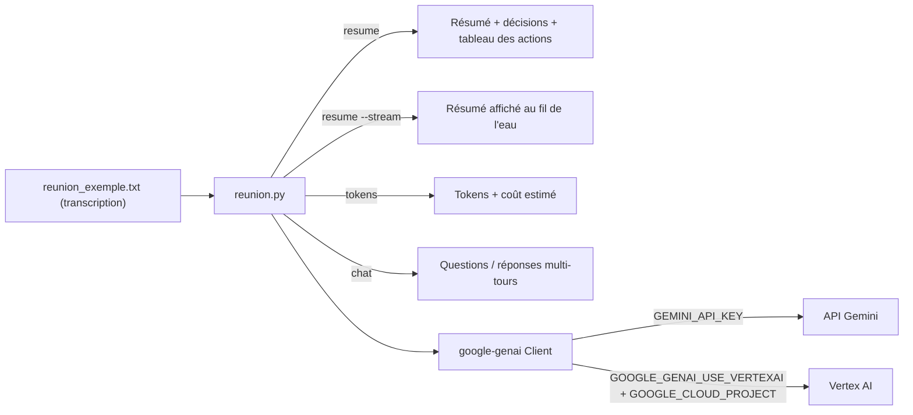

Vous savez ce qu'est un prompt ; il est temps de l'envoyer **depuis votre code**. Cette formation vous apprend le SDK officiel **`google-genai`**, la bibliothèque Python qui parle à Gemini, en écrivant un vrai petit outil : un **assistant de réunion** en ligne de commande, qui lit la transcription d'une réunion et rend un résumé, les décisions et la liste des actions (qui fait quoi, pour quand).

Le même code tourne de deux façons : avec une **clé d'API** créée dans Google AI Studio (idéal pour démarrer), ou sur **Vertex AI**, la plateforme IA de Google Cloud (pour l'entreprise : identité, facturation et données dans votre projet). On passe de l'une à l'autre en changeant **deux variables d'environnement**.

## Pour qui ?

- Débutants en Python à l'aise avec les fonctions, les listes et le terminal.
- Aucune expérience de l'IA requise. Si vous n'avez jamais utilisé Gemini, commencez par [Prototyper une application IA avec Google AI Studio](../01-prototyper-avec-google-ai-studio/index.md).

## Ce que vous allez construire

## Prérequis

- Python 3.10 ou plus récent.
- Une clé d'API Gemini (gratuite, créée dans [Google AI Studio](https://aistudio.google.com)).
- Pour le module 3 (facultatif) : un projet Google Cloud avec facturation et l'API Vertex AI activée, plus la CLI `gcloud`.

## Programme

| Module | Leçons | Durée indicative |
| --- | --- | --- |
| 1. Démarrer avec google-genai | Installer, créer le client, premier `generate_content` ; streaming et conversation | 50 min |
| 2. Maîtriser l'appel | Configuration ; tokens et coût ; erreurs et réessais | 1h15 |
| 3. Clé d'API ou Vertex AI | Passer à Vertex AI en changeant 2 variables | 30 min |
| 4. Projet final | Construire le CLI ; le tester dans les deux modes | 55 min |

Chaque leçon contient un schéma, des quiz corrigés, un exercice avec sa solution, une checklist « Je sais faire » et la sortie réelle obtenue lors de nos tests du 2026-10-15.

## En local ou sur Google Cloud ?

| | Clé d'API (sans GCP) | Vertex AI (avec GCP) |
| --- | --- | --- |
| Authentification | clé dans `GEMINI_API_KEY` | identité Google Cloud (ADC, `gcloud auth application-default login`) |
| Variables à définir | `GEMINI_API_KEY` | `GOOGLE_GENAI_USE_VERTEXAI=TRUE`, `GOOGLE_CLOUD_PROJECT` |
| Facturation | compte AI Studio (niveau gratuit possible) | projet Google Cloud |
| Région des traitements | gérée par Google | `global` par défaut, ou une région choisie (`europe-west1`…) |
| Ressources à nettoyer | aucune | aucune : on n'appelle qu'un modèle, rien n'est créé dans le projet |

## Le lab

Tout est dans [files/](./files/reunion.py) : le CLI [reunion.py](./files/reunion.py), ses 14 tests sans clé [test_reunion.py](./files/test_reunion.py), une transcription fictive [reunion_exemple.txt](./files/reunion_exemple.txt), [requirements.txt](./files/requirements.txt) et un modèle de configuration `files/.env.example` (valeurs factices) qui documente les deux modes.
