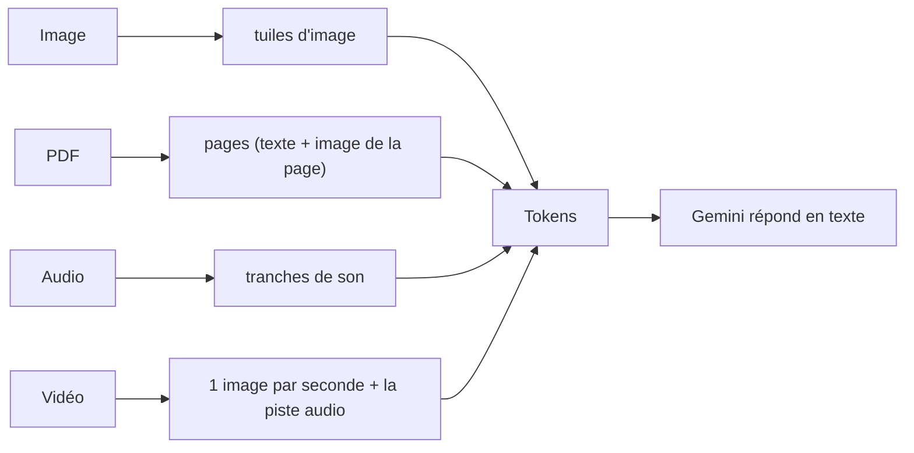
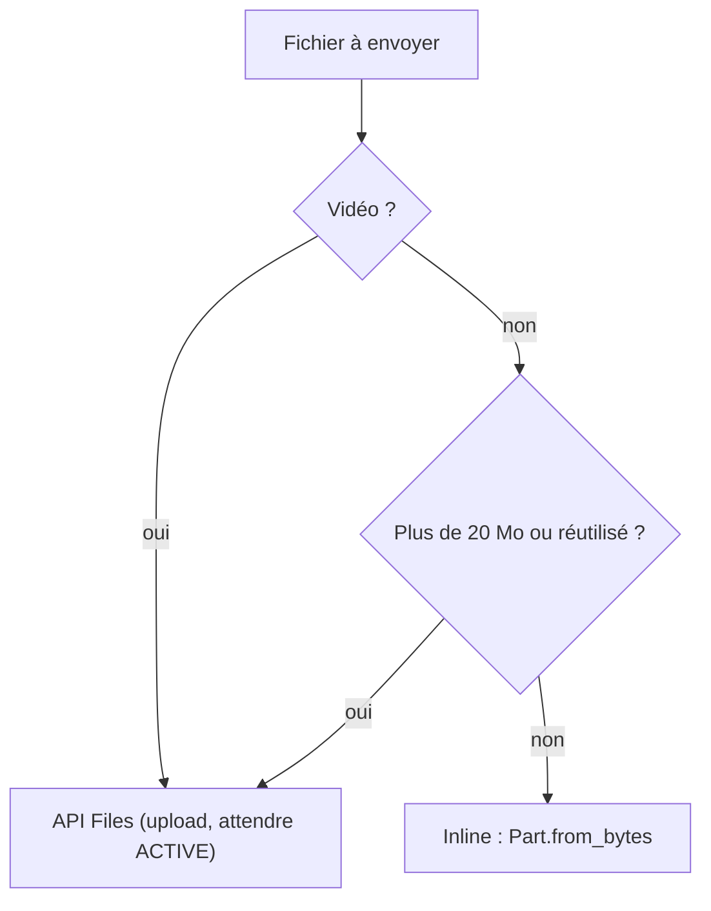

# Ce que « voit » le modèle

> [!NOTE]
> Dans cette leçon, vous allez comprendre comment une image, un PDF, un son ou une vidéo deviennent des **tokens** pour Gemini, et choisir entre les trois façons d'envoyer un fichier.

## Tout devient des tokens

Un modèle de langage ne lit pas des mots ni des pixels : il lit des **tokens**, de petits morceaux d'information (un bout de mot, un carré d'image, une fraction de seconde de son). C'est en tokens que l'on mesure **la taille d'une requête** et **son prix**.



Ordres de grandeur donnés par la documentation Gemini (ils évoluent avec les modèles, vérifiez la page de chaque modalité) :

| Modalité | Comment c'est découpé | Ordre de grandeur |
| --- | --- | --- |
| Image | en tuiles de 768 × 768 pixels | 258 tokens par tuile (petites images : 258 en tout) |
| PDF | page par page | 258 tokens par page, jusqu'à 1 000 pages et 50 Mo |
| Audio | tranches de temps | 32 tokens par seconde (environ 1 900 par minute) |
| Vidéo | 1 image par seconde + son | environ 100 tokens par seconde en résolution par défaut |

> [!TIP]
> Avec les modèles Gemini 3, un paramètre `media_resolution` fixe le nombre maximum de tokens par image ou par image de vidéo. Plus de tokens = meilleure lecture des petits caractères, mais requête plus chère et plus lente. Mesurez plutôt que deviner : la réponse contient toujours `usage_metadata`.

```quiz
question: "Pourquoi s'intéresser au nombre de tokens d'une image ?"
options:
  - "Parce qu'il détermine la couleur de la réponse"
  - "Parce qu'il compte dans la taille maximale de la requête et dans le prix"
  - "Parce qu'une image de plus de 258 tokens est refusée"
answer: 1
explanation: "Les tokens d'entrée (texte + médias) sont facturés et limités par la fenêtre de contexte du modèle. Une grande image est simplement découpée en plusieurs tuiles, elle n'est pas refusée."
```

## Trois façons d'envoyer un fichier

| Méthode | Principe | Quand l'utiliser |
| --- | --- | --- |
| **Inline** | les octets du fichier voyagent dans la requête | petits fichiers (photo, PDF court, mémo vocal) |
| **API Files** | on téléverse d'abord, on obtient un identifiant `files/…`, on le cite ensuite | vidéos, gros fichiers, fichier réutilisé dans plusieurs requêtes |
| **URL** | on donne une adresse publique (ou une vidéo YouTube publique) | contenu déjà en ligne |

Les limites ne sont pas identiques partout dans la documentation : le tableau général des méthodes d'envoi annonce jusqu'à 100 Mo en inline (50 Mo pour un PDF), tandis que les guides image, audio et vidéo parlent de **20 Mo par requête au total**. Dans notre code, nous restons prudents : au-delà de 20 Mo, ou pour toute vidéo, on passe par l'API Files.



> [!WARNING]
> Un fichier envoyé à l'API Files est conservé **48 heures** dans votre projet (20 Go maximum par projet). Ne téléversez jamais de documents confidentiels sans en avoir le droit, et supprimez-les quand vous avez fini : c'est ce que fait la fonction `nettoyer()` du lab.

```quiz
question: "Vous voulez analyser une vidéo de 12 secondes et 25 Ko. Quelle méthode choisit notre code ?"
options:
  - "Inline, car le fichier est minuscule"
  - "L'API Files, parce que c'est une vidéo"
  - "Une URL YouTube obligatoirement"
answer: 1
explanation: "Notre règle envoie toujours les vidéos par l'API Files : c'est la voie documentée et elle évite les surprises de taille. Inline marcherait sans doute pour 25 Ko, mais une règle simple et constante vaut mieux."
```

## Le modèle ne « voit » pas comme vous

Il devine à partir des tokens. Conséquences pratiques :

- une photo floue donne des chiffres **plausibles mais faux** : il faut prévoir un contrôle ;
- un PDF scanné est lu comme une image : la qualité du scan compte ;
- dans une vidéo, ce qui se passe **entre** deux images échantillonnées (1 par seconde) peut être manqué.

## Exercice : choisir la méthode

Pour chaque cas, choisissez inline, API Files ou URL : (a) une photo de facture de 300 Ko ; (b) un PDF de 80 pages (12 Mo) que vous allez interroger 10 fois ; (c) une vidéo publique YouTube de 4 minutes ; (d) un enregistrement de réunion de 45 minutes en MP3 (40 Mo).

<details>
<summary>Voir la solution</summary>

- (a) **Inline** : petit et utilisé une fois.
- (b) **API Files** : sous les limites inline, mais réutilisé 10 fois ; on ne renvoie pas les 12 Mo à chaque question.
- (c) **URL** : la vidéo est déjà publique.
- (d) **API Files** : 40 Mo dépasse la limite prudente de 20 Mo.

</details>

## Résultat obtenu

Mesures réelles du lab le 2026-10-15 avec `gemini-3.5-flash` (champ `usage_metadata.prompt_token_count`, prompt compris) :

```text title="tokens d'entrée mesurés"
ticket.png  (558 x 748 px)            1 123 tokens
facture.png (820 x 620 px)            1 161 tokens
ticket.png + facture.png (comparaison) 2 207 tokens
rapport.pdf (3 pages)                  1 622 tokens
memo.wav    (environ 11 s)               295 tokens
tuto.mp4    (12 s, sans son)             811 tokens
```

On constate que l'image seule pèse environ 1 065 tokens avec ce modèle (mesuré avec `count_tokens`) : plus que les « 258 par tuile » des anciens modèles, à cause de la résolution par défaut de Gemini 3. D'où le conseil : **mesurez**.

- [ ] Je sais expliquer ce qu'est un token et pourquoi il fixe le prix
- [ ] Je connais l'ordre de grandeur des tokens pour une image, une page, une seconde d'audio
- [ ] Je sais choisir entre inline, API Files et URL
- [ ] Je sais qu'un fichier de l'API Files reste 48 h et qu'il faut le supprimer
