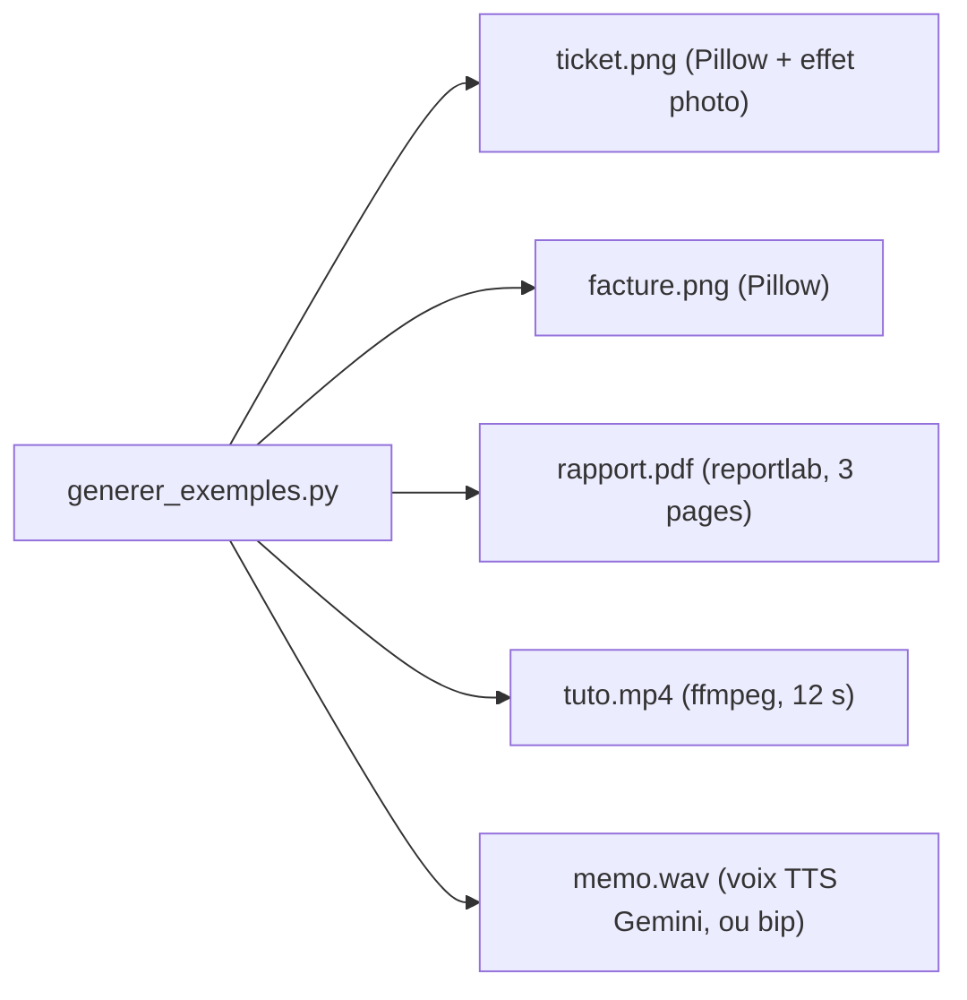

# Préparer son poste et premier appel

> [!NOTE]
> Dans cette leçon, vous allez installer le lab, générer les fichiers d'exemple fictifs et envoyer votre première image à Gemini en 6 lignes de Python.

## 1. Installer

Un **environnement virtuel** (venv) est un dossier qui contient un Python et ses bibliothèques, isolé du reste de votre machine.

```bash title="terminal"
cd files
python3 -m venv .venv && source .venv/bin/activate     # Windows : .venv\Scripts\activate
pip install -r requirements.txt
cp .env.example .env        # puis remplacez la valeur factice par votre clé
```

```text title="files/.env.example"
GOOGLE_API_KEY=votre-cle-api-ici
# MODEL=gemini-3.5-flash
```

Le SDK `google-genai` lit `GOOGLE_API_KEY` (ou `GEMINI_API_KEY`) tout seul ; `python-dotenv` charge le fichier `.env` au démarrage. Le nom du modèle vient de la variable `MODEL`, avec `gemini-3.5-flash` par défaut.

> [!WARNING]
> Le fichier `.env` contient votre clé : il ne doit **jamais** être partagé ni commité dans git. Ajoutez `.env` à votre `.gitignore`.

## 2. Générer les fichiers d'exemple

```bash title="terminal"
python generer_exemples.py
# OK : facture.png, memo.wav, rapport.pdf, ticket.png, tuto.mp4
```



| Fichier | Outil | Ce qu'il contient (fictif) |
| --- | --- | --- |
| `ticket.png` | Pillow | ticket de boulangerie, légèrement tourné, flou et bruité comme une photo |
| `facture.png` | Pillow | facture de papeterie avec HT, TVA 20 %, TTC |
| `rapport.pdf` | reportlab | rapport trimestriel de 3 pages avec des chiffres |
| `memo.wav` | modèle TTS Gemini | mémo vocal d'environ 11 secondes |
| `tuto.mp4` | ffmpeg | 4 étapes d'un tutoriel, 3 secondes chacune |

> [!TIP]
> Le mémo vocal est produit par un modèle de **synthèse vocale** (TTS, *text-to-speech*) de Gemini. Sans clé, le script écrit un simple bip : la transcription n'aura alors rien à dire, c'est normal.

## 3. Premier appel : décrire une image

```python title="premier_appel.py"
from pathlib import Path
from google import genai
from google.genai import types

client = genai.Client()                       # lit la clé dans l'environnement
image = types.Part.from_bytes(data=Path("ticket.png").read_bytes(), mime_type="image/png")
r = client.models.generate_content(model="gemini-3.5-flash",
                                   contents=[image, "Décris cette image en deux phrases."])
print(r.text, r.usage_metadata.prompt_token_count)
```

Trois idées à retenir :

1. `contents` est une **liste** : on y mélange librement des médias et du texte.
2. `Part.from_bytes` emballe des octets avec leur **type MIME** (`image/png`, `application/pdf`, `audio/wav`…), l'étiquette standard qui dit « ce sont des octets de quel format ».
3. `usage_metadata` donne les tokens consommés : c'est votre compteur de coût.

```quiz
question: "Que contient l'argument contents dans l'appel ci-dessus ?"
options:
  - "Uniquement le texte de la question"
  - "Une liste qui mélange l'image (Part) et la consigne en texte"
  - "Le chemin du fichier ticket.png sous forme de texte"
answer: 1
explanation: "On passe une liste de parties : un Part qui contient les octets de l'image et une chaîne de texte. Donner le chemin en texte ne servirait à rien, le modèle n'a pas accès à votre disque."
```

```quiz
question: "Vous oubliez de définir GOOGLE_API_KEY. Que se passe-t-il ?"
options:
  - "Le SDK utilise une clé de démonstration"
  - "genai.Client() lève une erreur qui signale l'absence de clé"
  - "La requête part et la réponse est vide"
answer: 1
explanation: "Sans clé (ni configuration Vertex AI), le client refuse de se créer. C'est voulu : une erreur immédiate et claire vaut mieux qu'un comportement silencieux."
```

## Exercice : changer de consigne

Modifiez le prompt pour obtenir uniquement le nom du commerce et le total, sur une seule ligne au format `Commerce ; total`. Que se passe-t-il si vous ajoutez « Si tu n'es pas sûr, écris INCONNU » ?

<details>
<summary>Voir la solution</summary>

```python
contents=[image, "Donne uniquement le nom du commerce et le total TTC, au format "
                 "« Commerce ; total ». Si tu n'es pas sûr, écris INCONNU."]
```

Réponse attendue : `BOULANGERIE DU CANAL ; 9,50 EUR`. La phrase « Si tu n'es pas sûr… » donne au modèle une **porte de sortie** : sans elle, il a tendance à toujours répondre quelque chose, même sur une image illisible. Le module 4 remplacera ce format libre par un vrai JSON validé.

</details>

## Résultat obtenu

Exécution réelle le 2026-10-15, `gemini-3.5-flash` :

```text title="sortie"
Il s'agit d'un ticket de caisse de la « BOULANGERIE DU CANAL » située à Lyon, daté du
14 octobre 2026. Le récépissé détaille l'achat de croissants, d'une baguette tradition,
d'un café et d'un jus d'orange pour un montant total de 9,50 euros payé par carte.
1073
```

Malgré la rotation, le flou et le bruit ajoutés, le texte est bien lu.

- [ ] J'ai un venv avec les dépendances et une clé dans `.env`
- [ ] J'ai généré les cinq fichiers d'exemple
- [ ] Je sais envoyer une image avec `Part.from_bytes` et lire `usage_metadata`
