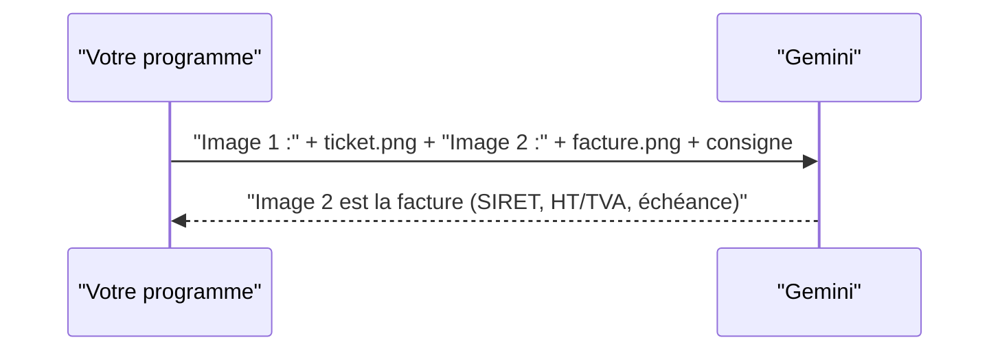

# Une image, plusieurs images, comparer

> [!NOTE]
> Dans cette leçon, vous allez écrire la fonction `part_from()` qui prépare n'importe quel fichier, puis envoyer **deux images** dans la même requête pour les comparer.

## Une fonction pour tous les fichiers

Plutôt que de répéter `Part.from_bytes(...)` partout, le lab centralise la préparation dans `part_from()`. Elle devine le type MIME d'après l'extension et choisit inline ou API Files.

```python title="files/multimodal.py (extrait)"
INLINE_MAX = 20 * 1024 * 1024
MIME = {".png": "image/png", ".jpg": "image/jpeg", ".pdf": "application/pdf",
        ".wav": "audio/wav", ".mp4": "video/mp4", ...}

def mime_of(path) -> str:
    p = Path(path)
    return MIME.get(p.suffix.lower()) or mimetypes.guess_type(p.name)[0] or "application/octet-stream"

def doit_uploader(path, forcer_files=False) -> bool:
    return forcer_files or mime_of(path).startswith("video/") or Path(path).stat().st_size > INLINE_MAX

def part_from(client, path, forcer_files=False):
    if doit_uploader(path, forcer_files):
        return uploader(client, path)          # API Files, voir leçon suivante
    return types.Part.from_bytes(data=Path(path).read_bytes(), mime_type=mime_of(path))
```

Code complet : [multimodal.py](../files/multimodal.py).

Formats d'image acceptés par Gemini : PNG, JPEG, WEBP, HEIC et HEIF.

## Plusieurs images : étiquetez-les

Une requête peut contenir de nombreuses images (la documentation annonce jusqu'à 3 600). Le piège : sans repère, le modèle et vous ne parlerez pas de la même image. La solution est simple : **placez un texte « Image 1 : » juste avant chaque image**.

```python title="files/multimodal.py (extrait)"
def comparer_images(client, chemins):
    parts = []
    for i, c in enumerate(chemins, 1):
        parts += [f"Image {i} :", part_from(client, c)]
    parts.append("Compare ces justificatifs : type, émetteur, date, total. "
                 "Lequel est une facture d'entreprise ? Réponds en 5 lignes maximum.")
    r = generer(client, parts)
    return {"texte": r.text, "tokens": tokens(r)}
```



| Cas d'usage | Ce qu'on envoie | Question type |
| --- | --- | --- |
| Détection de doublon | deux photos de tickets | « Est-ce le même achat ? » |
| Contrôle qualité | photo de référence + photo du produit | « Quelles différences visibles ? » |
| Avant / après | deux photos d'un chantier | « Qu'est-ce qui a été fait ? » |
| Tri | dix justificatifs | « Classe-les par type et par date » |

> [!TIP]
> Mettez la consigne **après** les images. La documentation Gemini recommande cet ordre lorsque la requête contient un seul média, et il reste lisible avec plusieurs.

```quiz
question: "Pourquoi ajouter le texte « Image 1 : » avant chaque image ?"
options:
  - "Parce que l'API refuse plusieurs images sans étiquette"
  - "Pour que la réponse puisse désigner chaque image sans ambiguïté"
  - "Pour réduire le nombre de tokens"
answer: 1
explanation: "L'API accepte des images sans étiquette, mais la réponse dirait « la première » ou « celle de gauche », ce qui devient ambigu au-delà de deux. L'étiquette ajoute quelques tokens, elle ne les réduit pas."
```

```quiz
question: "Votre comparaison de deux photos coûte environ 2 200 tokens d'entrée. Combien environ pour dix photos similaires ?"
options:
  - "Toujours environ 2 200 : seules les images différentes comptent"
  - "Environ 11 000 : chaque image ajoute ses propres tokens"
  - "Environ 22 000 000"
answer: 1
explanation: "Chaque image est convertie en tokens indépendamment, environ 1 100 ici. Dix images font donc à peu près cinq fois plus que deux. Pensez-y avant d'envoyer des lots de photos haute résolution."
```

## Exercice : détecter un doublon

Copiez `ticket.png` en `ticket2.png`, puis écrivez l'appel qui demande si les deux images sont le même achat. Que doit-on vérifier en plus, sans IA, avant de rejeter une note de frais pour doublon ?

<details>
<summary>Voir la solution</summary>

```python
res = comparer_images(client, ["ticket.png", "ticket2.png"])
# ou, avec une consigne dédiée :
parts = ["Image 1 :", part_from(client, "ticket.png"), "Image 2 :", part_from(client, "ticket2.png"),
         "Ces deux justificatifs correspondent-ils au même achat ? Réponds OUI ou NON puis justifie "
         "avec le commerçant, la date, l'heure, le numéro de ticket et le total."]
```

Avant de rejeter : comparer **en Python** les champs extraits (numéro de ticket, date, heure, total) après une extraction JSON (module 4). Le modèle peut se tromper ; une décision qui pénalise quelqu'un passe par une règle vérifiable et une validation humaine.

</details>

## Résultat obtenu

`python multimodal.py comparer ticket.png facture.png`, exécution réelle du 2026-10-15 :

```text title="sortie (extrait)"
* Image 1 : Ticket de caisse émis par la Boulangerie du Canal le 14/10/2026 pour un total TTC de 9,50 €.
* Image 2 : Facture émise par la Papeterie Martin & Fils le 02/10/2026 pour un total TTC de 87,60 € (73,00 € HT).

La facture d'entreprise est l'Image 2 : elle mentionne un client professionnel (Atelier Nord),
un numéro SIRET, le détail HT/TVA et une date d'échéance de paiement par virement.
"tokens": {"entree": 2207, "sortie": 164}
```

- [ ] Je sais préparer un fichier avec `part_from()` et son type MIME
- [ ] Je sais envoyer plusieurs images étiquetées dans une seule requête
- [ ] Je sais estimer le coût d'un lot d'images à partir d'une mesure
