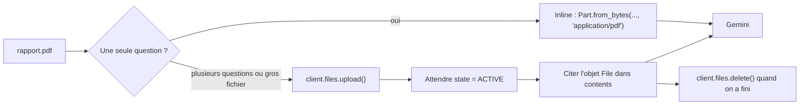

# Un PDF, inline puis via l'API Files

> [!NOTE]
> Dans cette leçon, vous allez résumer un rapport PDF de 3 pages de deux façons : en l'envoyant **inline**, puis en le **téléversant** avec l'API Files, en attendant qu'il soit prêt et en le supprimant ensuite.

## Ce que Gemini fait d'un PDF

Gemini lit chaque page **à la fois comme du texte et comme une image** : il comprend donc aussi les tableaux, les graphiques et la mise en page, pas seulement le texte brut. Limites documentées : **1 000 pages** et **50 Mo**, environ **258 tokens par page**.



## Inline

C'est la même chose qu'une image, seul le type MIME change :

```python
pdf = types.Part.from_bytes(data=Path("rapport.pdf").read_bytes(), mime_type="application/pdf")
r = client.models.generate_content(model=MODEL, contents=[pdf, "Résume ce document."])
```

## Via l'API Files

```python title="files/multimodal.py (extrait)"
ENVOYES = []  # fichiers envoyés pendant ce run, supprimés à la fin

def uploader(client, path, attente_max=120):
    """Envoie le fichier à l'API Files (stocké 48 h) et attend qu'il soit ACTIVE."""
    f = client.files.upload(file=str(path), config={"mime_type": mime_of(path)})
    ENVOYES.append(f.name)
    debut = time.time()
    while f.state and f.state.name == "PROCESSING":
        if time.time() - debut > attente_max:
            raise TimeoutError(f"{path} toujours en traitement")
        time.sleep(2)
        f = client.files.get(name=f.name)
    if f.state and f.state.name == "FAILED":
        raise RuntimeError(f"Traitement échoué pour {path}")
    return f

def nettoyer(client):
    while ENVOYES:
        client.files.delete(name=ENVOYES.pop())
```

L'objet `File` renvoyé (nom du type `files/abc123`) se met directement dans `contents`, comme un `Part`. Un fichier passe par trois **états** : `PROCESSING` (en cours de préparation, fréquent pour les vidéos), `ACTIVE` (utilisable) ou `FAILED`.

| | Inline | API Files |
| --- | --- | --- |
| Envoi | à chaque requête | une fois, puis on cite l'identifiant |
| Conservation | aucune | 48 h, 20 Go par projet |
| Taille | petite (on garde 20 Mo de marge) | jusqu'à 2 Go par fichier (50 Mo pour un PDF) |
| Nettoyage | rien à faire | `client.files.delete()` |
| Idéal pour | une question sur un petit document | plusieurs questions, vidéo, gros fichiers |

> [!WARNING]
> Un fichier téléversé reste accessible à **toute personne qui utilise la même clé d'API** pendant 48 h (`client.files.list()` les montre tous). Supprimez vos fichiers, et n'utilisez pas une clé partagée pour des documents confidentiels.

```quiz
question: "Juste après client.files.upload() d'une vidéo, l'état est PROCESSING. Que faire ?"
options:
  - "L'utiliser tout de suite, Gemini attendra"
  - "Relire le fichier avec client.files.get() jusqu'à ce qu'il soit ACTIVE"
  - "Le téléverser une seconde fois"
answer: 1
explanation: "Un fichier en PROCESSING n'est pas encore utilisable : la requête échouerait. On interroge son état toutes les quelques secondes, avec un délai maximum pour ne pas boucler sans fin."
```

```quiz
question: "Le résumé du PDF inline et celui via l'API Files ont exactement le même nombre de tokens d'entrée (1 622). Pourquoi ?"
options:
  - "C'est une coïncidence"
  - "Le mode d'envoi ne change pas la façon dont le document est converti en tokens"
  - "L'API Files compresse le PDF"
answer: 1
explanation: "Inline ou API Files ne sont que deux moyens de transport. Une fois arrivé, le PDF est découpé de la même façon. L'API Files fait gagner de la bande passante et du temps quand on réutilise le fichier, pas des tokens."
```

## Le prompt du résumeur

```python title="files/multimodal.py (extrait)"
def resumer_pdf(client, pdf_path, via_files=False):
    prompt = ("Résume ce document pour un manager pressé. Ne cite que des chiffres "
              "présents dans le document, en indiquant la page.")
    r = generer(client, [part_from(client, pdf_path, via_files), prompt], schema=ResumePdf)
    return {**ResumePdf.model_validate_json(r.text).model_dump(), "tokens": tokens(r)}
```

Demander **la page** de chaque chiffre permet au lecteur de vérifier en quelques secondes : c'est une forme simple de **citation de source**.

## Exercice : poser trois questions au même PDF

Écrivez le code qui téléverse `rapport.pdf` **une seule fois**, pose trois questions différentes (le canal en baisse, le risque principal, l'objectif du T4), puis supprime le fichier, même si une question échoue.

<details>
<summary>Voir la solution</summary>

```python
f = uploader(client, "rapport.pdf")
try:
    for q in ["Quel canal de vente est en baisse ?",
              "Quel est le risque principal ?",
              "Quel est l'objectif de chiffre d'affaires du T4 ?"]:
        print(q, "->", generer(client, [f, q]).text)
finally:
    client.files.delete(name=f.name)   # exécuté même en cas d'erreur
```

Réponses attendues d'après le document : les ventes aux professionnels (-5 %), la hausse du prix du bois (+12 %), 450 000 EUR.

</details>

## Résultat obtenu

`python multimodal.py pdf rapport.pdf --files`, exécution réelle du 2026-10-15 :

```json title="sortie (extrait)"
{
  "titre": "Rapport d'activité T3 2026 - Atelier Nord",
  "resume": "Au T3 2026, Atelier Nord enregistre un chiffre d'affaires de 412 000 EUR, en hausse de 8 % par rapport au T2, avec une marge brute de 31 %. ...",
  "chiffres_cles": [
    "Chiffre d'affaires T3 : 412 000 EUR (page 1)",
    "Ventes professionnels : 63 000 EUR (15 %), baisse de 5 % (page 2)",
    "Hausse du prix du bois : 12 % depuis juillet (page 3)",
    "Objectif de CA pour le T4 : 450 000 EUR (page 3)"
  ],
  "tokens": {"entree": 1622, "sortie": 542}
}
```

Après l'exécution, `client.files.list()` ne contient plus le fichier : `nettoyer()` l'a supprimé.

- [ ] Je sais envoyer un PDF inline
- [ ] Je sais téléverser un fichier, attendre `ACTIVE` et le supprimer
- [ ] Je sais demander des chiffres avec leur page pour pouvoir vérifier
