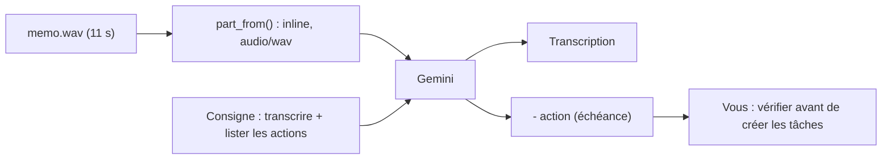

# Audio : transcrire et extraire des actions

> [!NOTE]
> Dans cette leçon, vous allez transcrire un mémo vocal fictif et en tirer, dans la même requête, la liste des actions à faire avec leur échéance.

## Ce que Gemini sait faire avec du son

- **Transcrire** : écrire mot à mot ce qui est dit (on parle aussi de *speech-to-text*).
- **Résumer, traduire, répondre à des questions** sur l'enregistrement.
- **Décrire** des sons non vocaux (une sonnerie, de la musique).

Formats acceptés : WAV, MP3, AIFF, AAC, OGG, FLAC, M4A, Opus, WebM, entre autres. Un prompt peut contenir jusqu'à **9 h 30** d'audio ; chaque seconde coûte environ **32 tokens**.



## Le code

```python title="files/multimodal.py (extrait)"
def transcrire(client, audio_path):
    r = generer(client, [part_from(client, audio_path),
                         "Transcris cet audio mot à mot en français, puis liste les actions à faire "
                         "sous la forme « - action (échéance) »."])
    return {"texte": r.text, "tokens": tokens(r)}
```

```bash title="terminal"
python multimodal.py audio memo.wav
```

Une seule requête fait deux choses : transcrire et structurer. C'est l'intérêt d'un modèle multimodal par rapport à un logiciel de dictée classique suivi d'un second traitement.

| Besoin | Consigne conseillée |
| --- | --- |
| Compte rendu exact | « Transcris mot à mot, sans reformuler. » |
| Réunion à plusieurs | « Indique qui parle (Intervenant 1, 2…) et l'horodatage MM:SS. » |
| Lecture rapide | « Résume en 3 points, puis liste les décisions. » |
| Langue étrangère | « Transcris dans la langue d'origine, puis traduis en français. » |

> [!WARNING]
> Une voix est une **donnée personnelle** : on peut identifier quelqu'un à sa voix. N'envoyez pas l'enregistrement d'une réunion sans que les participants le sachent, et vérifiez la politique de votre organisation sur l'usage des données par le fournisseur.

> [!TIP]
> Les chiffres dictés (« quatre cent vingt euros ») sont souvent réécrits en chiffres (« 420 € ») dans la transcription. C'est pratique, mais ce n'est plus du « mot à mot » strict : si vous avez besoin d'une transcription légale exacte, dites-le explicitement et relisez.

```quiz
question: "Un enregistrement de 10 minutes représente environ combien de tokens d'entrée ?"
options:
  - "Environ 320"
  - "Environ 19 000"
  - "Environ 1 900 000"
answer: 1
explanation: "32 tokens par seconde × 600 secondes = 19 200 tokens, plus quelques dizaines pour la consigne. C'est modeste par rapport à la fenêtre d'un million de tokens des modèles Flash."
```

```quiz
question: "Quelles bonnes pratiques s'appliquent à la transcription d'une réunion d'équipe ?"
options:
  - "Prévenir les participants que la réunion est enregistrée et analysée par une IA"
  - "Relire la liste des actions avant de l'envoyer à l'équipe"
  - "Supprimer la consigne pour que le modèle soit plus créatif"
answer: [0, 1]
explanation: "La voix est une donnée personnelle : on informe. Et la liste d'actions est une proposition : un humain la relit, car une erreur d'échéance ou de responsable a des conséquences. Une consigne précise rend la sortie plus fiable, pas moins."
```

## Exercice : sortir les actions en JSON

Plutôt qu'une liste en texte, obtenez un JSON `[{"action": ..., "echeance": ..., "responsable": ...}]` exploitable par un tableur. Utilisez un schéma Pydantic comme dans le module 4 (aperçu : `generer(client, contents, schema=MaClasse)`).

<details>
<summary>Voir la solution</summary>

```python
from pydantic import BaseModel

class Action(BaseModel):
    action: str
    echeance: str | None
    responsable: str | None

class Memo(BaseModel):
    transcription: str
    actions: list[Action]

r = generer(client, [part_from(client, "memo.wav"),
                     "Transcris puis extrais les actions. Laisse null ce qui n'est pas dit."],
            schema=Memo)
memo = Memo.model_validate_json(r.text)
for a in memo.actions:
    print(a.action, "|", a.echeance, "|", a.responsable)
```

« Laisse null ce qui n'est pas dit » évite que le modèle invente un responsable.

</details>

## Résultat obtenu

`python multimodal.py audio memo.wav`, exécution réelle du 2026-10-15 (voix de synthèse, texte fictif) :

```text title="sortie"
Transcription :
« Bonjour, c'est Camille du service achats. Petit rappel pour la réunion de jeudi, il faut
valider le devis de 420 € pour les chaises et envoyer le bon de commande avant vendredi midi. Merci ! »

Actions à faire :
- Valider le devis de 420 € pour les chaises (jeudi / pour la réunion de jeudi)
- Envoyer le bon de commande (avant vendredi midi)

"tokens": {"entree": 295, "sortie": 117}
```

La transcription est fidèle ; « quatre cent vingt euros » est devenu « 420 € », comme annoncé.

- [ ] Je sais envoyer un fichier audio et obtenir une transcription
- [ ] Je sais demander, dans la même requête, une liste d'actions structurée
- [ ] Je sais estimer le coût d'un enregistrement à partir de sa durée
- [ ] Je connais les précautions liées aux enregistrements de voix
