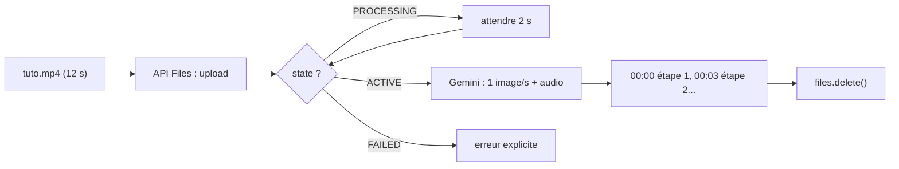

# Vidéo courte : étapes horodatées

> [!NOTE]
> Dans cette leçon, vous allez envoyer une vidéo de 12 secondes par l'API Files et obtenir la liste des étapes montrées, chacune avec son **horodatage** (le moment où elle apparaît, au format MM:SS).

## Comment Gemini « regarde » une vidéo

Par défaut, le modèle **échantillonne une image par seconde** et écoute la piste audio. Une vidéo, c'est donc une suite de photos + un son : environ **100 tokens par seconde** en résolution par défaut (environ 300 en haute résolution). Avec un modèle à 1 million de tokens de contexte, cela permet jusqu'à environ 3 heures de vidéo.



## Le code

Notre `part_from()` envoie **toujours** une vidéo par l'API Files ; `uploader()` attend l'état `ACTIVE` (voir la leçon sur les PDF). Il reste la consigne :

```python title="files/multimodal.py (extrait)"
def decrire_video(client, video_path):
    r = generer(client, [part_from(client, video_path),
                         "Liste les étapes montrées dans cette vidéo avec leur horodatage (MM:SS)."])
    return {"texte": r.text, "tokens": tokens(r)}
```

```bash title="terminal"
python multimodal.py video tuto.mp4
```

Et le bloc final du programme garantit la suppression, même en cas d'erreur :

```python title="files/multimodal.py (extrait)"
try:
    res = ACTIONS[action](client, args[0])
finally:
    nettoyer(client)
```

| Source de la vidéo | Comment l'envoyer | Remarque |
| --- | --- | --- |
| Fichier local | API Files | la voie la plus sûre |
| Vidéo YouTube **publique** | `types.Part(file_data=types.FileData(file_uri="https://www.youtube.com/watch?v=..."))` | fonction en préversion, quota quotidien en offre gratuite |
| Cloud Storage (Vertex AI) | URI `gs://…` | voir la formation Vertex AI |

> [!TIP]
> Pour une vidéo où tout va très vite (sport, écran de logiciel), l'échantillonnage à 1 image par seconde peut rater des détails. On peut découper la vidéo en extraits, ou régler la fréquence d'échantillonnage (voir la page « Compréhension vidéo » de la documentation).

> [!WARNING]
> Une vidéo de personnes reconnaissables contient des données personnelles. Mêmes précautions que pour l'audio : information, base légale, et suppression du fichier après usage.

```quiz
question: "Une action dure une demi-seconde entre la 4e et la 5e seconde de la vidéo. Que risque-t-on ?"
options:
  - "Rien, le modèle voit chaque image de la vidéo"
  - "Qu'elle soit manquée, car le modèle échantillonne par défaut une image par seconde"
  - "Que la vidéo soit refusée"
answer: 1
explanation: "Avec 1 image par seconde, un événement très bref peut tomber entre deux images. Pour les vidéos rapides, découpez-les ou augmentez la fréquence d'échantillonnage."
```

```quiz
question: "Notre tuto.mp4 (12 s, sans piste audio) a coûté 811 tokens d'entrée. Qu'est-ce qui l'explique le mieux ?"
options:
  - "12 images à environ 65 tokens chacune, plus la consigne"
  - "Le poids du fichier en kilo-octets"
  - "Le nombre de mots de la réponse"
answer: 0
explanation: "Le coût dépend de la durée (nombre d'images échantillonnées) et de la résolution, pas du poids du fichier. Sans audio, il n'y a pas les 32 tokens par seconde de son. La réponse, elle, compte dans les tokens de sortie."
```

## Exercice : un chapitrage de vidéo

Vous avez une vidéo de formation interne de 20 minutes. Écrivez une consigne qui produit un chapitrage (titre + horodatage de début) et une question à choix multiple par chapitre. Estimez l'ordre de grandeur des tokens d'entrée.

<details>
<summary>Voir la solution</summary>

```python
consigne = ("Découpe cette vidéo en 4 à 8 chapitres. Pour chacun : horodatage de début (MM:SS), "
            "titre court, et une question à choix multiple (3 options, indique la bonne). "
            "N'invente rien qui ne soit pas montré ou dit dans la vidéo.")
res = generer(client, [part_from(client, "formation.mp4"), consigne])
```

Ordre de grandeur : 1 200 s × (environ 100 tokens image + 32 tokens audio) ≈ **160 000 tokens** d'entrée. C'est bien sous la limite d'un modèle à 1 million de tokens, mais nettement plus cher qu'une image : testez d'abord sur un extrait de 2 minutes.

</details>

## Résultat obtenu

`python multimodal.py video tuto.mp4`, exécution réelle du 2026-10-15 :

```text title="sortie"
Voici la liste des étapes présentées dans le tutoriel avec leurs horodatages :

- 00:00 - 00:02 : 1. Débranchez l'imprimante
- 00:03 - 00:05 : 2. Ouvrez le capot avant
- 00:06 - 00:08 : 3. Retirez la feuille coincée
- 00:09 - 00:11 : 4. Refermez et rebranchez

"tokens": {"entree": 811, "sortie": 123}
```

Les horodatages correspondent exactement au découpage de la vidéo générée (une étape toutes les 3 secondes), et le fichier a été supprimé de l'API Files à la fin.

- [ ] Je sais envoyer une vidéo par l'API Files et attendre l'état `ACTIVE`
- [ ] Je sais demander des horodatages au format MM:SS
- [ ] Je sais pourquoi un événement très bref peut être manqué
- [ ] Je supprime mes fichiers après usage
