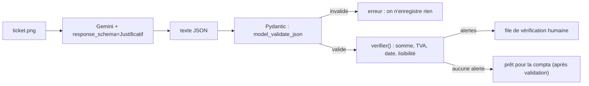

# Sortie JSON et contrôles automatiques

> [!NOTE]
> Dans cette leçon, vous allez obliger Gemini à répondre dans un **JSON** au format imposé, le valider avec Pydantic, puis vérifier les montants **en Python** : le modèle extrait, le code contrôle.

## Pourquoi un JSON imposé ?

Du texte libre est agréable à lire mais pénible à exploiter : où est le total ? avec une virgule ou un point ? Le **JSON** est un format de données structuré (des paires `"clé": valeur`) que n'importe quel programme ou tableur sait lire. Avec la **sortie structurée**, on donne au modèle un **schéma** (la liste des champs et de leurs types) et il est contraint de le respecter.



## Le schéma, avec Pydantic

**Pydantic** est une bibliothèque Python qui décrit des données avec des classes typées et vérifie qu'un JSON les respecte.

```python title="files/multimodal.py (extrait)"
class Ligne(BaseModel):
    libelle: str
    montant: float = Field(description="montant TTC de la ligne, en nombre (2.60)")

class Justificatif(BaseModel):
    type: str = Field(description="ticket, facture ou autre")
    commercant: str
    date: str = Field(description="au format AAAA-MM-JJ")
    numero: str | None = None
    lignes: list[Ligne]
    total_ttc: float
    tva: float | None = None
    devise: str = "EUR"
    lisible: bool = Field(description="false si l'image est trop floue pour être sûr")
```

Les `description` sont lues par le modèle : elles servent de consigne champ par champ. Le champ `lisible` est une **porte de sortie** : le modèle peut avouer qu'il n'est pas sûr.

```python title="files/multimodal.py (extrait)"
def generer(client, contents, schema=None, essais=4):
    config = types.GenerateContentConfig(temperature=0)
    if schema:
        config.response_mime_type = "application/json"
        config.response_schema = schema
    ...

def analyser_justificatif(client, image_path):
    r = generer(client, [part_from(client, image_path), PROMPT_JUSTIFICATIF], schema=Justificatif)
    j = Justificatif.model_validate_json(r.text)
    return {"justificatif": j.model_dump(), "alertes": verifier(j), "tokens": tokens(r)}
```

`temperature=0` rend les réponses plus stables d'un appel à l'autre : pour de l'extraction, on ne veut pas de créativité.

## Les contrôles : du code, pas de l'IA

```python title="files/multimodal.py (extrait)"
def verifier(j: Justificatif) -> list[str]:
    alertes = []
    somme = round(sum(l.montant for l in j.lignes), 2)
    if j.lignes and abs(somme - j.total_ttc) > 0.01:
        alertes.append(f"somme des lignes {somme} != total {j.total_ttc}")
    if j.tva is not None and not 0 <= j.tva < j.total_ttc:
        alertes.append(f"TVA incohérente : {j.tva}")
    if not (len(j.date) == 10 and j.date[4] == j.date[7] == "-"):
        alertes.append(f"date au mauvais format : {j.date}")
    if not j.lisible:
        alertes.append("image jugée peu lisible : vérification humaine")
    return alertes
```

| Qui fait quoi | Le modèle | Le code Python |
| --- | --- | --- |
| Lire une photo floue | oui | non |
| Additionner des montants | peut se tromper | toujours juste |
| Vérifier un format de date | approximatif | exact |
| Décider de rembourser | non | non : un humain |

> [!WARNING]
> Un JSON **valide** n'est pas un JSON **vrai**. Le schéma garantit la forme (un nombre est un nombre), pas que ce nombre est bien celui du ticket. D'où les contrôles et la validation humaine.

```quiz
question: "Que garantit response_schema ?"
options:
  - "Que les montants extraits sont exacts"
  - "Que la réponse respecte la structure demandée (champs et types)"
  - "Que le modèle ne lira jamais une image floue"
answer: 1
explanation: "La sortie structurée contraint la forme de la réponse. L'exactitude du contenu se vérifie autrement : contrôles déterministes, comparaison, relecture."
```

```quiz
question: "verifier() renvoie « somme des lignes 9.5 != total 12.0 ». Quelle est la bonne réaction ?"
options:
  - "Corriger automatiquement le total à 9,50"
  - "Envoyer le justificatif en vérification humaine avec l'alerte"
  - "Relancer le modèle jusqu'à ce que l'alerte disparaisse"
answer: 1
explanation: "Le code ne sait pas qui a raison : le total lu, une ligne mal lue, ou un ticket réellement faux. On ne corrige pas en silence et on ne relance pas « jusqu'à ce que ça passe » : un humain regarde l'image."
```

## Exercice : un contrôle de plus

Ajoutez à `verifier()` une alerte si la date du justificatif est **dans le futur** ou a **plus d'un an**. Ajoutez le test correspondant dans `test_multimodal.py`.

<details>
<summary>Voir la solution</summary>

```python
from datetime import date, timedelta

# dans verifier(), après le contrôle de format :
try:
    d = date.fromisoformat(j.date)
    if d > date.today() or d < date.today() - timedelta(days=365):
        alertes.append(f"date hors période : {j.date}")
except ValueError:
    pass  # déjà signalé par le contrôle de format
```

```python
def test_date_dans_le_futur():
    faux = dict(TICKET_OK, date="2099-01-01")
    res = mm.analyser_justificatif(FauxClient([json.dumps(faux)]), ICI / "ticket.png")
    assert any("hors période" in a for a in res["alertes"])
```

</details>

## Résultat obtenu

`python multimodal.py justificatif facture.png`, exécution réelle du 2026-10-15 :

```json title="sortie (extrait)"
{
  "justificatif": {
    "type": "facture", "commercant": "PAPETERIE MARTIN & FILS", "date": "2026-10-02",
    "numero": "F-2026-0193",
    "lignes": [
      {"libelle": "Ramette papier A4", "montant": 54.0},
      {"libelle": "Stylos bille (boîte)", "montant": 14.4},
      {"libelle": "Classeurs", "montant": 19.2}
    ],
    "total_ttc": 87.6, "tva": 14.6, "devise": "EUR", "lisible": true
  },
  "alertes": [],
  "tokens": {"entree": 1161, "sortie": 127}
}
```

Observation instructive : la facture affiche des montants **HT** par ligne (45,00 ; 12,00 ; 16,00), mais le schéma demandait le montant **TTC**. Le modèle a donc calculé 45 × 1,2 = 54,00, etc. Le résultat est juste et la somme vaut bien 87,60, mais ce sont des chiffres **calculés**, pas **recopiés**. Si vous voulez recopier exactement, ajoutez un champ `montant_ht` et laissez le code faire la multiplication.

- [ ] Je sais imposer un schéma de sortie avec Pydantic et `response_schema`
- [ ] Je sais valider la réponse avec `model_validate_json`
- [ ] Je sépare l'extraction (modèle) des contrôles (code)
- [ ] Je sais qu'un JSON valide n'est pas forcément vrai
