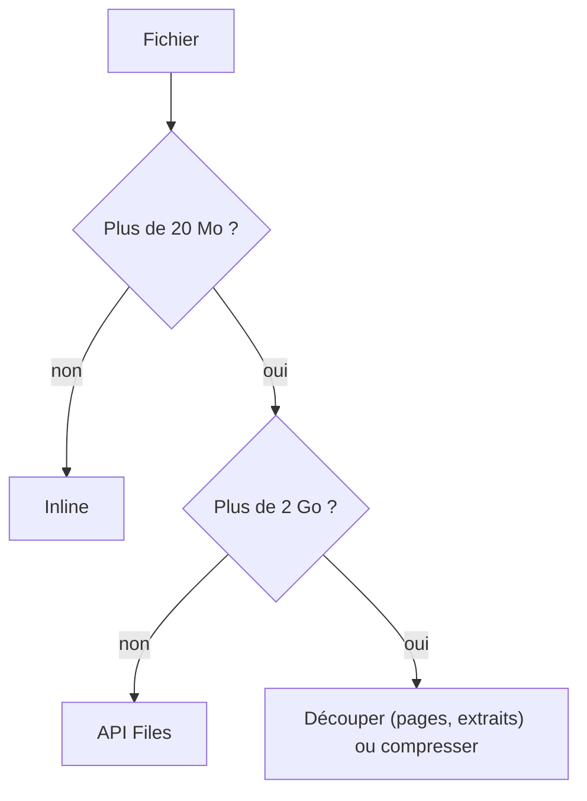

# Limites, coûts et bonnes pratiques

> [!NOTE]
> Dans cette leçon, vous allez rassembler les limites de taille de chaque modalité, calculer le coût d'un traitement à partir des tokens mesurés, et adopter une liste de bonnes pratiques pour la production.

## Les limites à connaître

Valeurs relevées dans la documentation de l'API Gemini le 2026-10-15 (elles évoluent : vérifiez les pages citées en références).

| Élément | Limite documentée |
| --- | --- |
| Requête inline | 20 Mo au total selon les guides image, audio et vidéo ; le tableau des méthodes d'envoi annonce jusqu'à 100 Mo |
| PDF | 50 Mo ou 1 000 pages, inline comme via l'API Files |
| API Files | 2 Go par fichier, 20 Go par projet, conservation 48 h |
| URL externe | 15 Mo par fichier |
| Images | jusqu'à 3 600 par requête |
| Audio | jusqu'à 9 h 30 par prompt |
| Vidéo | environ 3 h en résolution par défaut avec un modèle à 1 million de tokens ; jusqu'à 10 vidéos par requête |



## Calculer un coût

Le prix se calcule en **tokens**, séparément pour l'entrée et la sortie :

$$
\text{coût} = \frac{\text{tokens d'entrée}}{10^6} \times P_{\text{entrée}} + \frac{\text{tokens de sortie}}{10^6} \times P_{\text{sortie}}
$$

où $P$ est le prix par million de tokens affiché sur la page « Tarifs » pour votre modèle. Certains modèles ont un prix d'entrée différent pour l'audio : lisez bien la ligne correspondante.

Nos mesures réelles (module 1) donnent la base du calcul :

| Traitement | Entrée | Sortie | Pour 1 000 documents |
| --- | --- | --- | --- |
| Justificatif (ticket) | 1 123 | 133 | environ 1,1 M d'entrée, 0,13 M de sortie |
| Résumé de PDF (3 pages) | 1 622 | 542 | environ 1,6 M d'entrée, 0,54 M de sortie |
| Mémo vocal (11 s) | 295 | 117 | environ 0,3 M d'entrée, 0,12 M de sortie |

> [!TIP]
> Pour estimer **avant** de payer, utilisez `client.models.count_tokens(model=MODEL, contents=[...])` : il renvoie le nombre de tokens d'entrée sans générer de réponse.

```quiz
question: "Que faire pour réduire le coût d'un traitement de 10 000 photos de tickets ?"
options:
  - "Redimensionner les photos à une taille raisonnable avant l'envoi"
  - "Utiliser un modèle « lite » si sa qualité d'extraction suffit sur un échantillon testé"
  - "Augmenter media_resolution au maximum"
answer: [0, 1]
explanation: "Moins de pixels utiles = moins de tuiles, et un modèle plus léger coûte moins par token. Augmenter la résolution fait l'inverse : utile pour les petits caractères, mais plus cher. Dans tous les cas, mesurez la qualité sur un échantillon."
```

## Bonnes pratiques

| Pratique | Pourquoi |
| --- | --- |
| Consigne **après** le média, précise et en français | réponses plus pertinentes |
| Sortie structurée (JSON + schéma) | exploitable par le code, validable |
| `temperature=0` pour l'extraction | réponses stables |
| Porte de sortie (`lisible`, `null`, « INCONNU ») | le modèle n'invente pas pour combler |
| Contrôles en Python | les calculs et formats sont vérifiés à coup sûr |
| Réessais avec attente sur 429/503 | les quotas et surcharges sont normaux |
| `files.delete()` après usage | pas de documents qui traînent 48 h |
| Données fictives pour tester, minimisation en production | confidentialité |
| Humain dans la boucle pour toute décision | responsabilité |

Les réessais du lab :

```python title="files/multimodal.py (extrait)"
for i in range(essais):
    try:
        return client.models.generate_content(model=MODEL, contents=contents, config=config)
    except errors.APIError as e:
        if e.code not in (429, 500, 503) or i == essais - 1:
            raise
        time.sleep(5 * 2 ** i)  # 5 s, 10 s, 20 s
```

Le code **429** signifie « trop de requêtes » (quota dépassé), **503** « service momentanément indisponible ». Attendre de plus en plus longtemps entre deux essais s'appelle un **backoff exponentiel**. Une erreur **400** (requête invalide) ne se réessaie pas : elle échouerait pareil.

> [!WARNING]
> Ne renvoyez jamais à l'infini : fixez un nombre d'essais maximum. Et ne réessayez pas une erreur 400 ou 403, corrigez la requête ou la clé.

```quiz
question: "Une requête renvoie 400 INVALID_ARGUMENT. Que fait notre fonction generer() ?"
options:
  - "Elle réessaie 4 fois avec attente"
  - "Elle relève l'erreur immédiatement"
  - "Elle renvoie une réponse vide"
answer: 1
explanation: "Seuls 429, 500 et 503 sont considérés comme passagers. Une 400 indique une requête mal formée (fichier trop gros, type MIME faux…) : réessayer ne changerait rien."
```

## Exercice : estimer un budget

Votre service comptable reçoit environ 800 justificatifs par mois. À partir du tableau des mesures et en notant $P_e$ et $P_s$ les prix par million de tokens d'entrée et de sortie, écrivez la formule du coût mensuel. Puis écrivez le code qui mesure les tokens d'entrée de `ticket.png` **sans** générer de réponse.

<details>
<summary>Voir la solution</summary>

Coût mensuel ≈ $800 \times \left(\frac{1\,123}{10^6} P_e + \frac{133}{10^6} P_s\right) \approx 0{,}9\,P_e + 0{,}11\,P_s$ (en unités monétaires de la grille tarifaire).

```python
from google import genai
from google.genai import types
from pathlib import Path

client = genai.Client()
img = types.Part.from_bytes(data=Path("ticket.png").read_bytes(), mime_type="image/png")
print(client.models.count_tokens(model="gemini-3.5-flash", contents=[img]).total_tokens)
```

Ajoutez une marge (réessais, photos plus grandes) et remesurez sur vos vraies photos.

</details>

## Résultat obtenu

`count_tokens` sur l'image seule, exécution réelle du 2026-10-15 :

```text title="sortie"
count_tokens image seule 1065
```

Le reste des 1 123 tokens mesurés à l'extraction correspond à la consigne et au schéma.

- [ ] Je connais les limites de taille de chaque modalité et où les vérifier
- [ ] Je sais calculer un coût à partir des tokens et de la grille tarifaire
- [ ] Je sais estimer les tokens avant de payer avec `count_tokens`
- [ ] Je réessaie seulement les erreurs passagères, avec un maximum
