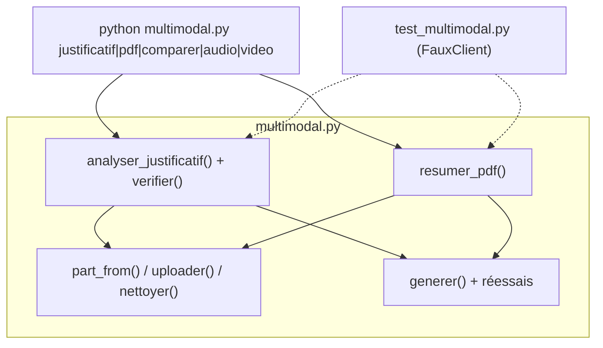

# Projet final : analyseur de justificatifs et résumeur de PDF

> [!NOTE]
> Dans cette leçon, vous allez assembler et tester le lab complet : tests automatiques sans clé, puis exécution réelle sur le ticket, la facture et le rapport, et enfin une extension à un dossier entier de justificatifs.

## Le cahier des charges

1. Une photo de ticket ou de facture → un JSON avec commerçant, date (AAAA-MM-JJ), lignes, total TTC, TVA.
2. Des **alertes** quand le code détecte une incohérence (somme, TVA, date, lisibilité).
3. Un PDF → titre, résumé de 3 phrases, points clés, chiffres **avec leur page**.
4. Aucun fichier ne reste dans l'API Files après l'exécution.
5. Des tests qui tournent **sans clé ni réseau**.



## Les fichiers du lab

| Fichier | Rôle |
| --- | --- |
| [multimodal.py](../files/multimodal.py) | tout le code : préparation des fichiers, appels, schémas, contrôles, ligne de commande |
| [generer_exemples.py](../files/generer_exemples.py) | crée les fichiers d'exemple fictifs |
| [test_multimodal.py](../files/test_multimodal.py) | 7 tests avec un faux client |
| [requirements.txt](../files/requirements.txt) | dépendances |
| `.env.example` (dans `files/`) | modèle de configuration (valeur factice) |

## Tester sans clé : le faux client

Un **test unitaire** vérifie une partie du code de façon automatique. Pour ne dépendre ni d'une clé ni du réseau, on remplace le vrai client par un **faux** qui renvoie des réponses écrites à l'avance :

```python title="files/test_multimodal.py (extrait)"
class FauxClient:
    def __init__(self, textes, erreurs=0):
        self.textes, self.erreurs, self.appels = list(textes), erreurs, []
        self.models = NS(generate_content=self._generer)
        ...

def test_justificatif_incoherent_genere_des_alertes():
    faux = dict(TICKET_OK, total_ttc=12.0, date="14/10/2026", lisible=False)
    res = mm.analyser_justificatif(FauxClient([json.dumps(faux)]), ICI / "ticket.png")
    texte = " ".join(res["alertes"])
    assert "somme des lignes 9.5 != total 12.0" in texte
    assert "mauvais format" in texte and "vérification humaine" in texte
```

On teste ainsi **notre** logique (contrôles, choix inline/Files, nettoyage, réessais) sans payer d'appels.

```quiz
question: "Que vérifie un test qui utilise FauxClient ?"
options:
  - "La qualité de lecture de Gemini sur une photo floue"
  - "Notre code autour du modèle : validation, contrôles, réessais, nettoyage"
  - "Que la clé d'API est valide"
answer: 1
explanation: "Le faux client renvoie ce qu'on lui dit : il ne mesure pas le modèle. Il garantit que notre code réagit bien à chaque cas, y compris les erreurs. La qualité du modèle se vérifie par l'exécution réelle sur des exemples connus."
```

```quiz
question: "Quelles commandes lancer avant de considérer le projet terminé ?"
options:
  - "pytest (sans clé)"
  - "Une exécution réelle sur chaque fichier d'exemple, comparée aux valeurs attendues"
  - "Aucune, le JSON est garanti par le schéma"
answer: [0, 1]
explanation: "Les deux sont complémentaires : pytest prouve que la logique est juste, l'exécution réelle prouve que le modèle lit correctement vos documents. Le schéma ne garantit que la forme."
```

## Lancer

```bash title="terminal"
pytest -q                                      # sans clé
python multimodal.py justificatif ticket.png   # avec clé
python multimodal.py pdf rapport.pdf
```

> [!TIP]
> Gardez des **valeurs attendues** pour vos fichiers d'exemple (ici : total 9,50 ; 87,60 ; CA 412 000 EUR). À chaque changement de modèle ou de consigne, relancez et comparez : c'est une mini-évaluation.

> [!WARNING]
> En production, ne laissez pas passer automatiquement un justificatif vers la comptabilité, même sans alerte : affichez le JSON **à côté de l'image** pour qu'une personne valide en un coup d'œil.

## Exercice : traiter un dossier entier

Écrivez un script `lot_justificatifs.py` qui analyse toutes les images `*.png` et `*.jpg` d'un dossier et écrit un fichier `justificatifs.csv` (une ligne par fichier : nom, commerçant, date, total, alertes). Un fichier en erreur ne doit pas arrêter le lot.

<details>
<summary>Voir la solution</summary>

```python title="lot_justificatifs.py"
import csv
import sys
from pathlib import Path

from google import genai

import multimodal as mm

dossier = Path(sys.argv[1] if len(sys.argv) > 1 else ".")
client = genai.Client()
with open("justificatifs.csv", "w", newline="", encoding="utf-8") as f:
    w = csv.writer(f)
    w.writerow(["fichier", "commercant", "date", "total_ttc", "alertes"])
    for img in sorted([*dossier.glob("*.png"), *dossier.glob("*.jpg")]):
        try:
            r = mm.analyser_justificatif(client, img)
            j = r["justificatif"]
            w.writerow([img.name, j["commercant"], j["date"], j["total_ttc"], " ; ".join(r["alertes"])])
        except Exception as e:
            w.writerow([img.name, "", "", "", f"ERREUR {type(e).__name__}"])
        print(img.name, "ok")
```

Avec les fichiers du lab, vous obtenez deux lignes : le ticket (9.5) et la facture (87.6), sans alerte. Ouvrez le CSV dans un tableur pour la validation humaine.

</details>

## Résultat obtenu

Tests automatiques, exécutés le 2026-10-15 sans clé :

```text title="pytest -v"
test_multimodal.py::test_justificatif_coherent PASSED
test_multimodal.py::test_justificatif_incoherent_genere_des_alertes PASSED
test_multimodal.py::test_json_invalide_leve_une_erreur PASSED
test_multimodal.py::test_mime_et_choix_inline_ou_files PASSED
test_multimodal.py::test_pdf_via_files_puis_nettoyage PASSED
test_multimodal.py::test_comparaison_etiquette_chaque_image PASSED
test_multimodal.py::test_reessai_sur_503 PASSED
7 passed in 0.33s
```

Exécution réelle, `python multimodal.py justificatif ticket.png` (`gemini-3.5-flash`) :

```json title="sortie (extrait)"
{
  "justificatif": {
    "type": "ticket", "commercant": "BOULANGERIE DU CANAL", "date": "2026-10-14", "numero": "004521",
    "lignes": [
      {"libelle": "2 x Croissant", "montant": 2.6},
      {"libelle": "1 x Baguette tradition", "montant": 1.3},
      {"libelle": "1 x Café allongé", "montant": 2.1},
      {"libelle": "1 x Jus d'orange", "montant": 3.5}
    ],
    "total_ttc": 9.5, "tva": 0.86, "devise": "EUR", "lisible": true
  },
  "alertes": [],
  "tokens": {"entree": 1123, "sortie": 133}
}
```

Toutes les valeurs attendues sont retrouvées (ticket 9,50 ; facture 87,60 ; rapport 412 000 EUR et 450 000 EUR d'objectif), et `client.files.list()` ne contient plus aucun fichier du lab.

- [ ] Les 7 tests passent sans clé
- [ ] L'exécution réelle retrouve les valeurs attendues des trois documents
- [ ] Je sais étendre le lab à un dossier entier avec gestion des erreurs
- [ ] Je prévois une validation humaine avant toute écriture comptable
