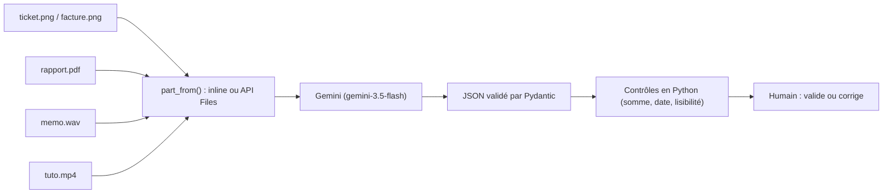

Un modèle **multimodal** comprend plusieurs types d'entrée (on dit des *modalités*) : du texte, mais aussi des images, des PDF, du son et de la vidéo. Concrètement, vous pouvez donner à Gemini la photo d'un ticket de caisse et lui demander « quel est le total ? », ou un enregistrement de réunion et lui demander « qui doit faire quoi ? ».

Cette formation vous fait pratiquer chaque modalité avec un vrai programme Python, puis assembler deux outils utiles au quotidien :

- un **analyseur de justificatifs** : photo de ticket ou de facture → JSON (commerçant, date, lignes, total, TVA) + contrôles automatiques ;
- un **résumeur de PDF** : rapport de plusieurs pages → titre, résumé, points clés et chiffres avec leur page.

Tous les fichiers d'exemple sont **fictifs** et générés par un script fourni.

## Pour qui ?

- Vous savez lancer une commande dans un terminal et lire un petit programme Python (variables, fonctions).
- Aucune connaissance en IA ou en traitement d'image n'est nécessaire.

## Ce que l'on construit

## Prérequis

- Python 3.10 ou plus récent.
- Une clé d'API Gemini, créée gratuitement dans Google AI Studio.
- `ffmpeg` (facultatif) pour générer la vidéo d'exemple.

## Programme

| Module | Leçons | Durée indicative |
| --- | --- | --- |
| 1. Comprendre le multimodal | Ce que « voit » le modèle, tokens et modes d'envoi ; préparer son poste et premier appel | 40 min |
| 2. Images et documents PDF | Une image, plusieurs images, comparaison ; PDF inline et via l'API Files | 45 min |
| 3. Audio et vidéo | Transcription et actions d'un mémo vocal ; étapes horodatées d'une vidéo courte | 35 min |
| 4. Fiabiliser, coûts, projet final | Sortie JSON et contrôles ; limites, coûts, bonnes pratiques ; projet final | 1h |

## En local ou sur Google Cloud ?

| | En local (cette formation) | Sur Google Cloud |
| --- | --- | --- |
| Accès au modèle | clé d'API Gemini (`GOOGLE_API_KEY`) | Vertex AI avec un projet et la facturation |
| Code | `multimodal.py` tel quel | même SDK `google-genai`, avec `GOOGLE_GENAI_USE_VERTEXAI=TRUE` |
| Fichiers volumineux | API Files (stockage 48 h) | Cloud Storage (`gs://…`) |

Tout le code est dans [files/](./files/multimodal.py) : `multimodal.py`, `generer_exemples.py`, `test_multimodal.py` et les fichiers d'exemple.
