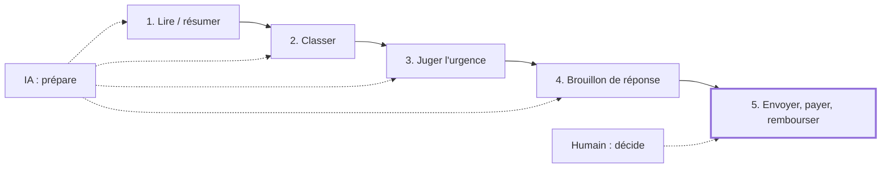

# Quoi automatiser, quoi garder

> [!NOTE]
> Dans cette leçon, vous allez repérer dans votre travail les tâches qu'une IA peut préparer, celles qu'elle ne doit pas faire seule, et poser le principe qui guide toute la formation : **l'IA prépare, l'humain décide**.

## Une tâche bureautique type

Prenons la boîte de réception d'un petit atelier. Pour chaque e-mail, quelqu'un fait toujours la même chose :

1. lire et **résumer** dans sa tête ;
2. **classer** (commande, facture, réclamation…) ;
3. juger l'**urgence** ;
4. **rédiger** une réponse ;
5. **envoyer**, rembourser, payer.

Les étapes 1 à 4 sont répétitives et portent sur du texte : c'est exactement ce qu'un **grand modèle de langage** (LLM, *large language model*, un programme entraîné à comprendre et produire du texte, comme Gemini) fait bien et vite. L'étape 5 engage l'entreprise : elle reste humaine.



## La grille de décision

| Tâche | Bonne candidate ? | Pourquoi |
| --- | --- | --- |
| Résumer des e-mails, des comptes rendus | oui | répétitif, facile à vérifier d'un coup d'œil |
| Classer dans une liste fermée de catégories | oui | sortie contrôlable (valeurs connues) |
| Extraire des champs (n° de commande, date) | oui, avec contrôle | le code peut vérifier le format |
| Rédiger un brouillon de réponse | oui, relu | gain de temps, mais ton et promesses à vérifier |
| Envoyer la réponse automatiquement | non | une erreur part chez le client |
| Accorder un remboursement, payer une facture | non | décision financière et responsabilité |
| Évaluer une personne (candidature, sanction) | non | risque de discrimination, cadre légal strict |

> [!WARNING]
> Les e-mails contiennent des **données personnelles** (noms, adresses, problèmes de clients). Avant d'en envoyer à une API d'IA, vérifiez avec votre responsable ou votre DPO (délégué à la protection des données) quel service est autorisé et dans quelles conditions. Pour apprendre, utilisez des données **fictives**, comme dans cette formation.

```quiz
question: "Quelle tâche ne faut-il PAS confier entièrement à l'IA ?"
options:
  - "Classer 200 e-mails en 6 catégories"
  - "Résumer chaque e-mail en une phrase"
  - "Répondre automatiquement aux clients mécontents et leur promettre un remboursement"
answer: 2
explanation: "Classer et résumer sont des préparations faciles à relire. Envoyer une réponse avec un engagement financier, sans relecture, peut coûter cher et abîmer la relation client."
```

## « Humain dans la boucle » : concrètement

L'expression *human in the loop* (humain dans la boucle) veut dire qu'**aucune action finale ne part sans validation humaine**. Dans un tableur, c'est très simple : une colonne **Statut**.

| Statut | Qui le met | Signification |
| --- | --- | --- |
| *(vide)* | personne | pas encore traité |
| à valider | l'IA (le script) | proposition prête, à relire |
| à relire en priorité | le script, selon une règle | client mécontent, urgence ou catégorie « autre » |
| Validé | un humain | relu, corrigé si besoin, prêt à envoyer |

La règle « à relire en priorité » n'est pas décidée par l'IA au hasard : c'est une règle **écrite dans le code**, donc prévisible.

> [!TIP]
> Mesurez le gain : chronométrez votre tri manuel de 20 e-mails, puis le tri avec l'IA **plus** votre relecture. Si la relecture prend autant de temps que le tri, revoyez la consigne avant de généraliser.

```quiz
question: "Que garantit la colonne Statut avec la valeur « à valider » ?"
options:
  - "Que l'IA a vérifié elle-même sa réponse"
  - "Qu'une personne sait quelles lignes elle doit encore relire avant d'agir"
  - "Que l'e-mail a été envoyé"
answer: 1
explanation: "Le statut rend visible ce qui reste à faire pour l'humain. L'IA ne se vérifie pas elle-même de façon fiable, et rien n'est envoyé par le script."
```

## Exercice : votre propre liste

Listez trois tâches répétitives de votre semaine qui portent sur du texte. Pour chacune, indiquez : ce que l'IA préparerait, ce que vous vérifieriez, et la colonne de statut que vous ajouteriez.

<details>
<summary>Voir la solution</summary>

Exemples de réponses :

| Tâche | L'IA prépare | Je vérifie | Statut |
| --- | --- | --- | --- |
| Comptes rendus de réunion | résumé + liste d'actions | les échéances et les noms | à valider / diffusé |
| Demandes de congés par e-mail | dates extraites, type de congé | le solde et le planning | à valider / accepté / refusé |
| Fiches produits | description à partir des caractéristiques | exactitude technique, ton | brouillon / publié |

Point commun : l'IA produit une **proposition** dans une colonne, l'humain change le **statut**.

</details>

## Résultat obtenu

Aperçu de ce que vous construirez : le tri réel des 20 e-mails fictifs par le script Python du module 3, exécuté le 2026-10-15 avec `gemini-3.5-flash-lite` (environ 23 secondes) :

```text title="répartition des statuts"
statut
à valider               15
à relire en priorité     5
```

Les 5 lignes prioritaires sont les 4 réclamations (colis abîmé, commande non reçue, livraison manquée, avis négatif) et une candidature classée « autre ». Rien n'a été envoyé : tout attend votre relecture.

- [ ] Je sais distinguer une tâche à préparer par l'IA d'une décision à garder
- [ ] Je sais expliquer « humain dans la boucle » avec une colonne Statut
- [ ] Je sais qu'il faut des données fictives ou autorisées avant d'envoyer des e-mails à une API
