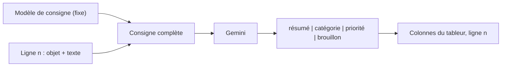

# Une consigne fiable pour un lot de textes

> [!NOTE]
> Dans cette leçon, vous allez écrire la **consigne** (le *prompt*) qui sera appliquée à chacun des 20 e-mails, la tester à la main sur trois lignes, et préparer le tableur qui recevra les résultats.

## Une ligne = un appel = la même consigne

Traiter un lot, c'est appliquer **la même recette** à chaque ligne d'un tableau. La consigne contient une partie fixe (les instructions) et une partie variable (l'objet et le texte de l'e-mail de la ligne).



Voici celle de notre lab :

```text title="consigne (extrait de traiter_lot.py)"
Tu tries la boîte de réception d'un atelier de mobilier.
Pour l'e-mail ci-dessous :
- resume : une phrase de 20 mots maximum ;
- categorie et priorite (haute = client mécontent, menace d'avis/remboursement, ou échéance sous 48 h) ;
- brouillon_reponse : 2 à 3 phrases polies, sans promettre de remboursement ni de date.
N'invente aucune information absente de l'e-mail.

Objet : {objet}
Texte : {texte}
```

## Les 5 règles d'une consigne de lot

| Règle | Dans notre consigne | Sans elle… |
| --- | --- | --- |
| Donner le **contexte** | « atelier de mobilier » | des résumés génériques |
| Imposer une **liste fermée** de catégories | commande, facturation, réclamation… | « Litige », « SAV », « Plainte » pour la même chose : impossible à filtrer |
| **Définir** les critères flous | « haute = client mécontent… » | une priorité au hasard |
| **Interdire** ce qui est risqué | « sans promettre de remboursement » | un brouillon qui engage l'entreprise |
| Une **porte de sortie** | catégorie « autre », « n'invente rien » | des informations inventées |

> [!TIP]
> Une **liste fermée** se garantit mieux par le programme que par la consigne : dans les modules 2 et 3, on donne au modèle un **schéma** avec une énumération (`enum`). Il ne peut alors répondre qu'une des valeurs prévues.

```quiz
question: "Pourquoi imposer une liste fermée de catégories ?"
options:
  - "Pour que le modèle réfléchisse plus longtemps"
  - "Pour pouvoir filtrer et compter les e-mails dans le tableur sans variantes d'écriture"
  - "Parce que l'API refuse les catégories libres"
answer: 1
explanation: "Un filtre « reclamation » ne trouve pas « Plainte client ». Avec des valeurs fixes, les filtres, tableaux croisés et règles automatiques fonctionnent."
```

## Tester à la main d'abord

Avant d'automatiser, testez la consigne sur **3 lignes variées** (un cas simple, un cas ambigu, un cas sensible) dans l'application Gemini ou Google AI Studio : collez la consigne en remplaçant `{objet}` et `{texte}`. Corrigez la consigne tant que les trois réponses ne vous conviennent pas.

## Préparer le tableur

Créez une feuille nommée **Emails** avec ces en-têtes (c'est ce qu'attend le script du module 2) :

| A | B | C | D | E | F |
| --- | --- | --- | --- | --- | --- |
| Objet | Texte | Résumé | Catégorie | Priorité | Statut |

Les colonnes A et B sont à vous ; C à F sont remplies par l'IA ; vous seul passez le Statut à « Validé ». Pour remplir A et B, importez [emails.csv](../files/emails.csv) (Fichier > Importer) et gardez les colonnes `objet` et `texte`.

> [!WARNING]
> Ne testez jamais une nouvelle consigne directement sur 2 000 lignes : une consigne ratée, c'est 2 000 appels payés pour rien. Commencez par 3, puis 20, puis le reste.

```quiz
question: "Vous avez une nouvelle consigne. Dans quel ordre procédez-vous ?"
options:
  - "Tout le fichier d'abord, puis on corrige ce qui ne va pas"
  - "3 lignes variées à la main, puis 20 avec le script, puis le reste"
  - "On demande au modèle de valider sa propre consigne"
answer: 1
explanation: "Petit, puis moyen, puis grand : on détecte les défauts quand ils coûtent encore peu. Faire valider la consigne par le modèle ne remplace pas un test sur de vrais exemples."
```

## Exercice : corriger une consigne faible

Cette consigne donne de mauvais résultats : « Lis cet e-mail et dis-moi ce que tu en penses. » Réécrivez-la pour obtenir un résumé, une catégorie parmi 4 valeurs et un indicateur « réponse sous 24 h nécessaire : oui/non ».

<details>
<summary>Voir la solution</summary>

```text
Tu aides le service client d'une boutique en ligne.
Pour l'e-mail ci-dessous, réponds avec exactement ces 3 lignes :
Résumé : une phrase de 20 mots maximum, sans inventer.
Catégorie : une seule valeur parmi commande, livraison, retour, autre.
Urgent : oui si le client est mécontent ou si une échéance tombe sous 24 h, sinon non.

E-mail :
{texte}
```

Ce qui a changé : contexte, format de sortie imposé, liste fermée, critère d'urgence défini, interdiction d'inventer.

</details>

## Résultat obtenu

Trois lignes réelles produites par la consigne ci-dessus le 2026-10-15 (`gemini-3.5-flash-lite`) :

```text title="extrait de exemple_emails_traite.csv"
id 1  | Le client signale que le pied de la table de sa commande 1042 est cassé et demande un
      | remplacement rapide pour samedi.            | reclamation | haute   | à relire en priorité
id 9  | Proposition d'une offre promotionnelle de logiciels avec réduction de 50 pour cent.
      |                                             | spam        | basse   | à valider
id 15 | Relance pour le paiement de la facture F-0877 d'un montant de 560 EUR échue le 30/09.
      |                                             | facturation | normale | à valider
```

À noter : la relance fournisseur (id 15) est classée « facturation » et non « fournisseur ». Les deux se défendent : c'est le genre de cas que la relecture humaine tranche, et qui peut amener à préciser la consigne.

- [ ] Je sais écrire une consigne de lot avec contexte, liste fermée, critères et interdits
- [ ] Je teste une consigne sur 3 lignes avant d'automatiser
- [ ] J'ai une feuille Emails prête avec les colonnes A à F
