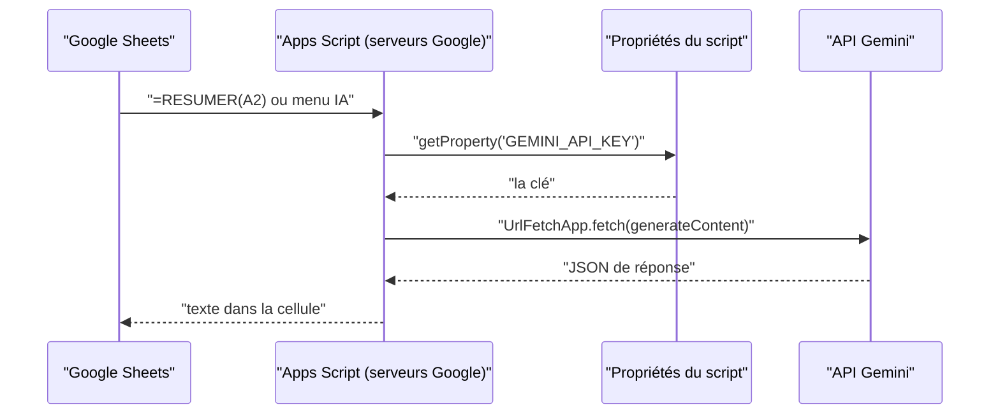

# Premier script Apps Script et clé secrète

> [!NOTE]
> Dans cette leçon, vous allez ouvrir l'éditeur Apps Script de votre classeur, ranger la clé d'API dans les **propriétés du script** (et nulle part ailleurs), et comprendre la fonction qui appelle Gemini.

## Apps Script en deux mots

**Google Apps Script** est un langage (du JavaScript) qui tourne sur les serveurs de Google et peut piloter Sheets, Docs, Gmail… Chaque classeur peut avoir son script : **Extensions > Apps Script**. Les fichiers portent l'extension `.gs`.



## Étape 1 : coller le script

1. Ouvrez votre classeur, puis **Extensions > Apps Script**.
2. Remplacez le contenu de `Code.gs` par celui de [resumer.gs](../files/resumer.gs).
3. Cliquez sur l'icône **Enregistrer**.

## Étape 2 : la clé dans les propriétés du script

1. Dans l'éditeur, roue dentée **Paramètres du projet**.
2. Section **Propriétés du script** > **Ajouter une propriété**.
3. Nom : `GEMINI_API_KEY`, valeur : votre clé. Enregistrez.

```javascript title="files/resumer.gs (extrait)"
function lireCle_() {
  const cle = PropertiesService.getScriptProperties().getProperty('GEMINI_API_KEY');
  if (!cle) {
    throw new Error('Clé absente : Paramètres du projet > Propriétés du script > GEMINI_API_KEY');
  }
  return cle;
}
```

| Où mettre la clé ? | Verdict | Pourquoi |
| --- | --- | --- |
| Dans le code (`const CLE = "..."`) | non | visible par toute personne qui ouvre le script, copiée avec lui |
| Dans une cellule du classeur | non | visible par toute personne qui a accès au classeur |
| Dans les propriétés du script | oui | séparée du code, lue à l'exécution |

> [!WARNING]
> Les éditeurs du classeur peuvent aussi ouvrir le script et ses propriétés. Ne partagez **en modification** qu'avec des personnes de confiance, utilisez une clé dédiée à ce classeur, et limitez-la dans Google AI Studio / la console Google Cloud. Si une clé fuit, supprimez-la et créez-en une nouvelle.

Le `_` final de `lireCle_` rend la fonction **privée** : elle n'apparaît pas dans le menu d'exécution ni comme formule.

## Étape 3 : l'appel à Gemini

```javascript title="files/resumer.gs (extrait)"
const MODELE = 'gemini-3.5-flash';

function appelerGemini_(prompt, schema) {
  const url = 'https://generativelanguage.googleapis.com/v1beta/models/' + MODELE + ':generateContent';
  const generationConfig = { temperature: 0.2 };
  if (schema) {
    generationConfig.responseMimeType = 'application/json';
    generationConfig.responseSchema = schema;
  }
  const options = {
    method: 'post',
    contentType: 'application/json',
    headers: { 'x-goog-api-key': lireCle_() },
    payload: JSON.stringify({ contents: [{ parts: [{ text: prompt }] }], generationConfig: generationConfig }),
    muteHttpExceptions: true, // on lit nous-mêmes le code HTTP
  };
  for (let essai = 1; essai <= 3; essai++) {
    const rep = UrlFetchApp.fetch(url, options);
    const code = rep.getResponseCode();
    if (code === 200) {
      const parts = JSON.parse(rep.getContentText()).candidates[0].content.parts;
      return parts.map(function (p) { return p.text || ''; }).join('').trim();
    }
    if (code !== 429 && code !== 503) {
      throw new Error('Gemini a répondu ' + code + ' : ' + rep.getContentText().slice(0, 200));
    }
    Utilities.sleep(2000 * essai);
  }
  throw new Error('Gemini indisponible, réessayez dans quelques minutes');
}
```

- `UrlFetchApp.fetch` envoie une requête HTTP, c'est-à-dire un message à un serveur web (ici, l'**API REST** de Gemini : une adresse web qui reçoit et renvoie du JSON).
- La clé passe dans l'en-tête `x-goog-api-key`, pas dans l'URL (une URL finit souvent dans des journaux).
- `muteHttpExceptions: true` permet de lire le code d'erreur au lieu de planter : on réessaie sur **429** (quota) et **503** (surcharge).

> [!TIP]
> Au premier lancement, Google demande d'**autoriser** le script (accès au classeur et aux services externes). C'est normal : lisez la liste, puis acceptez si elle correspond à ce que fait le script.

```quiz
question: "Où ranger la clé d'API dans un projet Apps Script ?"
options:
  - "Dans une constante en haut du fichier .gs"
  - "Dans les propriétés du script (Paramètres du projet)"
  - "Dans la cellule Z1, masquée"
answer: 1
explanation: "Les propriétés du script séparent le secret du code. Une constante ou une cellule masquée sont visibles par toute personne qui ouvre le script ou le classeur."
```

```quiz
question: "Que fait la boucle for dans appelerGemini_ ?"
options:
  - "Elle envoie trois fois la même question pour comparer les réponses"
  - "Elle réessaie jusqu'à 3 fois, en attendant de plus en plus, seulement si l'API répond 429 ou 503"
  - "Elle découpe le texte en trois morceaux"
answer: 1
explanation: "Au premier code 200, la fonction renvoie le texte. Une autre erreur (400, 403…) est levée immédiatement. Seules les erreurs passagères déclenchent une attente de 2 puis 4 secondes."
```

## Exercice : une fonction de test

Ajoutez une fonction `testerGemini()` (sans `_`, pour pouvoir la lancer depuis l'éditeur) qui appelle `appelerGemini_('Réponds juste OK')` et affiche la réponse avec `Logger.log`.

<details>
<summary>Voir la solution</summary>

```javascript
function testerGemini() {
  const reponse = appelerGemini_('Réponds juste OK');
  Logger.log('Réponse de Gemini : ' + reponse);
}
```

Sélectionnez `testerGemini` dans la liste en haut de l'éditeur, cliquez sur **Exécuter**, puis ouvrez le **Journal d'exécution**. Si vous voyez « Clé absente », retournez à l'étape 2.

</details>

## Résultat obtenu

Le code Apps Script ne peut s'exécuter que chez Google. Pour le tester ici, `test_gs.mjs` charge `resumer.gs` dans Node.js et remplace les services Google (`PropertiesService`, `UrlFetchApp`…) par des **doublures**, de petites imitations. En mode `REEL=1`, la doublure de `UrlFetchApp` envoie **la vraie requête** à l'API Gemini. Exécution du 2026-10-15 :

```text title="REEL=1 node test_gs.mjs (extrait)"
RESUMER(A2) -> Le client exige d'être remboursé sous 48 heures pour sa commande 1042 cassée, sinon il laissera un avis.
OK
```

La requête construite par `appelerGemini_` (URL, en-tête, corps JSON) est donc acceptée par l'API telle quelle.

- [ ] J'ai collé le script et enregistré le projet
- [ ] Ma clé est dans les propriétés du script, nulle part ailleurs
- [ ] Je comprends le rôle de `UrlFetchApp`, de l'en-tête de clé et des réessais
