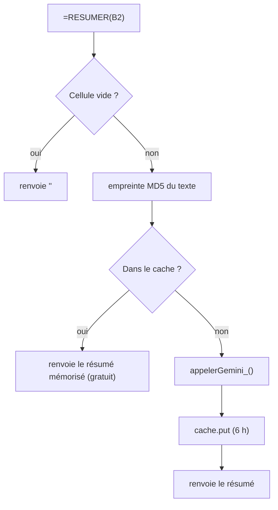

# La fonction =RESUMER(A2)

> [!NOTE]
> Dans cette leçon, vous allez créer votre propre formule Google Sheets, `=RESUMER(A2)`, qui résume une cellule avec Gemini, l'appliquer à une plage entière et éviter de payer deux fois le même résumé grâce à un cache.

## Une fonction personnalisée

Une **fonction personnalisée** est une fonction Apps Script que l'on tape dans une cellule comme `=SOMME()`. Trois conditions :

- elle est déclarée avec `function NOM(...)`, son nom **ne finit pas par `_`** ;
- un commentaire JSDoc (le bloc `/** ... */` au-dessus) avec `@customfunction` la fait apparaître dans l'autocomplétion ;
- elle doit répondre en **moins de 30 secondes**, sinon la cellule affiche `#ERROR!`.

```javascript title="files/resumer.gs (extrait)"
/**
 * Résume un texte en une phrase de 20 mots maximum.
 *
 * @param {string} texte Le texte ou la cellule à résumer.
 * @return {string} Le résumé.
 * @customfunction
 */
function RESUMER(texte) {
  if (Array.isArray(texte)) { // =RESUMER(A2:A20) : une plage arrive en tableau 2D
    return texte.map(function (ligne) { return [RESUMER(ligne[0])]; });
  }
  if (!texte) return '';
  // Le tableur recalcule souvent : un cache de 6 h évite de repayer le même appel
  const cache = CacheService.getScriptCache();
  const cleCache = 'resume:' + Utilities.base64Encode(
    Utilities.computeDigest(Utilities.DigestAlgorithm.MD5, String(texte)));
  const enCache = cache.get(cleCache);
  if (enCache) return enCache;
  const resume = appelerGemini_(
    'Résume ce texte en une phrase de 20 mots maximum, en français, sans inventer :\n\n' + texte);
  cache.put(cleCache, resume, 21600);
  return resume;
}
```



## Utiliser la formule

| Vous tapez | Résultat |
| --- | --- |
| `=RESUMER(B2)` | le résumé de B2 dans la cellule |
| `=RESUMER(B2:B21)` | une colonne de 20 résumés (les cellules dessous doivent être vides) |
| `=RESUMER("Texte libre…")` | le résumé du texte entre guillemets |

> [!WARNING]
> `=RESUMER(B2:B21)` fait jusqu'à 20 appels **dans une seule exécution** : au-delà de quelques lignes, vous risquez de dépasser les 30 secondes. Pour un lot, préférez le menu de la leçon suivante, qui a 6 minutes.

## Pourquoi un cache ?

Google Sheets **recalcule** les formules à l'ouverture, quand une cellule change, quand on copie la feuille… Sans cache, chaque recalcul relancerait un appel payant. Le `CacheService` garde le résultat jusqu'à 6 heures (21 600 secondes). La **clé de cache** est une **empreinte MD5** du texte : un code court, toujours identique pour un même texte, différent dès qu'un caractère change.

> [!TIP]
> Vous voulez figer définitivement un résumé ? Copiez la colonne, puis **Collage spécial > Valeurs uniquement**. La formule disparaît, le texte reste, plus aucun appel n'est fait.

```quiz
question: "Pourquoi la fonction s'appelle RESUMER et pas resumer_ ?"
options:
  - "Les majuscules sont obligatoires"
  - "Un nom qui finit par _ est privé et ne peut pas être utilisé comme formule"
  - "Pour éviter un conflit avec SOMME"
answer: 1
explanation: "Le souligné final rend une fonction privée en Apps Script. La casse n'a pas d'importance pour les formules : =resumer(B2) fonctionne aussi."
```

```quiz
question: "La cellule affiche #ERROR! avec « Exceeded maximum execution time » sur =RESUMER(B2:B200). Que faire ?"
options:
  - "Attendre : ça finira par passer"
  - "Utiliser le traitement par lot du menu IA, qui a jusqu'à 6 minutes et écrit ligne par ligne"
  - "Retirer le cache"
answer: 1
explanation: "Une fonction personnalisée doit répondre en 30 secondes. 200 appels n'y tiennent pas. Le menu lance une exécution normale (6 minutes) et reprend là où il s'est arrêté."
```

## Exercice : une formule =CLASSER

Écrivez une fonction personnalisée `CLASSER(texte)` qui renvoie une seule catégorie parmi `commande`, `facturation`, `reclamation`, `autre`, en réutilisant `appelerGemini_` avec un schéma `enum`.

<details>
<summary>Voir la solution</summary>

```javascript
/**
 * Classe un e-mail dans une catégorie.
 * @param {string} texte Le texte de l'e-mail.
 * @return {string} commande, facturation, reclamation ou autre.
 * @customfunction
 */
function CLASSER(texte) {
  if (!texte) return '';
  const schema = { type: 'STRING', enum: ['commande', 'facturation', 'reclamation', 'autre'] };
  const brut = appelerGemini_('Classe cet e-mail :\n\n' + texte, schema);
  return JSON.parse(brut); // la réponse JSON est une chaîne entre guillemets : "reclamation"
}
```

Avec un schéma `enum`, le modèle ne peut répondre qu'une des quatre valeurs : vos filtres et tableaux croisés dynamiques restent fiables.

</details>

## Résultat obtenu

`node test_gs.mjs` (doublures, sans clé) puis `REEL=1 node test_gs.mjs` (vrai Gemini), le 2026-10-15. Le test vérifie que **deux appels identiques ne déclenchent qu'une requête** (cache), qu'une cellule vide renvoie `''`, et qu'une plage de 2 cellules renvoie 2 lignes :

```text title="sortie"
RESUMER(A2) -> Résumé factice.
...
OK
RESUMER(A2) -> Le client exige d'être remboursé sous 48 heures pour sa commande 1042 cassée, sinon il laissera un avis.
...
OK
```

- [ ] Je sais créer une fonction personnalisée avec `@customfunction`
- [ ] Je connais la limite de 30 secondes et quand passer au menu
- [ ] Je sais pourquoi et comment mettre en cache un résultat payant
