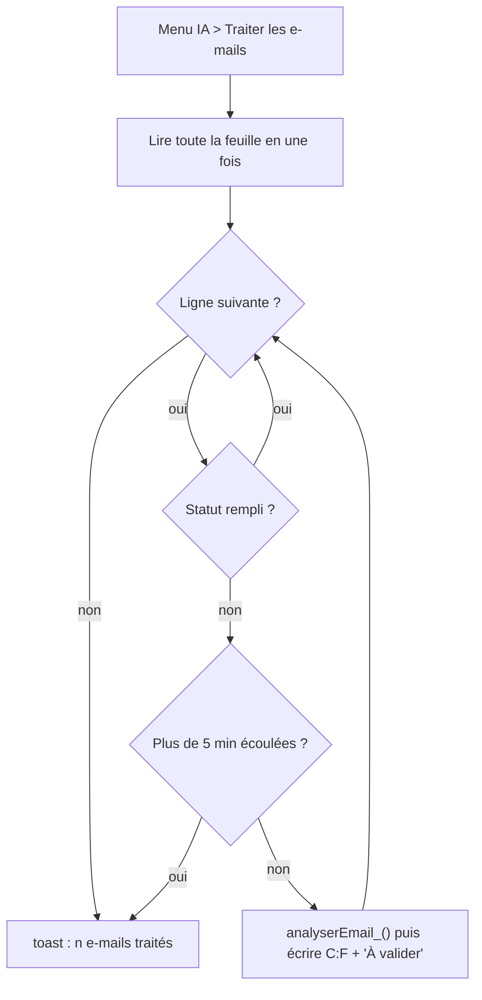

# Traitement par lot, menu IA et vérification du script

> [!NOTE]
> Dans cette leçon, vous allez ajouter un menu **IA > Traiter les e-mails** qui remplit résumé, catégorie et priorité de toute la feuille, s'arrête proprement avant la limite de 6 minutes, ne touche jamais une ligne déjà validée, puis vérifier le script hors de Google.

## Le menu

`onOpen` est un **déclencheur simple** : une fonction au nom réservé que Google lance automatiquement à l'ouverture du classeur.

```javascript title="files/resumer.gs (extrait)"
function onOpen() {
  SpreadsheetApp.getUi().createMenu('IA')
    .addItem('Traiter les e-mails', 'traiterEmails')
    .addToUi();
}
```

## Une réponse structurée par e-mail

On demande un **JSON** conforme à un schéma, avec des listes fermées (`enum`) :

```javascript title="files/resumer.gs (extrait)"
function analyserEmail_(objet, texte) {
  const schema = {
    type: 'OBJECT',
    properties: {
      resume: { type: 'STRING' },
      categorie: { type: 'STRING', enum: CATEGORIES },
      priorite: { type: 'STRING', enum: ['haute', 'normale', 'basse'] },
    },
    required: ['resume', 'categorie', 'priorite'],
  };
  const prompt = 'Tu tries la boîte de réception d\'une petite entreprise. ' + ... + texte;
  return JSON.parse(appelerGemini_(prompt, schema));
}
```

## La boucle sur la feuille

```javascript title="files/resumer.gs (extrait)"
const COL = { OBJET: 1, TEXTE: 2, RESUME: 3, CATEGORIE: 4, PRIORITE: 5, STATUT: 6 };
const LIMITE_MS = 5 * 60 * 1000; // on s'arrête avant la limite de 6 min par exécution

function traiterEmails() {
  const debut = Date.now();
  const feuille = SpreadsheetApp.getActive().getSheetByName('Emails');
  const valeurs = feuille.getDataRange().getValues(); // ligne 0 = en-têtes
  let traitees = 0;
  for (let i = 1; i < valeurs.length; i++) {
    if (valeurs[i][COL.STATUT - 1]) continue;        // déjà traité ou validé : on n'y touche pas
    if (Date.now() - debut > LIMITE_MS) break;       // relancez le menu pour continuer
    const r = analyserEmail_(valeurs[i][COL.OBJET - 1], valeurs[i][COL.TEXTE - 1]);
    feuille.getRange(i + 1, COL.RESUME, 1, 4).setValues([[r.resume, r.categorie, r.priorite, 'À valider']]);
    traitees++;
  }
  SpreadsheetApp.getActive().toast(traitees + ' e-mail(s) traité(s). Relisez la colonne Statut.');
}
```



| Choix de conception | Raison |
| --- | --- |
| Lire la feuille **en une fois** (`getValues`) | chaque lecture de cellule est un appel lent ; une seule lecture est bien plus rapide |
| Écrire **après chaque ligne** | si le script s'arrête, le travail déjà fait est gardé |
| Sauter les lignes avec un statut | relancer ne repaie pas ce qui est fait et **n'écrase jamais** une ligne validée |
| S'arrêter à 5 min | la limite est de 6 min par exécution : on garde une marge |
| Statut « À valider » | aucune action automatique : un humain relit |

> [!WARNING]
> Quotas Apps Script (comptes gratuits) : **6 minutes** par exécution et **20 000** appels `UrlFetchApp` par jour (100 000 pour Google Workspace). Le quota de l'API Gemini de votre clé s'applique **en plus** : surveillez-le dans Google AI Studio.

```quiz
question: "Vous relancez le menu après qu'il s'est arrêté à la ligne 120 sur 300. Que se passe-t-il ?"
options:
  - "Tout est retraité depuis la ligne 2"
  - "Les lignes déjà dotées d'un statut sont sautées, le traitement reprend à la première ligne vide"
  - "Le script refuse de se relancer"
answer: 1
explanation: "La colonne Statut sert de marque-page : toute ligne qui a un statut (À valider, Validé…) est ignorée. C'est aussi ce qui protège les lignes déjà relues par un humain."
```

```quiz
question: "Pourquoi écrire le résultat dans la feuille après chaque e-mail, plutôt qu'une seule fois à la fin ?"
options:
  - "C'est plus rapide"
  - "Pour ne rien perdre si l'exécution s'arrête (limite de temps, erreur)"
  - "Parce que setValues ne peut écrire qu'une ligne"
answer: 1
explanation: "Une écriture à la fin serait un peu plus rapide, mais une erreur à la ligne 150 ferait perdre 149 résultats déjà payés. On choisit la sûreté."
```

## Vérifier le script hors de Google

Le fichier `.gs` ne s'exécute que chez Google, mais c'est du JavaScript : on peut le vérifier sur son ordinateur avec **Node.js**.

1. **Syntaxe** : `node --check` refuse l'extension `.gs`, on copie donc le fichier en `.js`. Les appels à `SpreadsheetApp`, `UrlFetchApp`… ne gênent pas : `--check` ne fait que lire le code sans l'exécuter.
2. **Comportement** : [test_gs.mjs](../files/test_gs.mjs) exécute le script avec des doublures des services Google et une feuille « Emails » en mémoire.

```bash title="terminal"
cp resumer.gs /tmp/resumer.js && node --check /tmp/resumer.js && echo "syntaxe OK"
node test_gs.mjs                                    # doublures, sans clé
GEMINI_API_KEY=... REEL=1 node test_gs.mjs          # vrais appels à Gemini via curl
```

```javascript title="files/test_gs.mjs (extrait)"
ctx.traiterEmails()
assert.equal(lignes[1][5], 'À valider')
assert.deepEqual(lignes[3], ['Déjà vu', 'Texte', 'ok', 'information', 'basse', 'Validé'])  // intacte
```

> [!TIP]
> En mode réel, la clé est passée à `curl` par l'entrée standard (`-H @-`) : elle n'apparaît ni dans la liste des processus ni dans l'historique du terminal.

## Exercice : un statut « Erreur »

Aujourd'hui, si Gemini échoue sur une ligne, toute l'exécution s'arrête. Modifiez la boucle pour écrire `Erreur : <message>` dans la colonne Statut de la ligne fautive et continuer avec la suivante.

<details>
<summary>Voir la solution</summary>

```javascript
    try {
      const r = analyserEmail_(valeurs[i][COL.OBJET - 1], valeurs[i][COL.TEXTE - 1]);
      feuille.getRange(i + 1, COL.RESUME, 1, 4).setValues([[r.resume, r.categorie, r.priorite, 'À valider']]);
      traitees++;
    } catch (e) {
      feuille.getRange(i + 1, COL.STATUT).setValue('Erreur : ' + String(e.message).slice(0, 80));
    }
```

Pour retraiter une ligne en erreur, il suffit de vider sa cellule Statut et de relancer le menu.

</details>

## Résultat obtenu

Vérifications exécutées le 2026-10-15 :

```text title="node --check, puis REEL=1 node test_gs.mjs"
node --check OK
RESUMER(A2) -> Le client exige d'être remboursé sous 48 heures pour sa commande 1042 cassée, sinon il laissera un avis.
 | Le client demande le remboursement sous 48 heures de sa commande n° 1042 arrivée cassée, sous peine de laisser un avis négatif. | reclamation | haute | À valider
 | Le client demande si l'entreprise est ouverte le samedi matin. | information | basse | À valider
 | ok | information | basse | Validé
2 e-mail(s) traité(s). Relisez la colonne Statut. (3 appels réels)
OK
```

Trois appels réels : un pour `RESUMER` (le second, identique, est servi par le cache) et deux pour les e-mails sans statut. La ligne « Validé » n'a pas été touchée.

- [ ] J'ai un menu IA qui traite la feuille Emails
- [ ] Je sais pourquoi le script lit en une fois, écrit à chaque ligne et s'arrête à 5 minutes
- [ ] Je sais vérifier la syntaxe d'un `.gs` avec `node --check`
- [ ] Aucune ligne validée n'est jamais écrasée
