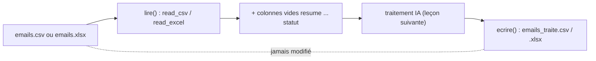

# pandas : lire et écrire un CSV ou un Excel

> [!NOTE]
> Dans cette leçon, vous allez installer le lab Python, ouvrir le fichier `emails.csv` avec **pandas**, ajouter les colonnes que l'IA remplira, et réécrire le résultat en CSV ou en Excel sans jamais écraser le fichier d'origine.

## Pourquoi passer à Python ?

| Besoin | Apps Script | Python |
| --- | --- | --- |
| Fichiers Excel ou CSV sur votre poste | non (il faut les importer dans Sheets) | oui |
| Plus de 6 minutes de traitement | non (reprise manuelle) | oui |
| Tests automatiques | possible, mais hors de Google | oui (pytest) |
| Aucune installation | oui | non |

**pandas** est la bibliothèque Python de référence pour manipuler des tableaux (on les appelle des *DataFrame* : des lignes, des colonnes nommées, comme une feuille de tableur).

## Installer

```bash title="terminal"
cd files
python3 -m venv .venv && source .venv/bin/activate     # Windows : .venv\Scripts\activate
pip install -r requirements.txt                         # google-genai, pandas, openpyxl, pydantic...
cp .env.example .env                                    # puis mettez votre clé
```

`openpyxl` est le moteur qui permet à pandas de lire et écrire des fichiers `.xlsx`.

## Lire, compléter, écrire

```python title="files/traiter_lot.py (extrait)"
COLONNES_IA = ["resume", "categorie", "priorite", "brouillon_reponse", "statut"]

def lire(chemin: Path) -> pd.DataFrame:
    df = pd.read_excel(chemin) if chemin.suffix in (".xlsx", ".xls") else pd.read_csv(chemin)
    for c in COLONNES_IA:
        if c not in df.columns:
            df[c] = ""
    return df.fillna("").astype({c: str for c in COLONNES_IA})

def ecrire(df: pd.DataFrame, chemin: Path):
    df.to_excel(chemin, index=False) if chemin.suffix in (".xlsx", ".xls") else df.to_csv(chemin, index=False)
```



Quelques notions pandas utilisées :

| Code | Signification |
| --- | --- |
| `df.columns` | la liste des noms de colonnes |
| `df["statut"] == ""` | une colonne de vrai/faux : « cette ligne n'a pas de statut » |
| `df.index[...]` | les numéros des lignes qui vérifient la condition |
| `df.at[i, "objet"]` | la valeur d'une cellule (ligne `i`, colonne `objet`) |
| `fillna("")` | remplace les cellules vides (`NaN`, « pas un nombre ») par du texte vide |
| `index=False` | n'écrit pas la colonne de numéros de ligne dans le fichier |

> [!WARNING]
> N'écrivez jamais le résultat **par-dessus** le fichier source. Le script écrit dans `emails_traite.csv` : si quelque chose se passe mal, l'original est intact.

> [!TIP]
> Un CSV exporté d'Excel en français utilise souvent le **point-virgule** comme séparateur et un encodage Windows. Si les colonnes sont mal découpées, essayez `pd.read_csv(chemin, sep=";", encoding="cp1252")`.

```quiz
question: "Pourquoi convertir les colonnes IA en texte avec fillna(\"\") et astype(str) ?"
options:
  - "Pour que le test « statut vide » fonctionne aussi après relecture d'un fichier où ces cellules étaient vides"
  - "Pour réduire la taille du fichier"
  - "Parce que pandas ne sait pas lire les nombres"
answer: 0
explanation: "À la relecture d'un CSV, une cellule vide devient NaN, pas \"\". Sans conversion, df[\"statut\"] == \"\" serait faux pour ces lignes, et la reprise ne les traiterait jamais."
```

```quiz
question: "Quel paquet faut-il pour que pandas lise un fichier .xlsx ?"
options:
  - "openpyxl"
  - "reportlab"
  - "Aucun, c'est intégré à Python"
answer: 0
explanation: "pandas délègue la lecture et l'écriture des .xlsx au moteur openpyxl, listé dans requirements.txt."
```

## Exercice : compter avant de payer

Écrivez trois lignes de Python qui lisent `emails.csv` avec `lire()` et affichent : le nombre de lignes, le nombre de lignes sans statut (celles qui seront envoyées à l'IA), et la longueur moyenne des textes en caractères.

<details>
<summary>Voir la solution</summary>

```python
from pathlib import Path
import traiter_lot as tl

df = tl.lire(Path("emails.csv"))
print(len(df), (df["statut"] == "").sum(), round(df["texte"].str.len().mean()))
# 20 20 111
```

Ces chiffres permettent d'estimer le coût avant de lancer : 20 appels, chacun avec un texte court plus la consigne.

</details>

## Résultat obtenu

Exécution réelle le 2026-10-15 :

```text title="lecture de emails.csv avec lire()"
(20, 10)
['id', 'date', 'expediteur', 'objet', 'texte', 'resume', 'categorie', 'priorite', 'brouillon_reponse', 'statut']
 id          objet
  1    Colis abîmé
  2 Facture F-2210
  3       Horaires
```

Les 5 colonnes d'origine sont complétées par les 5 colonnes IA, vides pour l'instant. Le test `test_excel_aller_retour` vérifie qu'un aller-retour en `.xlsx` conserve les lignes.

- [ ] J'ai installé le lab Python et ses dépendances
- [ ] Je sais lire un CSV ou un Excel avec pandas et ajouter des colonnes
- [ ] J'écris toujours dans un nouveau fichier, jamais sur l'original
