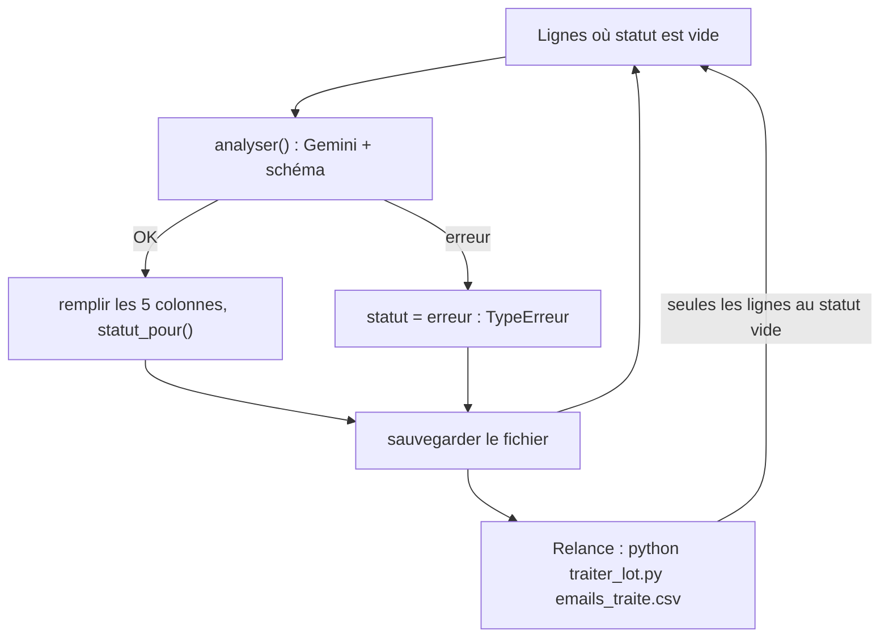

# Le script complet : schéma, reprise et tests

> [!NOTE]
> Dans cette leçon, vous allez assembler `traiter_lot.py` : un appel Gemini par ligne avec une réponse JSON validée, une règle de statut écrite en Python, une sauvegarde après chaque ligne pour pouvoir reprendre, et des tests qui tournent sans clé.

## Le schéma de réponse

```python title="files/traiter_lot.py (extrait)"
MODEL = os.environ.get("MODEL", "gemini-3.5-flash-lite")  # modèle « volume » : moins cher par ligne

class Analyse(BaseModel):
    resume: str
    categorie: Literal["commande", "facturation", "reclamation", "rendez-vous", "information",
                       "fournisseur", "spam", "autre"]
    priorite: Literal["haute", "normale", "basse"]
    brouillon_reponse: str
```

`Literal[...]` est l'équivalent Python d'un `enum` : le modèle reçoit la liste des valeurs permises, et Pydantic **refuse** toute autre valeur à la validation.

## Un appel par ligne, avec réessais

```python title="files/traiter_lot.py (extrait)"
def analyser(client, objet, texte, essais=4) -> Analyse:
    from google.genai import errors, types
    config = types.GenerateContentConfig(temperature=0.2, response_mime_type="application/json",
                                         response_schema=Analyse)
    for i in range(essais):
        try:
            r = client.models.generate_content(model=MODEL, contents=PROMPT.format(objet=objet, texte=texte),
                                               config=config)
            return Analyse.model_validate_json(r.text)
        except errors.APIError as e:
            if e.code not in (429, 500, 503) or i == essais - 1:
                raise
            time.sleep(5 * 2 ** i)
```

## L'humain dans la boucle, en code

```python title="files/traiter_lot.py (extrait)"
def statut_pour(a: Analyse) -> str:
    """Règle déterministe : les cas sensibles passent en tête de la file de relecture."""
    if a.priorite == "haute" or a.categorie in ("reclamation", "autre"):
        return "à relire en priorité"
    return "à valider"
```

Le script n'a **aucune** fonction d'envoi d'e-mail. Le brouillon est une suggestion dans une colonne.

## La boucle : sauvegarde et reprise

```python title="files/traiter_lot.py (extrait)"
def traiter(df, client, limite=None, sauvegarder=None) -> int:
    a_faire = df.index[df["statut"] == ""][:limite]
    for n, i in enumerate(a_faire, 1):
        try:
            a = analyser(client, df.at[i, "objet"], df.at[i, "texte"])
            df.loc[i, COLONNES_IA] = [a.resume, a.categorie, a.priorite, a.brouillon_reponse, statut_pour(a)]
        except Exception as e:  # une ligne en échec ne bloque pas le lot
            df.at[i, "statut"] = f"erreur : {type(e).__name__}"
        print(f"[{n}/{len(a_faire)}] ligne {df.at[i, 'id']} -> {df.at[i, 'categorie']} / {df.at[i, 'statut']}")
        if sauvegarder:
            sauvegarder(df)
    return len(a_faire)
```



| Commande | Effet |
| --- | --- |
| `python traiter_lot.py emails.csv --limite 3` | 3 lignes, pour tester la consigne |
| `python traiter_lot.py emails.csv` | tout le lot vers `emails_traite.csv` |
| `python traiter_lot.py emails_traite.csv` | reprise : seules les lignes au statut vide |
| `python traiter_lot.py emails.xlsx` | même chose avec Excel → `emails_traite.xlsx` |

> [!WARNING]
> Une ligne en **erreur** a un statut rempli (`erreur : …`) : elle ne sera pas retraitée à la reprise. C'est voulu (une erreur 400 se répéterait). Pour la retraiter, videz sa cellule statut.

> [!TIP]
> Le modèle par défaut est `gemini-3.5-flash-lite`, conçu pour les gros volumes. Pour comparer avec un modèle plus capable sur les cas difficiles : `MODEL=gemini-3.5-flash python traiter_lot.py emails.csv --limite 5`.

```quiz
question: "Le script s'arrête (coupure réseau) à la ligne 12 sur 20. Que perdez-vous ?"
options:
  - "Tout : il faut tout relancer et tout repayer"
  - "Au plus la ligne en cours : les 11 premières sont déjà sauvegardées, la relance traite les lignes au statut vide"
  - "Le fichier emails.csv d'origine"
answer: 1
explanation: "sauvegarder(df) est appelé après chaque ligne, et la relance sur emails_traite.csv saute les lignes déjà dotées d'un statut. L'original n'est jamais modifié."
```

```quiz
question: "Que vérifie test_lot_csv_avec_limite_et_reprise ?"
options:
  - "Que Gemini classe correctement les e-mails"
  - "Que --limite traite exactement 3 lignes et que la reprise n'appelle le modèle que pour les 17 restantes"
  - "Que la clé d'API est valide"
answer: 1
explanation: "Le test utilise un faux client qui compte ses appels : 3 puis 17, jamais 20 deux fois. La qualité du classement, elle, se juge sur l'exécution réelle."
```

## Exercice : un contrôle de cohérence

Le modèle peut produire un brouillon qui promet un remboursement malgré la consigne. Ajoutez une règle à `statut_pour` : si le brouillon contient « rembours » (sans tenir compte des majuscules), le statut devient « à relire en priorité ». Ajoutez le test.

<details>
<summary>Voir la solution</summary>

```python
def statut_pour(a: Analyse) -> str:
    if (a.priorite == "haute" or a.categorie in ("reclamation", "autre")
            or "rembours" in a.brouillon_reponse.lower()):
        return "à relire en priorité"
    return "à valider"
```

```python
def test_brouillon_qui_parle_de_remboursement():
    a = tl.Analyse(**dict(analyse(), brouillon_reponse="Nous allons vous Rembourser."))
    assert tl.statut_pour(a) == "à relire en priorité"
```

Un mot-clé est un contrôle grossier, mais il est **prévisible** et attrape le cas le plus coûteux.

</details>

## Résultat obtenu

Tests sans clé puis exécution réelle sur les 20 e-mails fictifs, le 2026-10-15 :

```text title="pytest -q"
.....                                                                    [100%]
5 passed in 0.62s
```

```text title="python traiter_lot.py emails.csv (extrait)"
[1/20] ligne 1 -> reclamation / à relire en priorité
[2/20] ligne 2 -> facturation / à valider
[3/20] ligne 3 -> information / à valider
[4/20] ligne 4 -> rendez-vous / à valider
[5/20] ligne 5 -> reclamation / à relire en priorité
...
[19/20] ligne 19 -> autre / à relire en priorité
[20/20] ligne 20 -> reclamation / à relire en priorité
20 ligne(s) traitée(s) -> emails_traite.csv
statut
à valider               15
à relire en priorité     5
```

20 appels, environ 23 secondes au total, aucune erreur.

- [ ] Je sais imposer des valeurs fermées avec `Literal` et `response_schema`
- [ ] Je sais écrire la règle de statut en Python, pas dans la consigne
- [ ] Mon script sauvegarde après chaque ligne et reprend là où il s'est arrêté
- [ ] Mes tests passent sans clé
