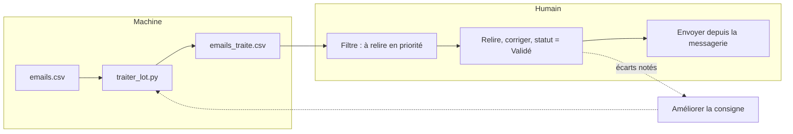

# Projet final : trier une boîte de 20 e-mails

> [!NOTE]
> Dans cette leçon, vous allez traiter les 20 e-mails fictifs de bout en bout, organiser la relecture humaine, mesurer la qualité du tri en le comparant à votre propre jugement, et décider si l'automatisation est prête à être utilisée.

## Le cahier des charges

1. Chaque e-mail reçoit un résumé, une catégorie (liste fermée), une priorité et un brouillon de réponse.
2. Les cas sensibles sont marqués « à relire en priorité » par une **règle en code**.
3. Rien n'est envoyé : un humain passe chaque ligne à « Validé » après relecture.
4. On peut relancer sans repayer ni écraser ce qui est validé.
5. Les tests passent sans clé.



## Étape 1 : lancer

Avec Google Sheets : importez [emails.csv](../files/emails.csv) dans la feuille **Emails** (colonnes Objet, Texte), puis **IA > Traiter les e-mails**. Avec Python :

```bash title="terminal"
pytest -q                                   # 5 tests, sans clé
python traiter_lot.py emails.csv --limite 3 # vérifier la consigne
python traiter_lot.py emails_traite.csv     # reprendre et finir les 17 autres
```

Un exemple de sortie réelle est fourni : [exemple_emails_traite.csv](../files/exemple_emails_traite.csv).

## Étape 2 : organiser la relecture

| Ordre | Filtre | Ce que vous vérifiez |
| --- | --- | --- |
| 1 | statut = « à relire en priorité » | ton du brouillon, aucune promesse, rappel rapide du client |
| 2 | statut commence par « erreur » | relancer ou traiter à la main |
| 3 | statut = « à valider » | catégorie juste, brouillon correct ; un coup d'œil suffit souvent |
| 4 | catégorie = spam | rien d'important classé par erreur |

> [!WARNING]
> Ne validez pas « en masse » sans lire. Si vous constatez que vous validez tout sans regarder, ce n'est plus un humain dans la boucle : c'est un envoi automatique déguisé. Réduisez plutôt le nombre de lignes à relire avec de meilleures règles.

```quiz
question: "Par quelles lignes commencer la relecture ?"
options:
  - "Le spam, pour vider la boîte"
  - "Les lignes « à relire en priorité » : clients mécontents et cas imprévus"
  - "Peu importe, l'IA a déjà tout vérifié"
answer: 1
explanation: "Les cas prioritaires sont ceux où une mauvaise réponse coûte le plus (client qui menace de partir, échéance proche). Le spam se contrôle à la fin, rapidement."
```

## Étape 3 : mesurer la qualité

Avant d'adopter l'outil, comparez **son** tri au **vôtre** sur ces 20 e-mails. Le **taux d'accord** est simplement le nombre de lignes où vous êtes d'accord avec la catégorie, divisé par 20.

| Indicateur | Comment le mesurer | Seuil indicatif à fixer vous-même |
| --- | --- | --- |
| Accord sur la catégorie | vos étiquettes contre la colonne `categorie` | par exemple 18/20 |
| Prioritaires bien détectés | aucun client mécontent en « à valider » | 100 % |
| Brouillons utilisables | brouillons validés sans réécriture complète | à suivre dans le temps |
| Temps gagné | chronomètre : tri manuel contre tri IA + relecture | positif, sinon on arrête |

> [!TIP]
> Les désaccords sont précieux : chacun montre une **ambiguïté de la consigne**. Par exemple, une relance de paiement fournisseur est-elle « facturation » ou « fournisseur » ? Décidez, écrivez la règle dans la consigne, relancez sur les 20 lignes.

```quiz
question: "Sur 20 lignes, vous êtes d'accord 17 fois avec la catégorie, et un client mécontent a été classé « à valider ». Que faites-vous ?"
options:
  - "On déploie : 85 % c'est très bien"
  - "On corrige la consigne et la règle de statut, puis on remesure, car rater un client mécontent est l'erreur la plus coûteuse"
  - "On abandonne l'IA"
answer: 1
explanation: "Le taux global compte moins que le type d'erreur. Un client mécontent non signalé doit être corrigé (consigne plus précise, règle par mots-clés) avant usage. Abandonner serait prématuré : on itère."
```

## Exercice : calculer votre taux d'accord

Sans regarder la colonne `categorie` de `exemple_emails_traite.csv`, classez vous-même les 20 e-mails de `emails.csv`. Puis comparez et calculez le taux d'accord avec pandas.

<details>
<summary>Voir la solution</summary>

```python
import pandas as pd

ia = pd.read_csv("exemple_emails_traite.csv")
moi = {1: "reclamation", 2: "facturation", 3: "information", 4: "rendez-vous", 5: "reclamation",
       6: "autre", 7: "commande", 8: "facturation", 9: "spam", 10: "information",
       11: "rendez-vous", 12: "commande", 13: "information", 14: "reclamation", 15: "fournisseur",
       16: "reclamation", 17: "information", 18: "commande", 19: "autre", 20: "reclamation"}
ia["moi"] = ia["id"].map(moi)
print((ia["moi"] == ia["categorie"]).sum(), "/ 20")
print(ia.loc[ia["moi"] != ia["categorie"], ["id", "objet", "categorie", "moi"]])
```

Avec ces étiquettes, on obtient **17 / 20**. Les 3 écarts sont des cas défendables dans les deux sens : le salon professionnel (id 6), la relance fournisseur (id 15) et la demande de garantie (id 16). Aucun ne concerne un client mécontent : les 4 vraies réclamations sont toutes en « à relire en priorité ». Prochaine étape : préciser dans la consigne « une demande de garantie est une réclamation » et « un e-mail d'un fournisseur est fournisseur ».

</details>

## Résultat obtenu

Sortie réelle du 2026-10-15 (`gemini-3.5-flash-lite`), deux lignes prioritaires de `exemple_emails_traite.csv` :

```text title="extrait"
id 1  | reclamation | haute | à relire en priorité
résumé    : Le client signale que le pied de la table de sa commande 1042 est cassé et demande
            un remplacement rapide pour samedi.
brouillon : Bonjour, nous avons bien pris connaissance de votre message concernant votre commande
            n° 1042. Nous sommes désolés d'apprendre que le pied de la table est cassé et nous
            examinons votre dossier. Nous reviendrons vers vous dans les plus brefs délais pour
            vous indiquer la suite donnée.

id 20 | reclamation | haute | à relire en priorité
brouillon : Bonjour, nous avons bien pris connaissance de votre message concernant votre récente
            visite et votre canapé. Nous prenons vos remarques très au sérieux et transmettons votre
            dossier à notre responsable pour étude. Nous reviendrons vers vous dès que possible.
```

Les brouillons respectent la consigne : excuses, aucune promesse de remboursement ni de date. Bilan du lot : 20 lignes, 5 prioritaires, 0 erreur, accord de 17/20 avec un classement humain.

- [ ] J'ai traité les 20 e-mails avec Google Sheets ou Python
- [ ] J'ai relu les lignes prioritaires en premier et passé les statuts à « Validé »
- [ ] J'ai calculé mon taux d'accord et noté les ambiguïtés de la consigne
- [ ] Je sais décider si l'automatisation est prête, et quoi améliorer sinon
