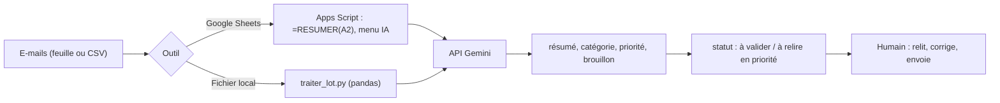

Chaque matin, la même routine : ouvrir la boîte de réception, lire, classer, repérer l'urgent, préparer des réponses. Cette formation vous montre comment confier **la partie répétitive** à un modèle d'IA (Gemini), tout en gardant **la décision** à un humain.

On avance en trois marches, de la plus simple à la plus puissante :

1. **Sans coder** : comprendre ce qu'on automatise et écrire une bonne consigne pour un lot de textes dans un tableur.
2. **Google Sheets + Apps Script** : une formule `=RESUMER(A2)` qui appelle Gemini, et un menu « IA » qui trie toute une feuille d'e-mails.
3. **Python** : la même automatisation sur un fichier CSV ou Excel local, avec `pandas`, reprise après erreur et tests.

Fil rouge : la boîte de réception d'un atelier de mobilier **fictif**, 20 e-mails inventés (aucune donnée réelle).

## Pour qui ?

- Modules 1 et 2 : toute personne à l'aise avec un tableur ; aucun code à écrire, seulement à copier-coller et comprendre.
- Module 3 : débutants en Python (savoir lancer un script dans un terminal).

## Ce que l'on construit

## Prérequis

- Un compte Google (pour Google Sheets et Apps Script).
- Une clé d'API Gemini, créée dans Google AI Studio.
- Pour le module 3 : Python 3.10 ou plus récent.

## Programme

| Module | Leçons | Durée indicative |
| --- | --- | --- |
| 1. L'IA dans le tableur, sans coder | Quoi automatiser et quoi garder ; une consigne fiable pour un lot de textes | 40 min |
| 2. Google Apps Script et Gemini | Premier script et clé secrète ; la fonction `=RESUMER(A2)` ; traitement par lot et menu | 1h |
| 3. La même automatisation en Python | pandas, CSV et Excel ; le script complet avec reprise et tests | 50 min |
| 4. Projet final | Trier une boîte de 20 e-mails et organiser la relecture humaine | 30 min |

## En local ou dans le cloud ?

| | Google Sheets + Apps Script | Python en local |
| --- | --- | --- |
| Où ça tourne | sur les serveurs de Google, dans votre classeur | sur votre ordinateur |
| Installation | aucune | Python + `pip install -r requirements.txt` |
| Limites | 30 s par formule, 6 min par exécution | celles de votre machine et de votre quota d'API |
| Idéal pour | une équipe qui vit dans Google Sheets | des fichiers Excel/CSV, des volumes plus gros, des tests |

Le code est dans [files/](./files/traiter_lot.py) : `resumer.gs`, `test_gs.mjs`, `traiter_lot.py`, `test_traiter_lot.py`, `emails.csv` et un exemple de sortie réelle `exemple_emails_traite.csv`.
